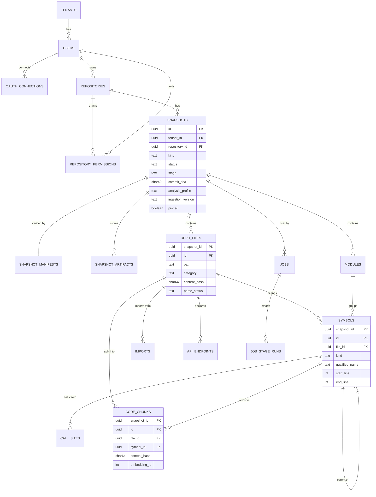
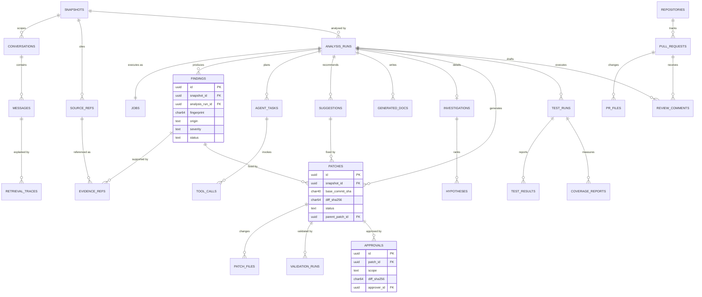

# CodePilot — API, Integration & Data Specification

**The Knowledge of Athena · Sections 3 and 4 of the project specification set**

| Field | Value |
| --- | --- |
| Document | CodePilot API, Integration & Data Specification (AIDS) |
| Version | 1.0 |
| Companion to | *CodePilot Master Architecture, Feature & Engineering Specification v2.1* (**Master Spec**) and *CodePilot System Design Specification v1.1* (**SDS**) |
| Covers | Section 3 (API and integration specifications) and Section 4 (data specifications) |
| Audience | Frontend, backend, AI/ML, infrastructure, QA and project leads |
| Status | Proposed. Every number marked *default* or *target* is a planning value to calibrate in staging, not a claim about existing behaviour |
| Purpose | Freeze the contracts between modules so that the database is not redesigned and data does not diverge between modules |

## How to read this document

- The **Master Spec** is the source of truth for features, the 98-endpoint catalogue and the 39+ feature tables. The **SDS** adds tenancy, the snapshot manifest, job leases, the outbox, quotas and the 1,000-user capacity design. This document **does not replace either**. It consolidates them into one build-ready contract and records where the two disagree.
- References look like `Master §11.3` or `SDS §6.2`. Items marked **Δ** are added by this document or by the SDS relative to Master Spec v2.1.
- **§3.11 and §4.17 list reconciliation decisions (R-1 … R-11).** Where Master Spec and SDS differ, this document picks one answer so the team builds one thing. Ratify them as ADRs before coding.
- Names of external products are the stack recommended in the Master Spec. Vendor-specific numbers (GitHub limits, webhook rules) were checked against GitHub's public documentation when this document was written; re-verify at implementation time because providers change limits without notice.

## Contents

- [3. API and integration specifications](#3-api-and-integration-specifications)
  - [3.1 API conventions](#31-api-conventions)
  - [3.2 Authentication and authorisation](#32-authentication-and-authorisation)
  - [3.3 Endpoint specifications (all 98 endpoints)](#33-endpoint-specifications-all-98-endpoints)
  - [3.4 Request and response formats](#34-request-and-response-formats)
  - [3.5 Streaming protocols (SSE)](#35-streaming-protocols-sse)
  - [3.6 Error catalogue and error handling](#36-error-catalogue-and-error-handling)
  - [3.7 Rate limits, quotas and timeouts](#37-rate-limits-quotas-and-timeouts)
  - [3.8 Retry, idempotency and resilience policies](#38-retry-idempotency-and-resilience-policies)
  - [3.9 External API dependencies and third-party documentation](#39-external-api-dependencies-and-third-party-documentation)
  - [3.10 Webhooks](#310-webhooks)
  - [3.11 API reconciliation decisions](#311-api-reconciliation-decisions)
- [4. Data specifications](#4-data-specifications)
  - [4.1 Data architecture and store roles](#41-data-architecture-and-store-roles)
  - [4.2 Data conventions](#42-data-conventions)
  - [4.3 ER diagrams](#43-er-diagrams)
  - [4.4 Table ownership and cross-module write rules](#44-table-ownership-and-cross-module-write-rules)
  - [4.5 Core DDL](#45-core-ddl)
  - [4.6 Feature-owned tables](#46-feature-owned-tables)
  - [4.7 Neo4j graph model](#47-neo4j-graph-model)
  - [4.8 Vector index data model (FAISS)](#48-vector-index-data-model-faiss)
  - [4.9 Redis data model](#49-redis-data-model)
  - [4.10 Enumeration registry](#410-enumeration-registry)
  - [4.11 Data models (API objects)](#411-data-models-api-objects)
  - [4.12 Sample input and output data](#412-sample-input-and-output-data)
  - [4.13 Data validation rules](#413-data-validation-rules)
  - [4.14 Data retention and deletion](#414-data-retention-and-deletion)
  - [4.15 Data migration requirements](#415-data-migration-requirements)
  - [4.16 Expected data volume and growth](#416-expected-data-volume-and-growth)
  - [4.17 Consistency invariants and reconciliation decisions](#417-consistency-invariants-and-reconciliation-decisions)

---

# 3. API and integration specifications

## 3.1 API conventions

| Topic | Rule |
| --- | --- |
| Base path and versioning | `/api/v1`. Breaking changes ship as `/api/v2`; additive changes (new optional fields, new endpoints) do not bump the version. Old versions are supported for at least one release cycle after deprecation, announced with `Deprecation` and `Sunset` response headers |
| Content types | Requests and responses are `application/json; charset=utf-8`. Exceptions: SSE endpoints (`text/event-stream`), patch/diagram/doc exports (`text/plain`, `application/json`, `image/svg+xml`, `text/markdown`) and the two OAuth redirect endpoints (HTTP 302) |
| Schema source of truth | FastAPI + Pydantic generate the OpenAPI 3.1 document at `/api/v1/openapi.json`. The frontend uses a generated typed client. CI fails if the committed OpenAPI file differs from the generated one (contract drift guard) |
| Identifier format | UUID (string, lowercase, hyphenated) for every resource id. `provider_repo_id` is GitHub's numeric id carried as a string. Commit SHAs are 40-char lowercase hex |
| Timestamps | ISO 8601 UTC with `Z` suffix, millisecond precision (`2026-11-21T09:30:00.000Z`) |
| Path scoping | Reads of snapshot-scoped data use `/snapshots/{sid}/…`. Operations that start work or consume AI/compute are top-level resources with `snapshot_id` in the JSON body. Run resources (analysis runs, patches, conversations, pull requests, findings, jobs) have globally unique ids and carry `snapshot_id` as an attribute. The server always validates that the snapshot belongs to the caller (Master §11.1) |
| File paths | Never a URL path segment. Always a URL-encoded `?path=` query parameter (Master §11.1) |
| Pagination | Cursor (keyset) pagination: `?limit=` (default 50, max 200) and `?cursor=`. Response `meta.next_cursor` is `null` on the last page. No `OFFSET` on large tables (SDS §5.5) |
| Sorting and filtering | `?sort=field` or `?sort=-field`; filters are explicit named parameters. Unknown parameters are rejected with `VALIDATION_FAILED` rather than ignored |
| Bounds | Graph depth, node count, query length, `top_k` and response size are capped (§4.13). Truncated responses carry `meta.truncated = true` and a `warnings[]` entry |
| Long-running work | Return `202 Accepted` with `job_id` (and `run_id` / `snapshot_id` where relevant) and `Location: /api/v1/jobs/{job_id}`. Anything expected to exceed ~2 s is asynchronous (SDS §5.5) |
| Request correlation | Every response carries `X-Request-Id` and `X-Trace-Id`. Clients may send `X-Request-Id`; the server generates one if absent. `trace_id` is also in the body |
| Idempotency | Mutating endpoints that can duplicate work accept `Idempotency-Key` (§3.8) |
| Concurrency control | `PATCH` on `repositories`, `diagram_configs` and `findings` accepts `If-Match: <version>` where the resource exposes `version`; mismatches return `409 VERSION_CONFLICT` |
| CORS | Strict allowlist from `CORS_ALLOWED_ORIGINS`; credentials allowed only for those origins; no wildcard |
| Security headers | `Strict-Transport-Security`, `X-Content-Type-Options: nosniff`, CSP on the web origin, `Cache-Control: no-store` on all authenticated JSON |
| Caching | Snapshot-scoped `GET` responses are immutable per `snapshot_id`: send `ETag` (content hash) and `Cache-Control: private, max-age=60`. Clients revalidate with `If-None-Match` |
| Request size | Default max body 1 MB; `PATCH /fixes/{id}` (edited diff) 2 MB; `POST /search`, `/chat`, `/ai/*` 64 KB |

## 3.2 Authentication and authorisation

### 3.2.1 Mechanism (decision R-1)

The Master Spec (§18.2) specifies **one session mechanism with no parallel JWT**; the SDS (§9.2) allows "cookie or short-lived JWT". This document adopts the Master Spec rule:

| Aspect | Specification |
| --- | --- |
| Identity provider | GitHub only in the initial release (Master ADR-009) |
| Browser session | Server-side session referenced by a **Secure, HttpOnly, SameSite=Lax** cookie (`cp_session`). Session record in Redis (`sess:{session_id}`), signed with `SESSION_SECRET`. Idle timeout 12 h, absolute lifetime 7 days (defaults); session id rotated on login and on privilege change |
| CSRF | Cookie-authenticated state-changing requests (`POST`, `PATCH`, `PUT`, `DELETE`) require the header `X-CSRF-Token` equal to the value in the non-HttpOnly `cp_csrf` cookie (double-submit) **and** an `Origin` header matching `APP_BASE_URL`. OAuth redirects use `state` (mandatory) |
| API/automation access | Not offered in v1. If added later: short-lived bearer tokens bound to a user, scoped per repository, hashed at rest, never reusing the GitHub token |
| SSE and fetch-streaming | Use the same cookie. `EventSource` is used only for `GET` endpoints; chat streams through `fetch()` with `POST` (Master §4) |
| MFA | Delegated to GitHub |
| Service-to-service | Internal calls between API, workers, LLM Gateway and sandbox runner use mTLS or signed internal tokens on the private network; no user cookie is forwarded to workers. Workers receive `tenant_id`, `user_id`, `job_id`, `deadline_at` and `traceparent` in job metadata |
| Unauthenticated routes | `GET /integrations/github/start`, `GET /integrations/github/callback`, `POST /github/webhooks` (HMAC instead of session), health and metrics endpoints on the internal network only |

### 3.2.2 GitHub authorisation flow (Master §B1)

```mermaid
sequenceDiagram
  participant U as Browser
  participant API as CodePilot API
  participant GH as GitHub
  participant KMS as KMS / Secret manager
  U->>API: GET /integrations/github/start
  API->>API: create state (+ PKCE verifier), store in Redis, TTL 10 min
  API-->>U: 302 to GitHub authorize URL (state, code_challenge)
  U->>GH: user consents, selects repositories
  GH-->>U: 302 to /integrations/github/callback?code&state
  U->>API: GET /integrations/github/callback
  API->>API: validate state (single use), bind to session
  API->>GH: exchange code for user token (server-side, client secret)
  API->>KMS: store token material, get encrypted_token_ref
  API->>GH: GET user, installations, accessible repositories
  API->>API: upsert users, oauth_connections, repository_permissions; write audit_event
  API-->>U: 302 to /app (session cookie set, rotated)
```

Rules:

- The access token **never** reaches the browser, logs, prompts or ordinary tables; only `oauth_connections.encrypted_token_ref` is stored (SDS §9.2).
- `state` is single-use with a 10-minute TTL and is bound to the initiating session. PKCE (`code_challenge`, method `S256`) is added as defence in depth; **confirm GitHub App support for PKCE at implementation time and keep `state` mandatory regardless**.
- Repository access prefers **GitHub App installation tokens**: short-lived (GitHub issues them for one hour), repository-scoped, minted on demand by exchanging an app JWT. Workers get a token scoped to a single job and repository, never the stored credential.
- Permission tiers (Master §15.2): **Read** (Metadata, Contents, Pull requests: read) is the default; **Review publishing** adds Pull requests: write; **Branch and PR creation** adds Contents: write. Merge permission is never requested. Changing a tier requires re-authorisation by the installation owner.
- Disconnect (`DELETE /integrations/github`) revokes the token at GitHub, sets `oauth_connections.revoked_at`, suspends reads of private-repository snapshots and blocks refresh/publish until reconnection (Master §5.7, ADR-010).

### 3.2.3 Authorisation model

Every request runs this chain, in order (SDS §9.1): **authenticate → resolve tenant → authorise (user, repository, role) → resolve and validate snapshot → execute**. `repo_id` and `snapshot_id` supplied by the client are never trusted; ownership is checked server-side on every call and again for every entity referenced inside a context envelope (Context Builder, Master §3.4).

| Role (`repository_permissions.role`) | May do |
| --- | --- |
| `VIEWER` | Read snapshots, explorer, search, graph, findings, conversations; run AI Q&A / explain / summaries (consumes quota); export documents and diagrams |
| `ADMIN` | Everything a viewer can, plus: import/refresh/retry/cancel, start analysis, agent, fix, test and scan runs, approve EXPORT, change finding status, edit diagrams, enable execution (EXECUTE opt-in), delete a snapshot |
| `OWNER` | Everything an admin can, plus: delete the repository, manage permissions, enable GitHub write tiers, approve PUBLISH |

Permission decisions are cached in Redis for 60 s and invalidated on change. Teams are deferred (Master §6.5), so every role belongs to a user directly. In the MVP each user owns one tenant (SDS AS-1).

### 3.2.4 Approval gates (what auth alone does not cover)

| Gate | Where enforced | Rule |
| --- | --- | --- |
| EXECUTE opt-in | `POST /tests/{run_id}/execute`, `POST /debug/investigations/{id}/diagnostics`, `POST /fixes/{id}/validate` (test step) | Explicit per-run consent, disposable sandbox, no secrets, no network (Master §13.3, §14.2) |
| Plan / step approval | `POST /agents/analysis-runs/{id}/approve` | Required for gated EXECUTE / WRITE / PUBLISH steps |
| EXPORT approval | `POST /fixes/{id}/approve` (scope `EXPORT`) | Bound to `diff_sha256`; any diff edit clears it |
| PUBLISH approval | `POST /fixes/{id}/pull-request`, `POST /pull-requests/{id}/reviews/{run_id}/publish` | Separate approval, requires write tier on the installation, `OWNER` role, audit event |

## 3.3 Endpoint specifications (all 98 endpoints)

Master §11.3 is the single source of truth for the catalogue. This table adds the build-time attributes that the Master Spec leaves open. Prefix every path with `/api/v1`.

**Legend.** *Role*: minimum repository role (`S` = any authenticated session, no repository context; `—` = not session-authenticated). *Mode*: `S` synchronous JSON, `A` asynchronous (`202` + `job_id`), `SSE` event stream, `X` file/export download, `R` redirect, `S/A` returns `200` if served from cache or fast path, otherwise `202`. *Class*: rate-limit and timeout class from §3.7.

### B1 GitHub Integration

| # | Method | Path | Role | Mode | Class | Purpose |
| --- | --- | --- | --- | --- | --- | --- |
| 001 | GET | `/auth/me` | S | S | READ | Current user, session and GitHub connection state |
| 002 | POST | `/auth/logout` | S | S | AUTH | End the session |
| 003 | GET | `/integrations/github/start` | — | R | AUTH | Begin GitHub authorisation (state + PKCE) |
| 004 | GET | `/integrations/github/callback` | — | R | AUTH | Validate state, exchange code server-side |
| 005 | GET | `/integrations/github/status` | S | S | READ | Connection, permission tier, token expiry |
| 006 | DELETE | `/integrations/github` | S | S | WRITE | Disconnect and revoke |
| 007 | GET | `/github/repositories` | S | S | GH | Authorised repository picker (paged, searchable) |
| 008 | GET | `/github/repositories/{provider_repo_id}/branches` | S | S | GH | Branches/refs available for import |

### B2 Repository Import

| # | Method | Path | Role | Mode | Class | Purpose |
| --- | --- | --- | --- | --- | --- | --- |
| 009 | POST | `/repositories` | S | S | WRITE | Register a repository (picker id or public github.com URL) |
| 010 | POST | `/repositories/{id}/imports` | ADMIN | A | HEAVY | Start an import; `202` with `snapshot_id`, `job_id` |
| 011 | GET | `/jobs` | S | S | READ | List jobs (filter `repository_id`, `status`, `type`) |
| 012 | GET | `/jobs/{job_id}` | S | S | READ | Poll job/run state |
| 013 | GET | `/jobs/{job_id}/events` | S | SSE | STREAM | Stage/progress events |
| 014 | POST | `/jobs/{job_id}/retry` | ADMIN | A | HEAVY | Retry from the failed idempotent stage |
| 015 | POST | `/jobs/{job_id}/cancel` | ADMIN | S | WRITE | Cancel any job or analysis run |

### B3 Codebase Explorer · B4 Code Search · B5 File Summaries · B6 Explanation

| # | Method | Path | Role | Mode | Class | Purpose |
| --- | --- | --- | --- | --- | --- | --- |
| 016 | GET | `/snapshots/{sid}/tree?path=&depth=` | VIEWER | S | READ | Lazy directory tree |
| 017 | GET | `/snapshots/{sid}/files/content?path=` | VIEWER | S | READ | Source text and file metadata |
| 018 | GET | `/snapshots/{sid}/symbols?path=&kind=` | VIEWER | S | READ | Symbols in a file |
| 019 | GET | `/snapshots/{sid}/symbols/{symbol_id}` | VIEWER | S | READ | Symbol detail and span |
| 020 | GET | `/snapshots/{sid}/symbols/{symbol_id}/references` | VIEWER | S | GRAPH | Definition, callers, importers, variable references |
| 021 | POST | `/search` | VIEWER | S | SEARCH | Exact, symbol, semantic and hybrid search |
| 022 | GET | `/snapshots/{sid}/symbols/search?q=&kind=` | VIEWER | S | SEARCH | Symbol search/autocomplete |
| 023 | GET | `/snapshots/{sid}/files/search?q=` | VIEWER | S | SEARCH | File-name/path search |
| 024 | GET | `/snapshots/{sid}/files/summary?path=` | VIEWER | S | READ | Cached summary plus deterministic metadata |
| 025 | POST | `/ai/file-summary` | VIEWER | S/A | AI | Generate or regenerate a file summary |
| 026 | POST | `/ai/explain` | VIEWER | SSE or S | AI | Explain a range or symbol with citations |

### B7 Repository Management

| # | Method | Path | Role | Mode | Class | Purpose |
| --- | --- | --- | --- | --- | --- | --- |
| 027 | GET | `/repositories` | S | S | READ | List authorised repositories with status |
| 028 | GET | `/repositories/{id}` | VIEWER | S | READ | Repository detail |
| 029 | PATCH | `/repositories/{id}` | ADMIN | S | WRITE | Rename label, set tracked branch |
| 030 | GET | `/repositories/{id}/snapshots` | VIEWER | S | READ | List snapshots |
| 031 | POST | `/repositories/{id}/refresh` | ADMIN | A | HEAVY | Import latest tracked-branch commit as a new snapshot |
| 032 | DELETE | `/snapshots/{sid}` | ADMIN | A | WRITE | Delete one snapshot (cascade across all stores) |
| 033 | DELETE | `/repositories/{id}` | OWNER | A | WRITE | Delete repository and all snapshots (cascade) |

### A1 – A4 Graph, architecture, quality, dependencies

| # | Method | Path | Role | Mode | Class | Purpose |
| --- | --- | --- | --- | --- | --- | --- |
| 034 | GET | `/snapshots/{sid}/graph/nodes/{node_id}/relationships?types=&direction=&depth=&limit=` | VIEWER | S | GRAPH | Bounded relationship traversal |
| 035 | POST | `/snapshots/{sid}/graph/subgraph` | VIEWER | S | GRAPH | Bounded subgraph for the canvas |
| 036 | GET | `/snapshots/{sid}/graph/paths?from=&to=&max_depth=` | VIEWER | S | GRAPH | Bounded call/import paths |
| 037 | GET | `/snapshots/{sid}/graph/nodes/{node_id}/impact?depth=` | VIEWER | S | GRAPH | Reverse-reachability impact set |
| 038 | POST | `/architecture/diagram` | ADMIN | S/A | HEAVY | Generate and persist an architecture diagram |
| 039 | GET | `/snapshots/{sid}/architecture/components` | VIEWER | S | READ | Detected components and layers |
| 040 | GET | `/snapshots/{sid}/architecture/diagrams/{id}` | VIEWER | S | READ | Fetch a stored diagram |
| 041 | PATCH | `/snapshots/{sid}/architecture/diagrams/{id}` | ADMIN | S | WRITE | Apply user grouping/layout edits |
| 042 | GET | `/snapshots/{sid}/architecture/diagrams/{id}/export?format=` | VIEWER | X | EXPORT | Export as `mermaid`, `svg` or `json` |
| 043 | POST | `/analysis/code-quality` | ADMIN | A | HEAVY | Start a bug/code-smell run |
| 044 | GET | `/analysis-runs/{run_id}` | VIEWER | S | READ | Run status, coverage and summary (all run types) |
| 045 | GET | `/findings?snapshot_id=&category=&severity=&status=&origin=` | VIEWER | S | READ | List findings (quality and security) |
| 046 | GET | `/findings/{id}` | VIEWER | S | READ | Finding detail with evidence |
| 047 | PATCH | `/findings/{id}` | ADMIN | S | WRITE | Acknowledge, false positive, accepted risk, reopen |
| 048 | GET | `/snapshots/{sid}/dependencies/modules` | VIEWER | S | GRAPH | Modules and aggregated edges |
| 049 | GET | `/snapshots/{sid}/dependencies/matrix` | VIEWER | S | GRAPH | Module dependency matrix |
| 050 | GET | `/snapshots/{sid}/dependencies/cycles` | VIEWER | S | GRAPH | Strongly connected components |
| 051 | GET | `/snapshots/{sid}/dependencies/hotspots` | VIEWER | S | GRAPH | High-coupling / high-centrality modules |
| 052 | GET | `/snapshots/{sid}/dependencies/external` | VIEWER | S | READ | External packages (manifests and imports) |

### A5 – A7 Q&A, documentation, context

| # | Method | Path | Role | Mode | Class | Purpose |
| --- | --- | --- | --- | --- | --- | --- |
| 053 | POST | `/chat` | VIEWER | SSE | CHAT | Whole-codebase Q&A (creates a conversation on first message) |
| 054 | GET | `/conversations?snapshot_id=` | VIEWER | S | READ | List conversations |
| 055 | GET | `/conversations/{id}/messages` | VIEWER | S | READ | Message history with citations |
| 056 | DELETE | `/conversations/{id}` | VIEWER (own) | S | WRITE | Delete a conversation |
| 057 | POST | `/docs/generate` | ADMIN | A | HEAVY | Start a documentation run |
| 058 | GET | `/docs/{run_id}` | VIEWER | S | READ | Preview generated docs and validation |
| 059 | POST | `/docs/{run_id}/export` | VIEWER | X | EXPORT | Export Markdown |
| 060 | POST | `/docs/{run_id}/patch` | ADMIN | S | WRITE | Create a documentation patch through Patch Core |
| 061 | POST | `/context/resolve` | VIEWER | S | READ | Build and preview the context envelope |
| 062 | POST | `/ai/answer` | VIEWER | SSE or S | AI | Stateless single-turn answer over an envelope |
| 063 | GET | `/sources/{source_id}` | VIEWER | S | READ | Resolve a citation to snapshot/file/lines/snippet |

### M1 – M7 Mastermind

| # | Method | Path | Role | Mode | Class | Purpose |
| --- | --- | --- | --- | --- | --- | --- |
| 064 | POST | `/agents/analysis-runs` | ADMIN | A | HEAVY | Create a multi-agent run and plan |
| 065 | GET | `/agents/analysis-runs/{id}` | VIEWER | S | READ | Run state, plan, per-agent status |
| 066 | POST | `/agents/analysis-runs/{id}/approve` | ADMIN | S | WRITE | Approve plan or a gated step |
| 067 | POST | `/agents/analysis-runs/{id}/cancel` | ADMIN | S | WRITE | Cancel the run |
| 068 | GET | `/agents/analysis-runs/{id}/events` | VIEWER | SSE | STREAM | Agent progress |
| 069 | GET | `/agents/analysis-runs/{id}/report` | VIEWER | S | READ | Consolidated report with disagreements |
| 070 | POST | `/debug/investigations` | ADMIN | A | HEAVY | Start an investigation (issue, stack trace, failing test) |
| 071 | GET | `/debug/investigations/{id}` | VIEWER | S | READ | Call path, ranked hypotheses, evidence |
| 072 | POST | `/debug/investigations/{id}/diagnostics` | ADMIN | A | HEAVY | Request an approved diagnostic (sandbox) |
| 073 | POST | `/improvements/analyze` | ADMIN | A | HEAVY | Start an improvement run |
| 074 | GET | `/improvements/{run_id}` | VIEWER | S | READ | Prioritised suggestions |
| 075 | PATCH | `/improvements/suggestions/{id}` | ADMIN | S | WRITE | Accept, dismiss, add feedback |
| 076 | POST | `/fixes` | ADMIN | A | HEAVY | Generate a patch from finding, suggestion or task |
| 077 | GET | `/fixes/{id}` | VIEWER | S | READ | Patch, diff, rationale, validation, approval state |
| 078 | PATCH | `/fixes/{id}` | ADMIN | S | WRITE | User edits the diff (clears validation and approval) |
| 079 | POST | `/fixes/{id}/revise` | ADMIN | A | HEAVY | Ask the model for a revision |
| 080 | POST | `/fixes/{id}/validate` | ADMIN | A | HEAVY | Apply, syntax, lint, test, security, impact checks |
| 081 | POST | `/fixes/{id}/approve` | ADMIN | S | WRITE | Approve export (bound to `diff_sha256`) |
| 082 | POST | `/fixes/{id}/reject` | ADMIN | S | WRITE | Reject the patch |
| 083 | POST | `/fixes/{id}/export` | ADMIN | X | EXPORT | Download unified diff |
| 084 | POST | `/fixes/{id}/pull-request` | OWNER | A | HEAVY | Create branch/PR; separate PUBLISH approval |
| 085 | POST | `/tests/generate` | ADMIN | A | HEAVY | Generate candidate tests |
| 086 | GET | `/tests/{run_id}` | VIEWER | S | READ | Tests, assumptions, execution, coverage |
| 087 | POST | `/tests/{run_id}/execute` | ADMIN | A | HEAVY | Run tests in the sandbox (explicit opt-in) |
| 088 | POST | `/tests/{run_id}/export` | ADMIN | X | EXPORT | Export the test patch |
| 089 | POST | `/security/scans` | ADMIN | A | HEAVY | Start a security scan run |
| 090 | GET | `/security/scans/{id}` | VIEWER | S | READ | Scan status, coverage, what was not checked |
| 091 | POST | `/github/webhooks` | — (HMAC) | S | WEBHOOK | Receive GitHub events |
| 092 | GET | `/repositories/{id}/pull-requests` | VIEWER | S | GH | List/sync pull requests |
| 093 | POST | `/pull-requests/{id}/review-runs` | ADMIN | A | HEAVY | Start a PR review pinned to base/head SHAs |
| 094 | GET | `/pull-requests/{id}/reviews/{run_id}` | VIEWER | S | READ | Draft review: summary, comments, impact |
| 095 | PATCH | `/pull-requests/{id}/reviews/{run_id}/comments/{comment_id}` | ADMIN | S | WRITE | Edit or discard a draft comment |
| 096 | POST | `/pull-requests/{id}/reviews/{run_id}/publish` | OWNER | A | HEAVY | Publish approved comments (separate approval) |

### Cross-cutting

| # | Method | Path | Role | Mode | Class | Purpose |
| --- | --- | --- | --- | --- | --- | --- |
| 097 | POST | `/feedback` | VIEWER | S | WRITE | Feedback on answers, findings, suggestions |
| 098 | GET | `/usage` | S | S | READ | Token/cost usage and remaining budgets |

### Operational endpoints (not part of the 98)

| Method | Path | Exposure | Purpose |
| --- | --- | --- | --- |
| GET | `/healthz` | Internal | Liveness: process is up |
| GET | `/readyz` | Internal | Readiness: PostgreSQL, Redis and required stores reachable (SDS §10.4) |
| GET | `/metrics` | Internal | Prometheus metrics |
| GET | `/api/v1/openapi.json` | Public to authenticated users | OpenAPI document |

---

## 3.4 Request and response formats

### 3.4.1 Common envelope (Master §11.2)

Every successful JSON response:

```json
{
  "request_id": "7c1f3a52-7f9e-4c0e-9a3b-1b6f0d2f5e11",
  "data": { },
  "meta": { "snapshot_id": "uuid", "next_cursor": null, "truncated": false, "timing_ms": 42 },
  "warnings": [ { "code": "PARTIAL_COVERAGE", "message": "Go files were not parsed.", "details": { "language": "go" } } ],
  "trace_id": "4bf92f3577b34da6a3ce929d0e0e4736"
}
```

| Field | Type | Rule |
| --- | --- | --- |
| `request_id` | string | Always present. Equals the `X-Request-Id` header |
| `data` | object or array | The payload. Lists are always wrapped (`"data": []`), never returned as a bare array |
| `meta` | object | Pagination (`next_cursor`), `snapshot_id`, `truncated`, `timing_ms`, `capabilities_used` |
| `warnings` | array | Partial coverage, unresolved symbols, tool failures. Empty array if none. Clients must surface them; never silently dropped |
| `trace_id` | string | W3C trace id. Same value as `X-Trace-Id` |

Error envelope (Master §11.1) is in §3.6.

### 3.4.2 Standard request headers

| Header | Required | Purpose |
| --- | --- | --- |
| `Cookie: cp_session` | Yes (except unauthenticated routes) | Session |
| `X-CSRF-Token` | Yes on state-changing requests | Double-submit CSRF token |
| `Idempotency-Key` | Yes on endpoints marked in §3.8.2 | UUID chosen by the client per logical action |
| `If-Match` / `If-None-Match` | Optional | Optimistic concurrency / conditional GET |
| `Accept` | Optional | `application/json` (default), `text/event-stream` for dual-mode AI endpoints |
| `X-Request-Id` | Optional | Client-supplied correlation id |
| `traceparent` | Optional | W3C trace context; the server continues the trace |

### 3.4.3 Repository registration and import

`POST /api/v1/repositories` — register by picker id or public URL (exactly one of the two):

```json
{ "provider": "github", "provider_repo_id": "123456789", "label": "My service" }
```
```json
{ "provider": "github", "url": "https://github.com/octo-org/hello-world" }
```

Response `201`:

```json
{
  "data": {
    "id": "8d0e…", "provider": "github", "provider_repo_id": "123456789",
    "owner": "octo-org", "name": "hello-world", "canonical_url": "https://github.com/octo-org/hello-world",
    "visibility": "PRIVATE", "default_branch": "main", "tracked_branch": "main",
    "label": "My service", "status": "ACTIVE", "version": 1, "created_at": "2026-11-21T09:30:00.000Z"
  },
  "request_id": "…", "trace_id": "…"
}
```

`POST /api/v1/repositories/{id}/imports` (headers: `Idempotency-Key`) — start an import:

```json
{
  "ref": "main",
  "commit_sha": null,
  "analysis_profile": "standard",
  "policy": { "include_tests": true, "extra_excludes": ["docs/generated/**"], "max_file_kb": 512 }
}
```

Response `202` (same `Idempotency-Key` + same body returns the same response; an identical snapshot identity returns the existing snapshot, Master §5.5):

```json
{ "data": { "snapshot_id": "uuid", "job_id": "uuid", "status": "QUEUED", "reused_existing_snapshot": false }, "trace_id": "…" }
```

### 3.4.4 Job and run objects

`GET /api/v1/jobs/{job_id}` (also the shape embedded in run resources):

```json
{
  "data": {
    "id": "uuid", "job_type": "IMPORT", "status": "RUNNING", "stage": "PARSING",
    "progress": 0.42, "snapshot_id": "uuid", "run_id": null,
    "error_code": null, "retryable": false, "cancel_requested": false,
    "created_at": "…", "started_at": "…", "deadline_at": "…",
    "stages": [
      { "stage": "FETCH", "status": "SUCCEEDED", "attempt": 1, "ended_at": "…" },
      { "stage": "PARSE:shard-3", "status": "RUNNING", "attempt": 1 }
    ]
  }
}
```

`job_type` values: `IMPORT`, `REFRESH`, `SUMMARY`, `ARCHITECTURE`, `ANALYSIS`, `DOCS`, `AGENT`, `INVESTIGATION`, `IMPROVEMENT`, `FIX`, `TEST`, `SECURITY`, `PR_REVIEW`, `DELETE`, `MAINTENANCE`.

### 3.4.5 Explorer

`GET /snapshots/{sid}/tree?path=src&depth=1`

```json
{ "data": [
  { "path": "src/app", "type": "dir", "child_count": 14 },
  { "path": "src/main.py", "type": "file", "language": "python", "loc": 118, "size_bytes": 3921, "category": "SOURCE", "parse_status": "PARSED" }
], "meta": { "snapshot_id": "uuid", "next_cursor": null } }
```

`GET /snapshots/{sid}/files/content?path=src%2Fmain.py` → `{ "data": { "path": "...", "content": "…", "encoding": "utf-8", "language": "python", "loc": 118, "content_hash": "sha256…", "parse_status": "PARSED", "binary": false, "truncated": false } }`. Content is a JSON string (never HTML). Binary or oversized files return metadata with `content: null` and a `warnings[]` entry.

### 3.4.6 Search (Master §B4, §11.4)

Request:

```json
{
  "snapshot_id": "uuid", "query": "where is refresh token validated?",
  "mode": "hybrid", "kind": ["function", "variable"],
  "filters": { "language": ["python"], "path_prefix": "app/" },
  "top_k": 10, "cursor": null
}
```

`mode` ∈ `exact | symbol | semantic | hybrid`. `kind[]` uses the lower-case symbol kinds of §4.10 plus `file`. Response items:

```json
{ "file_path": "app/auth/service.py", "line_start": 42, "line_end": 67, "snippet": "def refresh_access_token(…):",
  "symbol_id": "uuid", "symbol": "refresh_access_token", "kind": "function",
  "match_type": "semantic", "score": 0.91, "source_id": "uuid" }
```

`meta` includes `modes_used` and, when a capability is off (Master §5.6), `warnings[]` with `code: "CAPABILITY_UNAVAILABLE"` and the fallback applied (for example semantic search off → lexical results returned).

### 3.4.7 AI endpoints: summary, explain, answer

`POST /ai/file-summary`

```json
{ "snapshot_id": "uuid", "file_path": "app/auth/service.py", "summary_depth": "brief", "focus": null, "regenerate": false }
```
Response: `purpose`, `responsibilities[]`, `key_symbols[]`, `dependencies[]`, `inbound_dependents[]`, `side_effects[]`, `uncertainties[]`, `citations[]`, plus `cache: { hit, content_hash, context_hash, prompt_version, model }`.

`POST /ai/explain` (JSON, or SSE with `Accept: text/event-stream`):

```json
{ "snapshot_id": "uuid", "file_path": "app/auth/service.py", "start_line": 42, "end_line": 67,
  "symbol_id": null, "explanation_style": "technical", "question": null }
```
Exactly one of (`start_line` + `end_line`) or `symbol_id`. `explanation_style` ∈ `beginner | technical | deep`. Response: `overview`, `step_by_step[]`, `inputs`, `outputs`, `side_effects[]`, `edge_cases[]`, `related_symbols[]`, `citations[]`, `limitations[]`.

`POST /context/resolve` → returns the envelope the UI shows as chips:

```json
{ "snapshot_id": "uuid", "active_file": "app/db.py", "selected_symbol": "uuid", "graph_selection": ["node-id"], "finding_id": null, "diff_id": null }
```
```json
{ "data": { "snapshot_id": "uuid", "commit_sha": "…", "active_entities": [ { "type": "FILE", "id": "uuid", "label": "app/db.py" } ],
  "evidence": [ ], "exclusions": [ { "entity": "…", "reason": "NOT_AUTHORISED_OR_OTHER_SNAPSHOT" } ], "token_budget": { "max_input": 6000, "used": 1840 }, "expires_at": "…" } }
```

`POST /ai/answer` — stateless single turn over an envelope (`{ "envelope_id": "uuid" | "envelope": {…}, "question": "…" }`), response is the RAG contract below.

### 3.4.8 RAG response contract (Master §7.4)

Used by `/chat`, `/ai/answer`, `/ai/explain` (final `done` event / JSON body):

```json
{
  "answer": "Refresh tokens are validated in `refresh_access_token` …",
  "sources": [ { "source_id": "uuid", "snapshot_id": "uuid", "file_path": "app/auth/service.py", "line_start": 42, "line_end": 67,
                 "snippet": "…", "symbol_id": "uuid", "retrieval_method": "semantic", "score": 0.91 } ],
  "claims": [ { "text": "Validation checks expiry before signature.", "source_ids": ["uuid"] } ],
  "limitations": [ "Dynamic dispatch in app/plugins.py could not be resolved." ],
  "confidence": { "level": "MEDIUM", "basis": "evidence_coverage" },
  "suggested_followups": [ "Which endpoints call this function?" ],
  "trace_id": "…"
}
```

Rules: every `claims[].source_ids` entry exists in `sources[]`; every source resolves to the pinned snapshot (citation validator, SDS §7.4); invalid citations are removed before serving. `confidence` is derived from evidence coverage, never from the model's own self-rating.

### 3.4.9 Graph and architecture

`POST /snapshots/{sid}/graph/subgraph`:

```json
{ "seed_node_ids": ["node-id"], "relationship_types": ["CALLS", "IMPORTS"], "direction": "BOTH", "depth": 2, "max_nodes": 300, "min_confidence": "PROBABLE" }
```
Response: `nodes[] {id, label, name, file_path, start_line, end_line}`, `edges[] {id, type, source, target, confidence, resolution_method, evidence_location}`, `traversal_depth`, `truncated`. The server never accepts raw Cypher; the request is translated by `SnapshotScopedGraphClient` (SDS §3.5).

`POST /architecture/diagram`:
```json
{ "snapshot_id": "uuid", "diagram_type": "component", "grouping_strategy": "layer", "depth": 2, "filters": { "exclude_tests": true } }
```
`diagram_type` ∈ `component | module | layered | api_flow`; response: `diagram_id`, `components[] {id,name,layer,files,confidence}`, `edges[] {source,target,kind}`, `layout`, `detected_patterns[]`, `citations[]`. Export formats: `mermaid`, `svg`, `json`.

### 3.4.10 Analysis, findings, dependencies

`POST /analysis/code-quality`:
```json
{ "snapshot_id": "uuid", "scope": { "paths": ["app/**"], "changed_files_only": false }, "rule_pack": "default", "severity_threshold": "LOW" }
```
Response `202`: `{ "run_id", "job_id", "status": "QUEUED" }`. `GET /analysis-runs/{run_id}` returns status, `tool_coverage[] {tool, version, status, duration_ms}`, `counts_by_severity` and `warnings`.

Finding (Master §11.4), extended with fields from §6.5:

```json
{ "id": "uuid", "snapshot_id": "uuid", "analysis_run_id": "uuid", "fingerprint": "sha256…",
  "rule_id": "SEC-EXAMPLE-001", "origin": "STATIC_TOOL", "category": "SECURITY", "severity": "HIGH", "confidence": "MEDIUM",
  "cwe": "CWE-89", "owasp": "A03:2021", "title": "Untrusted input reaches SQL query", "remediation": "Use parameterised queries.",
  "location": { "file_path": "app/db.py", "line_start": 88, "line_end": 92, "symbol_id": "uuid" },
  "evidence": [ { "source_id": "uuid", "role": "SUPPORTS" } ],
  "tool": "semgrep", "tool_version": "1.x.y", "status": "OPEN", "version": 3 }
```
`PATCH /findings/{id}` body `{ "status": "FALSE_POSITIVE", "reason": "Input is validated upstream." }` with `If-Match`.

Dependency endpoints return `modules[] {id,name,kind,language,root_path,afferent,efferent,instability,scc_id}`, `edges[] {source,target,weight}`, `cycles[] {scc_id,modules[]}`, `unresolved_count`, `coverage`.

### 3.4.11 Conversations and chat

`POST /chat` (request; response is the stream in §3.5.3):

```json
{ "snapshot_id": "uuid", "conversation_id": null, "question": "How does login work end to end?",
  "response_mode": "standard", "selected_context": { "active_file": "app/auth/service.py", "symbol_id": null } }
```
`response_mode` ∈ `standard | concise | detailed`. `chat_history` is **not** accepted from the client; the server loads it by `conversation_id` (prevents history tampering and over-large requests). `GET /conversations/{id}/messages` returns messages with `role`, `content`, `status` (`COMPLETE | INTERRUPTED | FAILED`), `sources[]`, `claims[]`, `limitations[]`, `model`, `prompt_version`, `token_usage`.

### 3.4.12 Documentation

`POST /docs/generate`: `{ "snapshot_id", "scope": { "kind": "module", "id": "…" }, "format": "markdown", "audience": "developer", "include_examples": true, "include_private_symbols": false }` → `202` with `run_id`. `GET /docs/{run_id}` returns `generated_docs[] {id, scope, title, content_md, validation, status}`. `POST /docs/{run_id}/patch` returns a `patch_id` (Patch Core, never a direct file write).

### 3.4.13 Agents and investigations

`POST /agents/analysis-runs`:
```json
{ "snapshot_id": "uuid", "analysis_scope": { "paths": ["app/**"] }, "agent_set": ["architecture", "quality", "security"],
  "budget": { "max_tokens": 150000, "max_wall_clock_s": 900, "max_tool_calls": 60 }, "policy_profile": "read_only" }
```
Response `202`: `{ run_id, job_id, state: "CREATED", estimated_cost: { tokens, currency_estimate } }`. If the estimate exceeds the remaining budget, the call returns `402 BUDGET_EXCEEDED` (admission control, SDS §11.3).

`POST /agents/analysis-runs/{id}/approve`: `{ "step_id": "uuid", "decision": "APPROVE" | "REJECT", "scope": "PLAN" | "EXECUTE" | "WRITE" | "PUBLISH" }`.

`POST /debug/investigations`: `{ "snapshot_id", "issue_description", "stack_trace": "…", "failing_test": "tests/test_auth.py::test_refresh", "entrypoint": "POST /login", "environment": { "python": "3.12" } }`. Stack traces and environment metadata are redacted for secrets before storage (`stack_trace_redacted`). Response: `problem_summary`, `root_causes[] {rank, summary, confidence, status}`, `call_path[]`, `evidence[]`, `reproduction_status`, `next_steps[]`.

### 3.4.14 Fixes (patches), tests, scans

`POST /fixes`: `{ "snapshot_id", "finding_id": "uuid" | "suggestion_id": "uuid" | "task": "text", "target_files": ["app/db.py"], "constraints": ["no new dependencies"], "validation_policy": { "syntax": true, "lint": true, "tests": false, "security": true } }` — exactly one of `finding_id`, `suggestion_id`, `task`.

Patch object: `id`, `status` (see §4.10), `base_commit_sha`, `unified_diff`, `diff_sha256`, `files[] {path, change_type, additions, deletions}`, `rationale`, `validation[] {kind, status, output_ref}`, `approvals[] {scope, diff_sha256, approver_id, created_at}`, `parent_patch_id`, `version`.

`POST /fixes/{id}/approve`: `{ "scope": "EXPORT", "diff_sha256": "…" }` — rejected with `409 DIFF_HASH_MISMATCH` if the hash differs from the stored diff. `POST /fixes/{id}/pull-request`: `{ "publish_approval_id": "uuid", "branch_name": "codepilot/fix-sql-injection", "title": "…", "body": "…" }`.

`POST /tests/generate`: `{ "snapshot_id", "target": { "symbol_id": "uuid" } | { "file_path": "…" }, "framework": "pytest", "test_type": "unit", "target_edge_cases": ["empty input"], "existing_test_paths": ["tests/"] }`. `POST /tests/{run_id}/execute`: `{ "consent": { "execute": true, "install_scripts": false } }`. `install_scripts: true` marks the run `HIGH_RISK` (Master §14.2).

`POST /security/scans`: `{ "snapshot_id", "scan_profile": "standard", "languages": ["python"], "include_dependencies": true, "changed_files_only": false }`. Response lists `tool_coverage` and `not_checked[]` (what was **not** scanned) so a partial scan is never read as "clean".

### 3.4.15 Pull-request reviews

`POST /pull-requests/{id}/review-runs`: `{ "base_sha": "…", "head_sha": "…", "review_profile": "standard" }`. SHAs must equal the PR's current `base_sha` / `head_sha`; a force-push between request and run returns `409 PR_HEAD_CHANGED` and the run is invalidated (Master §M7).

Review draft: `summary`, `impacted_modules[]`, `tests_to_run[]`, `comments[] {id, file_path, side, line, body, severity, finding_id, status}`. `POST …/publish`: `{ "comment_ids": ["uuid"], "publish_approval_id": "uuid" }`; response `202` with `github_comment_ids` filled when the job completes.

### 3.4.16 Feedback and usage

`POST /feedback`: `{ "target_type": "MESSAGE" | "FINDING" | "SUGGESTION", "target_id": "uuid", "rating": -1 | 1, "comment": "optional, ≤ 2000 chars" }`.

`GET /usage` → `{ "period": "DAY", "tokens_used": 82000, "tokens_limit": 200000, "imports_used": 2, "imports_limit": 20, "concurrent_jobs": 1, "concurrent_jobs_limit": 3, "storage_bytes": 123456789, "overload_level": 0 }`.

---

## 3.5 Streaming protocols (SSE)

### 3.5.1 Framing

- `Content-Type: text/event-stream`, `Cache-Control: no-cache`, `X-Accel-Buffering: no` (disable proxy buffering).
- Each event has `id:` (monotonic per stream), `event:` and a single-line JSON `data:`.
- Heartbeat comment line (`: ping`) every 15 s so idle proxies do not close the connection.
- `GET` streams (`/jobs/{id}/events`, `/agents/analysis-runs/{id}/events`) support `Last-Event-ID`; the server replays from Redis (`prog:{job_id}`, TTL 1 h) and then from PostgreSQL stage records. They are consumed with `EventSource`.
- `POST` streams (`/chat`, optional `/ai/explain`, `/ai/answer`) use `fetch()` streaming (Master §4). They are **not resumable**; on disconnect the client re-sends with the **same** `Idempotency-Key` (§3.8.2).
- Per-user concurrent streams: **2** (SDS §16.6). A third returns `429 TOO_MANY_STREAMS`.

### 3.5.2 Job and run events

| `event` | `data` example |
| --- | --- |
| `stage` | `{"stage":"PARSING","status":"RUNNING","attempt":1}` |
| `progress` | `{"stage":"PARSING","progress":0.42,"files_done":420,"files_total":1000}` |
| `diagnostic` | `{"severity":"WARNING","code":"PARSE_ERROR","file_path":"x.py","message":"…"}` |
| `approval_required` | `{"step_id":"uuid","scope":"EXECUTE","summary":"Run 12 tests in sandbox"}` (agent runs) |
| `capabilities` | `{"capabilities":{"explorer":true,"semantic_search":false}}` |
| `terminal` | `{"status":"READY","snapshot_id":"uuid"}` — last event; the server then closes the stream |

### 3.5.3 Chat / AI stream events

| `event` | Meaning | `data` |
| --- | --- | --- |
| `meta` | First event. Identifiers and degradation state | `{"conversation_id":"uuid","message_id":"uuid","snapshot_id":"uuid","overload_level":0,"capabilities":{…},"trace_id":"…"}` |
| `token` | Generated text delta | `{"text":"Refresh tokens are "}` |
| `source` | A retrieved source becomes available | `{"source_id":"uuid","file_path":"…","line_start":42,"line_end":67}` |
| `citation_check` | Validator removed or confirmed citations after streaming | `{"valid":3,"removed":1}` |
| `done` | Final RAG contract (§3.4.8) | `{ "answer":…, "sources":…, "claims":…, "limitations":…, "confidence":… }` |
| `error` | Terminal error (§3.6 envelope) | `{"error":{"code":"LLM_TIMEOUT","message":"…","trace_id":"…"}}` |

Behaviour: the first `token` must arrive within the time-to-first-token budget (SDS §5.1, target p95 < 2.5 s). On client disconnect the server cancels the provider call, stores the partial message with `status = INTERRUPTED` and keeps the tokens used (SDS §6.7). Under brownout level L3 the stream returns a single `done` event containing retrieval-only sources and a `limitations[]` entry saying generation is paused.

---

## 3.6 Error catalogue and error handling

### 3.6.1 Error envelope

```json
{ "error": { "code": "SNAPSHOT_NOT_READY", "message": "Snapshot is PARTIAL; semantic_search is unavailable.",
             "details": { "snapshot_id": "uuid", "status": "PARTIAL", "missing_capabilities": ["semantic_search"] },
             "retryable": false, "retry_after_s": null, "trace_id": "…" } }
```

- `code` is a stable machine-readable string; `message` is human-readable and safe to display; `details` is structured and never contains stack traces, SQL, file-system paths of the server, tokens or secrets.
- `retryable` and `retry_after_s` (also sent as the `Retry-After` header on `429/503`) tell clients what to do.
- Validation errors list every failing field: `details.fields: [ { "field": "top_k", "rule": "max", "limit": 50 } ]`.
- Unauthorised access to another tenant's resource returns `404 NOT_FOUND` (not `403`) so existence is not leaked.

### 3.6.2 Error codes

| Code | HTTP | Retryable | Meaning / client action |
| --- | --- | --- | --- |
| `UNAUTHENTICATED` | 401 | No | No/expired session. Redirect to sign-in |
| `CSRF_FAILED` | 403 | No | Missing/invalid CSRF token or Origin. Reload |
| `FORBIDDEN` | 403 | No | Role too low for this action. `details.required_role` |
| `GITHUB_NOT_CONNECTED` | 409 | No | No GitHub connection. Start `/integrations/github/start` |
| `GITHUB_ACCESS_REVOKED` | 409 | No | Installation or token revoked; reconnect (Master §5.7) |
| `GITHUB_PERMISSION_TIER_REQUIRED` | 403 | No | Write tier not enabled for this repository (§3.2.2) |
| `GITHUB_RATE_LIMITED` | 503 | Yes | GitHub limit hit; `retry_after_s` from `x-ratelimit-reset` |
| `GITHUB_UNAVAILABLE` | 503 | Yes | GitHub unreachable; existing snapshots remain usable |
| `NOT_FOUND` | 404 | No | Unknown id or not visible to the caller |
| `VALIDATION_FAILED` | 422 | No | Schema or rule violation; see `details.fields` |
| `PAYLOAD_TOO_LARGE` | 413 | No | Body over the limit for this endpoint |
| `UNSUPPORTED_MEDIA_TYPE` | 415 | No | Wrong `Content-Type` |
| `UNSUPPORTED_PROVIDER` | 422 | No | Repository host is not on the allowlist (only github.com in v1) |
| `INVALID_REF` | 422 | No | Branch/ref/commit does not exist or is not resolvable |
| `REPO_TOO_LARGE` | 422 | No | Over `MAX_REPO_SIZE_MB` / `MAX_FILES`; import as PARTIAL only if the policy allows |
| `SNAPSHOT_NOT_READY` | 409 | Later | Snapshot not in READY/PARTIAL/DEGRADED, or a needed capability is off |
| `SNAPSHOT_STALE` | 409 | No | Operation needs a newer snapshot (for example patch base moved); offer refresh/rebase |
| `SNAPSHOT_MISMATCH` | 422 | No | Entity/path belongs to a different snapshot than `snapshot_id` |
| `CAPABILITY_UNAVAILABLE` | 409 | Later | Feature disabled by capability flag (`details.capability`) |
| `PATH_INVALID` | 422 | No | Path traversal, absolute path, NUL byte, or outside the snapshot root |
| `FILE_NOT_TEXT` | 415 | No | Binary or unsupported encoding; metadata only |
| `GRAPH_TOO_LARGE` | 422 | No | Request exceeds depth/node caps; narrow it |
| `GRAPH_TIMEOUT` | 504 | Yes | Traversal exceeded the query timeout; reduce depth |
| `AMBIGUOUS_SYMBOL` | 409 | No | Name matches several symbols; `details.candidates[]` |
| `IDEMPOTENCY_CONFLICT` | 409 | No | Same key reused with a different request body |
| `VERSION_CONFLICT` | 409 | No | `If-Match` version is stale; re-fetch |
| `JOB_NOT_RETRYABLE` | 409 | No | Failure is deterministic or the job is not in a retryable state |
| `JOB_ALREADY_TERMINAL` | 409 | No | Cancel/approve on a finished job |
| `DIFF_HASH_MISMATCH` | 409 | No | Approval hash differs from the stored diff |
| `APPROVAL_REQUIRED` | 409 | No | A gated EXECUTE/WRITE/PUBLISH step has no approval |
| `PATCH_NOT_APPLICABLE` | 422 | No | Diff does not apply to the base commit; diagnostics in `details` |
| `PR_HEAD_CHANGED` | 409 | No | Force-push or new commits; re-sync and restart the review |
| `BUDGET_EXCEEDED` | 402 | No | Run estimate or tenant quota exceeds the remaining budget |
| `RATE_LIMITED` | 429 | Yes | Per-user/tenant/endpoint limit; honour `Retry-After` |
| `TOO_MANY_STREAMS` | 429 | Yes | More than 2 concurrent streams for the user |
| `QUEUE_FULL` | 429 | Yes | Tenant or class queue at its bound (SDS §4.6) |
| `OVERLOADED` | 503 | Yes | Brownout level blocks this action (`details.level`) |
| `LLM_UNAVAILABLE` | 503 | Yes | All providers failed; retrieval-only fallback may be offered |
| `LLM_TIMEOUT` | 504 | Yes | Provider exceeded the deadline |
| `OUTPUT_INVALID` | 502 | Yes (once) | Model output failed schema validation after the repair attempt |
| `SANDBOX_UNAVAILABLE` | 503 | Yes | Execution capacity down; patches shown unvalidated |
| `WEBHOOK_SIGNATURE_INVALID` | 401 | No | HMAC mismatch (webhook only) |
| `INTERNAL` | 500 | Maybe | Unexpected. Report `trace_id`; no internal detail leaked |

### 3.6.3 Handling rules

- **Server:** convert every exception to the envelope at one middleware; log full detail (redacted) with `trace_id`, return a safe message. Never return partial JSON after a failure; for streams emit a terminal `error` event.
- **Partial success is explicit.** `PARTIAL` snapshots and failed optional tools return `200` with `warnings[]` and `capabilities`, not an error (Master §5.6).
- **Frontend (TanStack Query):** a single error interceptor maps codes to UI states: `UNAUTHENTICATED` → sign-in; `SNAPSHOT_NOT_READY` / `CAPABILITY_UNAVAILABLE` → degraded banner with what still works (SDS §6.6 messages); `RATE_LIMITED` / `QUEUE_FULL` → countdown from `Retry-After`; `VERSION_CONFLICT` → refetch and prompt.
- **Background jobs:** the error code on `jobs.error_code` uses the same vocabulary plus stage codes (`CLONE_TIMEOUT`, `PARSER_CRASH`, `EMBED_PROVIDER_DOWN`, `NEO4J_WRITE_FAILED`, `VERIFY_FAILED`). Deterministic errors (parser rejects a file) become diagnostics and do not retry (SDS §6.3).

---

## 3.7 Rate limits, quotas and timeouts

### 3.7.1 Rate-limit classes (defaults, configurable, to be calibrated in SDS §16.10 load tests)

Limits are enforced in Redis (`rl:{scope}:{id}:{window}`) before expensive work starts. Where the SDS gives a number it is quoted; other values are proposals.

| Class | Applies to | Per-user limit | Other limits | Source |
| --- | --- | --- | --- | --- |
| `AUTH` | 002, 003, 004 | 20 / min per IP | 10 failed state/CSRF checks per 10 min per IP then temporary block | Proposed |
| `READ` | Explorer, lists, detail `GET`s | 300 / min | Per-tenant 3,000 / min | Proposed |
| `SEARCH` | 021–023 | 60 / min | `top_k` ≤ 50; query ≤ 500 chars | Proposed |
| `GRAPH` | A1, A4, 020 | 60 / min | depth ≤ 4, nodes ≤ 500 | Proposed (Master §A1 requires caps) |
| `AI` | 025, 026, 062 | 20 / min (shared with chat bucket for token accounting) | Counts against daily token quota | Proposed |
| `CHAT` | 053 | **10 / min**, **2 concurrent streams** | Per-user daily tokens e.g. 200,000 (base plan) | SDS §16.6 |
| `HEAVY` | Anything returning `202` that creates a run | 10 / hour per user | Per-tenant concurrent jobs: 3 (base plan); imports per day: plan quota; agent runs per day: plan quota | Proposed + SDS `tenant_quotas` |
| `WRITE` | `PATCH`, `DELETE`, approvals, feedback | 60 / min | — | Proposed |
| `EXPORT` | Exports | 20 / min | Response ≤ 25 MB | Proposed |
| `GH` | Endpoints that call GitHub live (007, 008, 092) | 30 / min | Cached 60 s per (user, query); protects the GitHub budget | Proposed |
| `STREAM` | SSE `GET`s | 2 concurrent per user per resource | — | SDS §16.6 |
| `WEBHOOK` | 091 | None per user; global 1,000 / min | Signature check happens **before** any quota logic | Proposed |

Layers (SDS §16.7): (1) edge WAF per IP; (2) admission control per user/tenant/global; (3) bounded queues; (4) brownout controller. Rejections happen **before** work starts.

Headers on every response in a limited class: `RateLimit-Limit`, `RateLimit-Remaining`, `RateLimit-Reset` (seconds). On `429/503`: `Retry-After`.

### 3.7.2 Quotas (`tenant_quotas`, SDS A.4)

| Metric | Period | Notes |
| --- | --- | --- |
| `tokens_per_day` | DAY | Per tenant; per-user share by plan (example 200,000 on the base plan) |
| `imports_per_day` | DAY | Includes refresh |
| `repos` | TOTAL | Repositories per tenant |
| `storage_bytes` | TOTAL | Sources, indexes, artifacts |
| `concurrent_jobs` | — | Redis semaphore `sem:{tenant}:{queue}` |
| `agent_runs_per_day` | DAY | Admission control with cost estimate |

Real-time counters live in Redis; `usage_events` is the durable ledger. Exceeded quota → `402 BUDGET_EXCEEDED` (cost/token) or `429 QUEUE_FULL` (concurrency).

### 3.7.3 Timeout requirements

Targets are the SDS SLOs (§1.2). **Hard timeouts** are what the server enforces; clients use a slightly larger value so the server's structured error arrives first.

| Class | SLO target (p95) | Server hard timeout | Client timeout | On timeout |
| --- | --- | --- | --- | --- |
| Explorer read (tree, file open, detail) | < 300 ms | 3 s | 5 s | `INTERNAL`/`504`; retry once (idempotent) |
| Symbol/exact search | < 400 ms | 3 s | 5 s | Partial results with warning if one source times out |
| Hybrid search | < 800 ms | 5 s; per-source budgets: lexical 300 ms, vector 400 ms, graph 400 ms | 8 s | Drop the slow source, return others + `warnings[]` (SDS §5.3) |
| Graph query (≤ 4 hops) | < 600 ms | 5 s (Neo4j tx timeout 4 s) | 8 s | `GRAPH_TIMEOUT` |
| Async start (`202`) | < 1 s | 5 s | 10 s | Safe to retry with the same `Idempotency-Key` |
| Chat / explain: first token | < 2.5 s | 10 s | — | `LLM_TIMEOUT` or degrade |
| Chat / explain: full answer | < 15 s | 60 s | 75 s | Partial message stored as `INTERRUPTED` |
| Export download | — | 30 s | 45 s | `504`; retry |
| Webhook handler (`POST /github/webhooks`) | < 500 ms | 5 s | n/a (GitHub's own limit is 10 s) | See §3.10 |
| SSE idle | — | Heartbeat every 15 s; close after 30 min total or terminal event | — | Client reconnects with `Last-Event-ID` |

Job-level deadlines (`jobs.deadline_at`, propagated to workers; work past the deadline is abandoned, SDS §6.2):

| Job | Target | Default hard deadline |
| --- | --- | --- |
| Import, 100k LOC | < 10 min to READY (SDS §1.2) | 60 min (configurable) |
| Incremental re-index, ≤ 50 changed files | < 2 min | 15 min |
| Quality / security / docs run | Depends on scope | 30 min |
| Agent run | Per-run caps | `budget.max_wall_clock_s` (default 15 min) |
| Sandbox execution (tests, validation) | — | Per-run wall clock from `SANDBOX_LIMITS` (default 10 min), CPU/memory/PID caps |
| Parse | — | `PARSE_TIMEOUT_S` per file; the file becomes a diagnostic, not a job failure |

---

## 3.8 Retry, idempotency and resilience policies

### 3.8.1 Policy table (shared client library, SDS §6.2)

| Policy | Rule |
| --- | --- |
| Timeouts | Every network call has connect and total timeouts. A downstream timeout is always shorter than the caller's remaining deadline; deadlines propagate in headers and job metadata |
| Retries | Only for **idempotent** operations and **transient** errors (connect errors, timeouts, `429`, `502/503/504`). Exponential backoff with **full jitter**, base 200 ms, cap 10 s, **max 3 attempts**, honour `Retry-After`. Never retry validation, auth, permission or deterministic parser errors |
| Retry budget | Retries may add at most ~10 % to the request volume to a provider; beyond that fail fast (SDS §16.6) |
| Circuit breaker | Per dependency (Neo4j, FAISS loader, Redis, LLM provider, GitHub, reranker, sandbox). Opens after consecutive failures or a high error ratio in a window; half-open probes before closing. While open: fail fast or use the degraded path (§3.8.4) |
| Load shedding | Lowest priority first (`batch` < `agent` < `on-demand` < `interactive`) with `429/503` + `Retry-After` |
| Poison messages | After N failed attempts (default 5) a job goes to a dead-letter queue with diagnostics; it never retries forever |
| Idempotent stages | Jobs run at-least-once; stage output commits atomically with the stage status (`job_stage_runs`), so redelivery is a no-op (SDS §6.3) |

### 3.8.2 Idempotency

| Aspect | Specification |
| --- | --- |
| Header | `Idempotency-Key: <uuid>` (client generates one per user action) |
| Required on | 009, 010, 014, 031, 032, 033, 038, 043, 053, 057, 064, 070, 072, 073, 076, 079, 080, 081, 084, 085, 087, 089, 093, 096. Missing key → `422 VALIDATION_FAILED` on these |
| Storage | `idempotency_keys(key, user_id, endpoint, request_hash, response_ref, created_at)`; unique on `(key, user_id, endpoint)`. Retained 24 h (default) |
| Behaviour | Same key + same body → return the stored response (with `Idempotent-Replayed: true`). Same key + different body → `409 IDEMPOTENCY_CONFLICT`. Request still in flight → `409` with `Retry-After: 1` |
| Chat | The key identifies a user message. After an interrupted stream, re-sending the same key resumes by returning the stored partial/complete message instead of calling the model twice (SDS §6.7) |
| Webhooks | Deduplicated by `X-GitHub-Delivery` in `webhook_deliveries` (§3.10) |
| Snapshot imports | Additionally idempotent by snapshot identity `(repository_id, commit_sha, analysis_profile, ingestion_version)` (Master §5.5) |

### 3.8.3 Retry policy per dependency

| Dependency | Retry on | Do not retry | Attempts / backoff | Fallback |
| --- | --- | --- | --- | --- |
| GitHub API | `429`, `403` with rate-limit headers, `5xx`, network errors | `401/403` permission (not rate limit), `404`, `422` | 3; wait until `x-ratelimit-reset` for primary limits, exponential backoff for secondary limits; conditional requests (`ETag`) | Existing snapshots stay available; show reconnect/retry path; `access_verified_at` marked stale |
| LLM provider | `429`, timeouts, `5xx` | `400` (bad request), content-policy rejections | 2 within the request deadline, jittered; then secondary provider or smaller model | Retrieval-only answer (SDS §6.6) |
| Embedding provider / local model | `429`, timeouts, `5xx`, GPU OOM (smaller batch) | Dimension mismatch | 3 with batch halving | Snapshot continues as `PARTIAL`; semantic search flag off |
| Neo4j | Transient transaction errors, deadlock | Constraint violations | 3 with jitter; writes are `MERGE` (idempotent) | PostgreSQL fallback for 1–2 hop queries (ADR-S12); rebuild from PostgreSQL |
| FAISS load / object storage | `5xx`, timeouts | Checksum mismatch | 3 | Lexical retrieval; rebuild index from `embedding_cache` |
| Redis | Connection errors | — | 2 fast | Cache bypass; local limiter (rate limits fail **open**, conservative); PostgreSQL advisory locks for critical sections |
| Static analyzers (Semgrep, Ruff, Bandit, ESLint, CodeQL) | Process start failure | Rule parse errors, non-zero findings exit | 1 | Partial results with `tool_coverage` showing the gap |
| Sandbox runner | Scheduling failure | Test failures, limit violations | 2 | Patch shown unvalidated (`SANDBOX_UNAVAILABLE`) |
| Advisory / vulnerability feed | Timeouts, `5xx` | — | 3 | Scan reports "advisory data unavailable" in `not_checked[]` |

### 3.8.4 Client-side retry rules

- `GET` requests: TanStack Query retries up to **2** times on network errors and `502/503/504` with exponential backoff; never on `4xx`.
- Mutations: no automatic retry unless an `Idempotency-Key` was sent; then retry up to 2 times on network errors and `503`.
- `429`: wait for `Retry-After`, show a countdown, do not retry in a loop.
- Streams: do not auto-retry a `POST` stream more than once; surface the partial answer and a "retry" action.
- Never retry `POST /github/webhooks` (server-to-server only).

---

## 3.9 External API dependencies and third-party documentation

### 3.9.1 Dependency register

| Dependency | Used for | Auth | Called from | Failure impact | Owner |
| --- | --- | --- | --- | --- | --- |
| **GitHub REST API (GitHub App + user OAuth)** | Sign-in, repository picker, branches, commit/ref resolution, clone, PR data, review comments, branch/PR creation | App JWT → installation token; user token for the picker | API (`httpx`), ingest workers, PR service | No import/refresh/PR sync/publish; everything on existing snapshots still works | Backend |
| **GitHub webhooks** | Push and pull-request events | HMAC-SHA256 secret | API | Missed events → lazy staleness check covers pushes; PR reviews wait for manual sync | Backend |
| **Git transport (HTTPS clone)** | Fetch the pinned commit | Installation token as HTTP credential, or none for public | Ingest worker (GitPython/safe subprocess) | Import fails at `CLONING` | Backend |
| **LLM provider(s)** | Chat, explanation, summaries, agents, docs, fixes, tests, PR review | API key in secret manager; injected into the LLM Gateway only | LLM Gateway | AI features degrade; retrieval-only fallback (SDS §6.6) | AI |
| **Embedding model** | Chunk and query embeddings | Local (Sentence Transformers) or provider key | Indexer, retrieval | Semantic search off; snapshot `PARTIAL` | AI |
| **Reranker** | Candidate reranking | Local model | Retrieval | Reciprocal-rank fusion fallback | AI |
| **Static-analysis tools** (Semgrep, Ruff, Bandit, ESLint, CodeQL where licensed) | Findings (A3, M6) | None (local CLI) | Sandbox/analysis workers | Partial analysis with coverage report | Security |
| **Dependency advisory data** (provider to be chosen; see ADR) | Known-vulnerable packages (A4, M6) | Depends on provider | Analysis workers | "Not checked" entry in scan | Security |
| **KMS / secret manager** | Token encryption, provider keys, app private key | Workload identity | API, workers | Cannot mint tokens; reads of cached sessions continue | Infra |
| **Object storage (S3-compatible)** | Source blobs, FAISS files, artifacts, exports | IAM, tenant prefixes | API, workers | See SDS §6.5 | Infra |
| **PostgreSQL / Neo4j / Redis** | Stores | Network + credentials | All | Per SDS §6.6 degradation matrix | Infra |
| **OpenTelemetry collector, Prometheus, Sentry** | Telemetry, errors | Network | All | Telemetry loss only; never blocks requests | Infra |

### 3.9.2 GitHub integration detail

All endpoints below are proposed usage; confirm exact routes and fields against the current GitHub REST documentation when implementing.

| Purpose | GitHub REST resource (typical) | Token | Notes |
| --- | --- | --- | --- |
| Current user | `GET /user` | User token | Map to `users` / `oauth_connections` |
| Installations visible to the user | `GET /user/installations` | User token | Fills the repository picker's scope |
| Repositories of an installation | `GET /user/installations/{installation_id}/repositories` | User token | Paged; cache 60 s per user |
| Repository metadata | `GET /repos/{owner}/{repo}` | Installation | `id`, `visibility`, `default_branch`, `permissions` |
| Branches | `GET /repos/{owner}/{repo}/branches` | Installation | Paged |
| Resolve ref → SHA | `GET /repos/{owner}/{repo}/commits/{ref}` | Installation | Pin the immutable SHA before cloning |
| Source fetch | `git clone` / shallow fetch of the pinned SHA over HTTPS | Installation token | Never accept user-supplied git arguments |
| Installation token | `POST /app/installations/{installation_id}/access_tokens` | App JWT (RS256, signed with `GITHUB_APP_PRIVATE_KEY`) | Token is short-lived (GitHub issues it for one hour); cache only until shortly before expiry; scope to one repository for workers |
| Pull request | `GET /repos/{owner}/{repo}/pulls/{n}` and `…/files` | Installation | Includes fork head repo; PR diffs are untrusted data |
| Post a review | `POST /repos/{owner}/{repo}/pulls/{n}/reviews` | Installation (write tier) | One request with batched comments; anchors validated against the diff |
| Create branch/PR | Git refs/contents/pulls endpoints | Installation (write tier) | Never merge; PUBLISH approval required |

**GitHub limits to design around** (checked against GitHub docs when this document was written):

| Limit | Value | Design consequence |
| --- | --- | --- |
| Primary limit, installation token | 5,000 requests/hour minimum; scales with users and repositories for non-Enterprise installations; 15,000/hour on Enterprise Cloud organisations | Track per installation; conditional requests with `ETag`; cache picker/branch lists |
| Primary limit, user token | 5,000 requests/hour per authenticated user (shared with the user's other apps/PATs) | Keep picker calls cached and rate-limited (`GH` class) |
| Secondary limits | No more than 100 concurrent requests; REST write requests cost more points than reads; about 900 points/minute for REST | Per-installation semaphore for ingest workers; serialize writes to one repository |
| Limit signalling | `403` or `429` with `x-ratelimit-remaining: 0` / `x-ratelimit-reset`; secondary limits may use `Retry-After` | Wait until reset; exponential backoff for secondary limits; continued requests while limited risk an integration ban |
| Webhook response deadline | 2xx within 10 s, otherwise recorded as failed | Acknowledge fast, process asynchronously (§3.10) |
| Webhook retries | GitHub does not retry failed deliveries automatically; manual/API redelivery is possible for recent deliveries | Reconciliation by lazy staleness checks (Master §5.7) |
| Webhook payload cap | 25 MB; larger events are not delivered | Fetch details via the API using ids from the payload |

### 3.9.3 LLM and embedding provider contract

Feature code depends only on the interfaces of Master §4.1 (`LLMProvider.generate/stream/generate_structured`, `EmbeddingProvider.embed_documents/embed_query`), implemented in the LLM Gateway (SDS §11.1, §16.6).

| Requirement | Specification |
| --- | --- |
| Capacity design target | ≈ 3.6 M tokens/min across providers at 1,000 concurrent users (SDS §16.6); confirm provider limits **before** launch |
| Per-feature token caps | Chat/explain: input ≤ 6,000, output ≤ 800; file summary: 4,000 / 400; intent classification: 500 / 50; agent step: 10,000 / 1,000; citation entailment: 2,000 / 100 (enforced, SDS §16.6) |
| Structured output | Responses validated with Pydantic; one repair attempt, then `OUTPUT_INVALID` |
| Waiting | A chat request waits at most ~2 s for provider capacity, then degrades or returns `OVERLOADED` |
| Routing | Small model for classification/rerank; larger model for cross-file reasoning, agents, fixes, PR review (SDS §11.1) |
| Provider data handling | Contracts must prohibit training on customer data and define retention (SDS §9.7); record in the data-processing record |
| Recorded per call | Provider, model, prompt version, tokens in/out, latency, cost estimate (`usage_events`, `messages`) — **sizes only, never source content in logs** |
| Embedding contract | Dimension, model name and revision recorded in `snapshot_artifacts` and the manifest; must equal the query embedder (invariant I4) |

### 3.9.4 Third-party service documentation

Keep these links in the repository's `docs/vendors.md` and review them each release. Pin exact versions in lockfiles after verification (Master §4.2).

| Service / library | Where to read | What the team must confirm |
| --- | --- | --- |
| GitHub REST API, rate limits, GitHub Apps | `docs.github.com` → REST API → "Rate limits for the REST API"; Apps → "Authenticating as a GitHub App installation" | Current limits, installation-token lifetime, PKCE support for the user flow |
| GitHub webhooks | `docs.github.com` → Webhooks → "Validating webhook deliveries", "Handling webhook deliveries", "Redelivering webhooks" | Header names, 10 s deadline, redelivery window |
| FastAPI / Pydantic / SQLAlchemy 2 / Alembic | `fastapi.tiangolo.com`, `docs.pydantic.dev`, `docs.sqlalchemy.org`, `alembic.sqlalchemy.org` | Versions in the lockfile |
| Celery and Redis | `docs.celeryq.dev`, `redis.io/docs` | Visibility timeout above the longest stage; AOF on the broker instance |
| Neo4j driver and Cypher | `neo4j.com/docs` | Edition and licence (SDS AS-6), transaction timeout settings |
| FAISS | `github.com/facebookresearch/faiss` (wiki) | Index types, mmap loading, deletion limits |
| Sentence Transformers | `sbert.net` | Model revision and exact output dimension (ADR-004) |
| Tree-sitter and grammars | `tree-sitter.github.io` and each grammar repository | Grammar versions per language |
| Semgrep, Ruff, Bandit, ESLint, CodeQL | Each tool's official documentation | Licensing, rule packs, CI/CD terms, availability per language |
| gVisor / Firecracker | `gvisor.dev`, `firecracker-microvm.github.io` | Runtime choice (ADR-S6) |
| OpenTelemetry, Prometheus, Grafana, Sentry | Official docs | Exporter versions |
| LLM provider(s) chosen | Provider API reference and usage-policy pages | Rate limits, data retention, regional availability, prompt caching behaviour |

---

## 3.10 Webhooks

**Inbound only.** CodePilot receives GitHub events. It sends **no outbound webhooks** in v1 (job completion is delivered over SSE and polling). If outbound webhooks are added later, they must be signed with HMAC-SHA256, carry a delivery id, and retry with the §3.8 policy.

### 3.10.1 Endpoint

`POST /api/v1/github/webhooks` (E-091). Not session-authenticated; trust comes only from the signature. Subscribed events (Master §15.2): **`push`** and **`pull_request`**. GitHub Apps also receive app-lifecycle deliveries (for example installation changes); route them to a handler that marks `oauth_connections` / `repositories.access_verified_at` stale and otherwise ignore unknown events with `200`.

Headers used:

| Header | Use |
| --- | --- |
| `X-GitHub-Event` | Event name (`push`, `pull_request`, …) |
| `X-GitHub-Delivery` | GUID; **deduplication key**; unchanged on redelivery |
| `X-Hub-Signature-256` | `sha256=` + HMAC hex digest of the **raw request body** with `GITHUB_WEBHOOK_SECRET`. The legacy SHA-1 `X-Hub-Signature` is ignored |
| `User-Agent` | Begins with `GitHub-Hookshot/` (informational; not trusted) |

### 3.10.2 Processing sequence (SDS §12.4)

1. Read the **raw bytes** before any JSON parsing; enforce a body limit of 26 MB (GitHub's payload cap is 25 MB).
2. Verify the signature with a **constant-time** comparison. Missing or wrong → `401 WEBHOOK_SIGNATURE_INVALID`, log without the body, no further work.
3. Deduplicate: `INSERT INTO webhook_deliveries(delivery_id, event, received_at, status) … ON CONFLICT DO NOTHING`. If the row already existed → return `200` immediately (replay).
4. Validate the repository ↔ installation mapping against `repositories`/`oauth_connections`; unknown installation → `202` and ignore (log at INFO).
5. Write an `outbox_events` row (`topic = webhook.process`) in the same transaction as step 3, then return **`202 Accepted`** (target < 500 ms; GitHub's limit is 10 s).
6. A worker handles the event (below), sets `webhook_deliveries.status` to `PROCESSED`, `IGNORED` or `FAILED`.

```python
import hmac, hashlib

def verify(raw_body: bytes, secret: str, header: str | None) -> bool:
    if not header or not header.startswith("sha256="):
        return False
    expected = "sha256=" + hmac.new(secret.encode(), raw_body, hashlib.sha256).hexdigest()
    return hmac.compare_digest(expected, header)
```

**Conformance test (from GitHub's documentation):** secret `It's a Secret to Everybody`, body `Hello, World!` must produce `sha256=757107ea0eb2509fc211221cce984b8a37570b6d7586c22c46f4379c8b043e17`. Include it in the unit tests.

### 3.10.3 Event handling

| Event / action | Fields used | Action |
| --- | --- | --- |
| `push` to a tracked branch | `repository.id`, `ref`, `after` (new head SHA), `deleted` flag | Update `repositories.remote_head_sha`, `remote_checked_at`; mark the READY snapshot `STALE` if SHAs differ; if auto-refresh policy applies, enqueue a **debounced** incremental snapshot (SDS §4.5). Branch deletion → flag the repository, no refresh |
| `pull_request` `opened`, `reopened`, `ready_for_review` | `number`, `pull_request.base.sha`, `pull_request.head.sha`, `pull_request.head.repo.full_name` (forks), `state`, `draft` | Upsert `pull_requests`; create `PR_BASE` and `PR_HEAD` snapshots (incremental from the branch snapshot); queue a review run **only if the review policy is enabled**; comments stay drafts until approval |
| `pull_request` `synchronize` | New `head.sha` | Update `pull_requests.head_sha`; mark the latest review run stale; re-run per policy (debounce 60 s default) |
| `pull_request` `closed` (merged or not) | `merged` | Set `state`; schedule retirement of PR snapshots after the grace period (SDS §11.5) |
| Anything else | — | Record `IGNORED` |

### 3.10.4 Operational requirements

| Concern | Requirement |
| --- | --- |
| Ordering | GitHub may deliver out of order. Use payload timestamps and compare SHAs; never assume sequence. Handlers are idempotent |
| Missed deliveries | GitHub does not retry automatically. The lazy staleness check (Master §5.7) and a scheduled reconciliation (default every 6 h per repository, rate-limited) detect missed pushes. A scheduled sync of open PRs covers missed PR events |
| Replays | Same `X-GitHub-Delivery` → `200`, no side effects |
| Secrets | `GITHUB_WEBHOOK_SECRET` rotated by a runbook that supports **two active secrets** during rotation |
| Security | Do not execute or check out PR code on a privileged runner; PR titles/descriptions/diffs are untrusted evidence (Master §M7, SDS §9.7). No source content in webhook logs |
| Retention | `webhook_deliveries` kept 30 days (default); payloads are **not** stored, only ids and statuses |
| Observability | Metrics: deliveries received/rejected/duplicate/processed, handler latency, lag from receipt to processing; alert on a spike of signature failures |
| Tests | Valid, invalid, missing and replayed signatures; duplicate delivery; out-of-order `synchronize`; force-push; fork PR; unknown installation; oversized body |

---

## 3.11 API reconciliation decisions

| ID | Topic | Master Spec says | SDS says | Decision in this document |
| --- | --- | --- | --- | --- |
| R-1 | Session mechanism | One session mechanism, no parallel JWT (§18.2) | Session cookie "or short-lived JWT with rotation" (§9.2) | **Server-side session + HttpOnly cookie only.** No JWT for browsers in v1 |
| R-2 | Tenant in the API | Roles and `owner_user_id` | `tenant_id` isolation key on every row (§9.1) | Clients **never send** `tenant_id`. It is derived from the session and set with `SET LOCAL app.tenant_id` per transaction |
| R-3 | Streaming transport | SSE for one-way; chat streams over `POST` using fetch streaming (§4) | SSE tokens and job progress (§5.5) | `GET` streams use `EventSource` with `Last-Event-ID`; `POST` streams use fetch streaming and recover via `Idempotency-Key`. Explain/answer support both JSON and SSE through `Accept` |
| R-4 | Webhook acknowledgement | HMAC + delivery dedupe (§11.1) | Acknowledge quickly, route through outbox (§12.4) | Verify → dedupe → outbox → `202`; all processing asynchronous |

Data-model reconciliations R-5 … R-11 are in [§4.17](#417-consistency-invariants-and-reconciliation-decisions).

---

# 4. Data specifications

This section freezes the data model so every module reads and writes the same shapes. It consolidates Master §5–§7, §11 and SDS §3, §8, §9, §11 and Appendix A–B. **Where two documents disagree, §4.17 records the decision.**

## 4.1 Data architecture and store roles

Two rules from the SDS govern everything else:

- **R1 — PostgreSQL is the source of truth; Neo4j and FAISS are derived and rebuildable.** A derived store may never hold a fact that PostgreSQL does not.
- **R2 — A published snapshot is immutable.** A new commit creates a new snapshot; nothing is edited in place, so every citation stays valid.

| Store | Holds | Authoritative? | Key / scope | Rebuildable from |
| --- | --- | --- | --- | --- |
| **PostgreSQL** | Users, tenants, repositories, snapshots, manifests, files, modules, symbols, imports, call sites, chunks, jobs, conversations, runs, findings, patches, approvals, audit, usage, caches, evaluation data | **Yes** | `tenant_id`, `snapshot_id` | Source blobs + GitHub (for derived rows); backups/PITR |
| **Neo4j** | Traversal graph: Files, Modules, Classes, Functions, Variables, Endpoints, Tests, Components, Findings and the relationships between them | No (derived) | `tenant_id`, `snapshot_id` on every node and edge | PostgreSQL rows (`GRAPH_BUILD`) |
| **FAISS** | One immutable vector index per snapshot (+ id sidecar) | No (derived) | `faiss/{tenant}/{sid}/{generation}.index` | `code_chunks` + `embedding_cache` (`EMBED`) |
| **Object storage** | Source blobs (content-addressed), FAISS files, snapshot artifacts, patch/report/export artifacts, test outputs | Source blobs: re-fetchable from GitHub at the pinned SHA | Prefix `tenants/{tenant}/…` | GitHub (sources), PostgreSQL (rest) |
| **Redis** | Sessions, caches, rate-limit counters, semaphores, SSE progress, overload level, broker (separate instance) | **Never the only copy** | `t:{tenant}:…` | Not needed (ephemeral) |
| **KMS / secret manager** | Token material, provider keys, GitHub App private key | Yes (secrets) | Key ids | — |

Per-snapshot data placement (SDS §3.2): source blobs at FETCH; `repo_files` at INVENTORY; `modules`, `symbols`, `imports`, `call_sites`, `api_endpoints` at PARSE/RESOLVE; `code_chunks` at CHUNK; Neo4j at GRAPH_BUILD; FAISS at EMBED; `snapshot_manifests` at VERIFY/PUBLISH.

## 4.2 Data conventions

| Topic | Convention |
| --- | --- |
| Primary keys | `UUID` (`gen_random_uuid()` default; UUIDv7 generated in the application is preferred for index locality when the library is available). Partitioned tables use composite keys `(snapshot_id, id)` because PostgreSQL requires the partition key inside the primary key |
| Tenancy | Every tenant-owned table has `tenant_id UUID NOT NULL REFERENCES tenants(id)` (denormalised for RLS and partition-local checks, SDS §9.1). `owner_user_id` stays where the Master Spec defines it |
| Snapshot scoping | Every snapshot-owned table has `snapshot_id`. Child rows reference parents with **composite foreign keys** `(snapshot_id, parent_id)` so a row can never point at a parent from a different snapshot (this enforces invariants at the database level) |
| Naming | `snake_case`, plural table names, `*_id` for foreign keys, `*_at` for `timestamptz`, `*_sha`/`*_hash` for lower-case hex |
| Timestamps | `timestamptz`, stored in UTC, default `now()`; `created_at` on every table; `updated_at` where rows mutate |
| Enumerations | `TEXT` + `CHECK (col IN (…))`, not native PostgreSQL enums (value changes are plain migrations). The single registry is §4.10; Pydantic enums and CHECK constraints are generated from it |
| Hashes | `content_hash`, `diff_sha256`, `fingerprint`: lower-case hex SHA-256, `CHAR(64)`, `CHECK (col ~ '^[0-9a-f]{64}$')`. Commit SHAs: `CHAR(40)` |
| Paths | Repository-relative, POSIX separators (`/`), Unicode NFC, no leading `/`, no `.` or `..` segments, ≤ 4096 bytes. Case-sensitive. Stored once in `repo_files.path` and referenced by `file_id` elsewhere (denormalised `file_path` only where the Master Spec requires it for citations) |
| JSONB | For flexible metadata only (`permissions`, `capabilities`, `metadata`, `evidence`, `validation`, `config`). Any field that is filtered, joined or constrained becomes a real column |
| Soft delete | Only `repositories` (`status = DELETED` tombstone) and snapshots (`status = DELETED/RETIRED` tombstone) for audit. All other deletes are physical |
| Optimistic locking | `version INTEGER NOT NULL DEFAULT 1` on mutable user-facing resources (`repositories`, `findings`, `suggestions`, `patches`, `diagram_configs`); incremented on every update |
| Money and tokens | `est_cost NUMERIC(12,6)`; token counts `BIGINT`/`INTEGER` |
| Deletion cascades | Application-managed saga across stores (§4.14). Database `ON DELETE CASCADE` is used only for pure child rows inside one snapshot (for example `patch_files` → `patches`) |
| Secrets | Never in ordinary columns. Tokens via `encrypted_token_ref`; secret findings store `fingerprint` only |

## 4.3 ER diagrams

### 4.3.1 Identity, repository and snapshot



### 4.3.2 Conversations, retrieval and AI runs



### 4.3.3 Graph model (Neo4j, derived)

```mermaid
flowchart LR
  RS((RepositorySnapshot)) --- F[File]
  F -- CONTAINS --> FN[Function]
  F -- CONTAINS --> C[Class]
  F -- CONTAINS --> V[Variable]
  F -- CONTAINS --> EP[APIEndpoint]
  F -- CONTAINS --> T[TestCase]
  C -- CONTAINS --> FN
  C -- CONTAINS --> V
  F -- IMPORTS --> F2[File or Module]
  FN -- CALLS --> FN2[Function]
  EP -- TRIGGERS --> FN
  C -- "EXTENDS or IMPLEMENTS" --> C2[Class]
  T -- TESTS --> FN
  FN -- REFERENCES --> V
  M[Module] -- DEPENDS_ON --> M2[Module]
  F -- BELONGS_TO --> M
  M -- BELONGS_TO --> CP[Component]
  FD[Finding] -- AFFECTS --> FN
```



## 4.4 Table ownership and cross-module write rules

**Rule: exactly one module writes each table. Other modules read through that module's service interface or read-only views, never by writing.** This is the main defence against inconsistent data across modules (Master §3.4 service boundaries).

| Module / service | Owns (sole writer) | May read |
| --- | --- | --- |
| Auth & identity | `tenants`, `users`, `oauth_connections`, `repository_permissions`, session store | — |
| Repository service | `repositories`, `snapshots` (lifecycle fields), `snapshot_manifests` (status, published_at, verified_at), `audit_events` (own actions) | users, permissions |
| Ingestion worker | `repo_files`, `ingestion_diagnostics`, `jobs`, `job_stage_runs` (via the job framework), source blobs | repositories, snapshots |
| Parsing service | `modules`, `symbols`, `imports`, `call_sites`, `api_endpoints` | repo_files |
| Indexing service | `code_chunks`, `embedding_cache`, `snapshot_artifacts` (FAISS), FAISS files | symbols, repo_files |
| Graph service | Neo4j; `dependency_metrics`, `architecture_components`, `component_memberships`, `diagram_configs` | symbols, imports, call_sites |
| Retrieval / RAG service | `retrieval_traces`, `source_refs`, `ai_cache` (shared), response caches | chunks, graph, symbols |
| Context builder | `context_sessions` | everything (authorised) |
| Conversation module | `conversations`, `messages`, `feedback` | source_refs |
| Summary service | `file_summaries` | symbols, graph |
| Documentation service | `generated_docs` | symbols, summaries |
| Static-analysis / security service | `findings`, `rule_metadata`, `tool_execution_logs`, `secret_findings`, `dependency_inventory`, `suppressions` | files, symbols, graph |
| Agent orchestrator | `analysis_runs`, `agent_tasks`, `agent_messages`, `tool_calls`, `verification_results`, `investigations`, `hypotheses`, `diagnostic_steps`, `suggestions` | findings, retrieval |
| `evidence_refs` | Written by the service that owns the **owner_type** (finding, hypothesis, suggestion, comment) | source_refs |
| Patch Core | `patches`, `patch_files`, `validation_runs`, `approvals`, `test_artifacts` | findings, suggestions |
| Sandbox runner / test service | `test_runs`, `test_results`, `coverage_reports` | patches, test_artifacts |
| PR service | `pull_requests`, `pr_files`, `review_comments`, `webhook_deliveries` | snapshots |
| API gateway | `idempotency_keys`, `usage_events` (via LLM Gateway), rate-limit state | — |
| Outbox relay / reaper / reconciler | `outbox_events`, `consistency_incidents`, `overload_events` | all (maintenance role, audited) |
| Platform / ML | `eval_*`, `tenant_quotas` | usage_events |

Cross-module reads of another module's tables go through its repository-layer function, which always filters by `tenant_id` **and** `snapshot_id`.

## 4.5 Core DDL

PostgreSQL 15+ syntax. Final names follow the Alembic migration conventions; constraints and indexes shown are the required minimum. Tables defined verbatim in SDS Appendix A (`snapshot_manifests`, `job_stage_runs`, `outbox_events`, `tenant_quotas`, `eval_*`, `consistency_incidents`, `overload_events`, plus the `jobs` and `snapshots` additions) are **adopted unchanged** and not repeated.

```sql
CREATE EXTENSION IF NOT EXISTS pgcrypto;   -- gen_random_uuid()
CREATE EXTENSION IF NOT EXISTS pg_trgm;    -- trigram indexes
CREATE EXTENSION IF NOT EXISTS citext;     -- case-insensitive email

-- ============ Identity and tenancy ============
CREATE TABLE tenants (                      -- SDS A.1 (adopted unchanged)
  id UUID PRIMARY KEY DEFAULT gen_random_uuid(),
  name TEXT NOT NULL,
  kind TEXT NOT NULL CHECK (kind IN ('PERSONAL','ORGANIZATION')),
  plan TEXT NOT NULL DEFAULT 'free',
  created_at TIMESTAMPTZ NOT NULL DEFAULT now(),
  disabled_at TIMESTAMPTZ
);

CREATE TABLE users (
  id UUID PRIMARY KEY DEFAULT gen_random_uuid(),
  tenant_id UUID NOT NULL REFERENCES tenants(id),
  github_login TEXT NOT NULL,
  email CITEXT,                              -- nullable: GitHub emails can be private
  display_name TEXT,
  avatar_url TEXT,
  created_at TIMESTAMPTZ NOT NULL DEFAULT now(),
  disabled_at TIMESTAMPTZ
);
CREATE UNIQUE INDEX users_email_uq ON users (email) WHERE email IS NOT NULL;
CREATE UNIQUE INDEX users_login_uq ON users (lower(github_login));

CREATE TABLE oauth_connections (
  id UUID PRIMARY KEY DEFAULT gen_random_uuid(),
  tenant_id UUID NOT NULL REFERENCES tenants(id),
  user_id UUID NOT NULL REFERENCES users(id),
  provider TEXT NOT NULL CHECK (provider IN ('github')),
  provider_user_id TEXT NOT NULL,
  installation_id TEXT,
  encrypted_token_ref TEXT NOT NULL,         -- pointer to KMS/secret manager, never the token
  permissions JSONB NOT NULL DEFAULT '{}',
  permission_tier TEXT NOT NULL DEFAULT 'READ'
      CHECK (permission_tier IN ('READ','REVIEW_PUBLISH','BRANCH_PR')),
  expires_at TIMESTAMPTZ,
  revoked_at TIMESTAMPTZ,
  created_at TIMESTAMPTZ NOT NULL DEFAULT now(),
  UNIQUE (provider, provider_user_id)
);

CREATE TABLE repositories (
  id UUID PRIMARY KEY DEFAULT gen_random_uuid(),
  tenant_id UUID NOT NULL REFERENCES tenants(id),
  owner_user_id UUID NOT NULL REFERENCES users(id),
  provider TEXT NOT NULL CHECK (provider IN ('github')),
  provider_repo_id TEXT NOT NULL,
  owner TEXT NOT NULL,
  name TEXT NOT NULL,
  canonical_url TEXT NOT NULL,
  visibility TEXT NOT NULL CHECK (visibility IN ('PUBLIC','PRIVATE','INTERNAL')),
  default_branch TEXT NOT NULL,
  tracked_branch TEXT NOT NULL,
  remote_head_sha CHAR(40),
  remote_checked_at TIMESTAMPTZ,
  access_verified_at TIMESTAMPTZ,
  label TEXT,
  status TEXT NOT NULL DEFAULT 'ACTIVE' CHECK (status IN ('ACTIVE','DELETING','DELETED')),
  version INTEGER NOT NULL DEFAULT 1,
  created_at TIMESTAMPTZ NOT NULL DEFAULT now(),
  UNIQUE (owner_user_id, provider, provider_repo_id)
);

CREATE TABLE repository_permissions (
  repository_id UUID NOT NULL REFERENCES repositories(id),
  user_id UUID NOT NULL REFERENCES users(id),
  tenant_id UUID NOT NULL REFERENCES tenants(id),
  role TEXT NOT NULL CHECK (role IN ('OWNER','ADMIN','VIEWER')),
  granted_by UUID REFERENCES users(id),
  created_at TIMESTAMPTZ NOT NULL DEFAULT now(),
  PRIMARY KEY (repository_id, user_id)
);

-- ============ Snapshots ============
CREATE TABLE snapshots (
  id UUID PRIMARY KEY DEFAULT gen_random_uuid(),
  tenant_id UUID NOT NULL REFERENCES tenants(id),
  repository_id UUID NOT NULL REFERENCES repositories(id),
  kind TEXT NOT NULL DEFAULT 'BRANCH' CHECK (kind IN ('BRANCH','PR_BASE','PR_HEAD')),
  branch TEXT,
  ref TEXT NOT NULL,
  commit_sha CHAR(40) NOT NULL,
  status TEXT NOT NULL DEFAULT 'CREATED'
      CHECK (status IN ('CREATED','BUILDING','READY','PARTIAL','DEGRADED','FAILED','CANCELLED','DELETING','DELETED','RETIRED')),
  stage TEXT CHECK (stage IN ('QUEUED','FETCHING','INVENTORY','PARSING','RESOLVING','CHUNKING','GRAPH_BUILD','EMBEDDING','VERIFYING')),
  is_stale BOOLEAN NOT NULL DEFAULT FALSE,   -- R-5: freshness is orthogonal to build status
  stale_since TIMESTAMPTZ,
  capabilities JSONB NOT NULL DEFAULT '{}',
  analysis_profile TEXT NOT NULL DEFAULT 'standard',
  ingestion_version TEXT NOT NULL,           -- R-10: bumps when parser/embedding/chunker version changes
  parser_version TEXT NOT NULL,
  embedding_version TEXT NOT NULL,
  parse_coverage NUMERIC(5,4),
  file_count INTEGER,
  pinned BOOLEAN NOT NULL DEFAULT FALSE,
  retire_after TIMESTAMPTZ,
  retired_at TIMESTAMPTZ,
  created_at TIMESTAMPTZ NOT NULL DEFAULT now(),
  indexed_at TIMESTAMPTZ,
  UNIQUE (repository_id, kind, commit_sha, analysis_profile, ingestion_version),
  UNIQUE (id, tenant_id)
);
CREATE INDEX snapshots_repo_idx ON snapshots (repository_id, created_at DESC);
CREATE INDEX snapshots_retention_idx ON snapshots (retire_after) WHERE retired_at IS NULL;

-- snapshot_manifests: see SDS A.1 and A.8 (content_digest, counts, verification, neo4j_state). Adopted unchanged.

-- ============ Snapshot-scoped tables (hash-partitioned by snapshot_id, SDS §4.4) ============
CREATE TABLE repo_files (
  snapshot_id UUID NOT NULL,
  id UUID NOT NULL DEFAULT gen_random_uuid(),
  tenant_id UUID NOT NULL,
  path TEXT NOT NULL,
  language TEXT,
  extension TEXT,
  category TEXT NOT NULL CHECK (category IN ('SOURCE','TEST','CONFIG','DOC','MANIFEST','GENERATED')),
  size_bytes BIGINT NOT NULL CHECK (size_bytes >= 0),
  loc INTEGER CHECK (loc >= 0),
  content_hash CHAR(64) NOT NULL CHECK (content_hash ~ '^[0-9a-f]{64}$'),
  is_binary BOOLEAN NOT NULL DEFAULT FALSE,
  parse_status TEXT NOT NULL DEFAULT 'PENDING'
      CHECK (parse_status IN ('PENDING','PARSED','PARTIAL','FAILED','SKIPPED','UNSUPPORTED')),
  PRIMARY KEY (snapshot_id, id),
  UNIQUE (snapshot_id, path)
) PARTITION BY HASH (snapshot_id);

CREATE TABLE modules (
  snapshot_id UUID NOT NULL,
  id UUID NOT NULL DEFAULT gen_random_uuid(),
  tenant_id UUID NOT NULL,
  name TEXT NOT NULL,
  kind TEXT NOT NULL CHECK (kind IN ('INTERNAL','EXTERNAL')),
  language TEXT,
  root_path TEXT,
  manifest_path TEXT,
  version TEXT,
  declared BOOLEAN NOT NULL DEFAULT TRUE,    -- false: imported but missing from manifests
  PRIMARY KEY (snapshot_id, id),
  UNIQUE (snapshot_id, kind, name, root_path)
);

CREATE TABLE symbols (
  snapshot_id UUID NOT NULL,
  id UUID NOT NULL DEFAULT gen_random_uuid(),
  tenant_id UUID NOT NULL,
  file_id UUID NOT NULL,
  module_id UUID,
  parent_symbol_id UUID,
  kind TEXT NOT NULL CHECK (kind IN ('MODULE','CLASS','INTERFACE','ENUM','TYPE_ALIAS','FUNCTION','METHOD',
                                      'VARIABLE','CONSTANT','FIELD','ENUM_MEMBER','API_ENDPOINT','TEST')),
  name TEXT NOT NULL,
  qualified_name TEXT NOT NULL,
  start_line INTEGER NOT NULL CHECK (start_line >= 1),
  end_line INTEGER NOT NULL,
  signature TEXT,
  exported BOOLEAN NOT NULL DEFAULT FALSE,
  complexity INTEGER,
  metadata JSONB NOT NULL DEFAULT '{}',
  PRIMARY KEY (snapshot_id, id),
  CHECK (end_line >= start_line),
  FOREIGN KEY (snapshot_id, file_id) REFERENCES repo_files (snapshot_id, id),
  FOREIGN KEY (snapshot_id, module_id) REFERENCES modules (snapshot_id, id),
  FOREIGN KEY (snapshot_id, parent_symbol_id) REFERENCES symbols (snapshot_id, id),
  UNIQUE (snapshot_id, file_id, qualified_name, start_line)   -- idempotent re-parse (SDS §4.3)
) PARTITION BY HASH (snapshot_id);
CREATE INDEX symbols_qn_idx ON symbols (snapshot_id, qualified_name);
CREATE INDEX symbols_name_trgm ON symbols USING gin (name gin_trgm_ops);
CREATE INDEX symbols_file_idx ON symbols (snapshot_id, file_id, start_line);

CREATE TABLE imports (
  snapshot_id UUID NOT NULL,
  id UUID NOT NULL DEFAULT gen_random_uuid(),
  tenant_id UUID NOT NULL,
  source_file_id UUID NOT NULL,
  target_specifier TEXT NOT NULL,
  resolved_file_id UUID,
  resolved_module_id UUID,
  line INTEGER NOT NULL,
  resolution_status TEXT NOT NULL CHECK (resolution_status IN ('RESOLVED','PROBABLE','UNRESOLVED')),
  resolution_method TEXT,
  confidence NUMERIC(4,3),
  PRIMARY KEY (snapshot_id, id),
  FOREIGN KEY (snapshot_id, source_file_id) REFERENCES repo_files (snapshot_id, id),
  FOREIGN KEY (snapshot_id, resolved_file_id) REFERENCES repo_files (snapshot_id, id),
  FOREIGN KEY (snapshot_id, resolved_module_id) REFERENCES modules (snapshot_id, id)
) PARTITION BY HASH (snapshot_id);
CREATE INDEX imports_src_idx ON imports (snapshot_id, source_file_id);
CREATE INDEX imports_dst_idx ON imports (snapshot_id, resolved_file_id);

CREATE TABLE call_sites (                    -- unresolved calls live here, not in Neo4j (Master §6.5)
  snapshot_id UUID NOT NULL,
  id UUID NOT NULL DEFAULT gen_random_uuid(),
  tenant_id UUID NOT NULL,
  caller_symbol_id UUID NOT NULL,
  callee_symbol_id UUID,
  raw_callee_text TEXT NOT NULL,
  line INTEGER NOT NULL,
  call_kind TEXT NOT NULL,
  resolution_status TEXT NOT NULL CHECK (resolution_status IN ('RESOLVED','PROBABLE','UNRESOLVED')),
  confidence NUMERIC(4,3),
  PRIMARY KEY (snapshot_id, id),
  FOREIGN KEY (snapshot_id, caller_symbol_id) REFERENCES symbols (snapshot_id, id),
  FOREIGN KEY (snapshot_id, callee_symbol_id) REFERENCES symbols (snapshot_id, id)
) PARTITION BY HASH (snapshot_id);
CREATE INDEX call_sites_caller_idx ON call_sites (snapshot_id, caller_symbol_id);
CREATE INDEX call_sites_callee_idx ON call_sites (snapshot_id, callee_symbol_id);

CREATE TABLE api_endpoints (
  snapshot_id UUID NOT NULL,
  id UUID NOT NULL DEFAULT gen_random_uuid(),
  tenant_id UUID NOT NULL,
  file_id UUID NOT NULL,
  handler_symbol_id UUID,
  method TEXT NOT NULL,
  route TEXT NOT NULL,
  framework TEXT,
  line INTEGER NOT NULL,
  PRIMARY KEY (snapshot_id, id),
  FOREIGN KEY (snapshot_id, file_id) REFERENCES repo_files (snapshot_id, id),
  FOREIGN KEY (snapshot_id, handler_symbol_id) REFERENCES symbols (snapshot_id, id)
);

CREATE TABLE code_chunks (
  snapshot_id UUID NOT NULL,
  id UUID NOT NULL DEFAULT gen_random_uuid(),
  tenant_id UUID NOT NULL,
  file_id UUID NOT NULL,
  symbol_id UUID,
  chunk_type TEXT NOT NULL CHECK (chunk_type IN ('CODE','FILE_SUMMARY','DOC','CONFIG')),
  start_line INTEGER NOT NULL,
  end_line INTEGER NOT NULL,
  content_hash CHAR(64) NOT NULL,
  text_ref TEXT NOT NULL,                    -- object-storage key or inline offset; raw text preserved
  search_text TEXT,                          -- normalised text for full-text/trigram
  search_tsv TSVECTOR,
  embedding_id INTEGER,                      -- row position in the snapshot's FAISS index (dense 0..n-1)
  PRIMARY KEY (snapshot_id, id),
  CHECK (end_line >= start_line),
  FOREIGN KEY (snapshot_id, file_id) REFERENCES repo_files (snapshot_id, id),
  FOREIGN KEY (snapshot_id, symbol_id) REFERENCES symbols (snapshot_id, id),
  UNIQUE (snapshot_id, embedding_id)
) PARTITION BY HASH (snapshot_id);
CREATE INDEX chunks_fts_idx ON code_chunks USING gin (search_tsv);
CREATE INDEX chunks_trgm_idx ON code_chunks USING gin (search_text gin_trgm_ops);

-- 32 hash partitions to start per partitioned table (SDS §4.4), e.g. for repo_files:
DO $$ BEGIN
  FOR i IN 0..31 LOOP
    EXECUTE format('CREATE TABLE repo_files_p%s PARTITION OF repo_files FOR VALUES WITH (MODULUS 32, REMAINDER %s)', i, i);
  END LOOP;
END $$;  -- repeat for symbols, imports, call_sites, code_chunks

-- ============ Embedding cache (R-11: tenant-scoped) ============
CREATE TABLE embedding_cache (
  tenant_id UUID NOT NULL,
  content_hash CHAR(64) NOT NULL,
  embedding_version TEXT NOT NULL,
  vector BYTEA,                              -- or storage_ref
  storage_ref TEXT,
  created_at TIMESTAMPTZ NOT NULL DEFAULT now(),
  last_used_at TIMESTAMPTZ NOT NULL DEFAULT now(),
  PRIMARY KEY (tenant_id, content_hash, embedding_version),
  CHECK (vector IS NOT NULL OR storage_ref IS NOT NULL)
);

-- ============ Jobs (Master §6.5 + SDS A.2 columns) ============
CREATE TABLE jobs (
  id UUID PRIMARY KEY DEFAULT gen_random_uuid(),
  tenant_id UUID NOT NULL REFERENCES tenants(id),
  owner_id UUID NOT NULL REFERENCES users(id),
  snapshot_id UUID REFERENCES snapshots(id),
  run_id UUID,
  job_type TEXT NOT NULL,
  status TEXT NOT NULL DEFAULT 'QUEUED'
      CHECK (status IN ('QUEUED','RUNNING','SUCCEEDED','FAILED','CANCELLED','DEAD_LETTER')),
  stage TEXT,
  progress NUMERIC(5,4) NOT NULL DEFAULT 0 CHECK (progress BETWEEN 0 AND 1),
  error_code TEXT,
  retryable BOOLEAN NOT NULL DEFAULT FALSE,
  trace_id TEXT,
  idempotency_key UUID,
  lease_owner TEXT, lease_expires_at TIMESTAMPTZ, fencing_token BIGINT NOT NULL DEFAULT 0,
  cancel_requested BOOLEAN NOT NULL DEFAULT FALSE,
  deadline_at TIMESTAMPTZ, traceparent TEXT, priority SMALLINT NOT NULL DEFAULT 5,
  created_at TIMESTAMPTZ NOT NULL DEFAULT now(), started_at TIMESTAMPTZ, ended_at TIMESTAMPTZ
);
CREATE INDEX jobs_owner_idx ON jobs (tenant_id, created_at DESC);
CREATE INDEX jobs_active_idx ON jobs (status, priority) WHERE status IN ('QUEUED','RUNNING');

-- ============ Conversations ============
CREATE TABLE conversations (
  id UUID PRIMARY KEY DEFAULT gen_random_uuid(),
  tenant_id UUID NOT NULL REFERENCES tenants(id),
  owner_id UUID NOT NULL REFERENCES users(id),
  snapshot_id UUID NOT NULL REFERENCES snapshots(id),   -- a conversation never re-points to another snapshot
  title TEXT,
  created_at TIMESTAMPTZ NOT NULL DEFAULT now()
);
CREATE TABLE messages (
  id UUID PRIMARY KEY DEFAULT gen_random_uuid(),
  tenant_id UUID NOT NULL REFERENCES tenants(id),
  conversation_id UUID NOT NULL REFERENCES conversations(id) ON DELETE CASCADE,
  role TEXT NOT NULL CHECK (role IN ('user','assistant','system')),
  content TEXT NOT NULL,
  status TEXT NOT NULL DEFAULT 'COMPLETE' CHECK (status IN ('COMPLETE','INTERRUPTED','FAILED')),
  model TEXT, prompt_version TEXT,
  retrieval_trace_id UUID,
  token_usage JSONB,
  idempotency_key UUID,
  created_at TIMESTAMPTZ NOT NULL DEFAULT now(),
  UNIQUE (conversation_id, idempotency_key)
);
CREATE INDEX messages_conv_idx ON messages (conversation_id, created_at);

-- ============ Runs, findings, patches ============
CREATE TABLE analysis_runs (
  id UUID PRIMARY KEY DEFAULT gen_random_uuid(),
  tenant_id UUID NOT NULL REFERENCES tenants(id),
  snapshot_id UUID NOT NULL REFERENCES snapshots(id),
  run_type TEXT NOT NULL CHECK (run_type IN ('QUALITY','SECURITY','AGENT_ANALYSIS','INVESTIGATION','IMPROVEMENT',
                                             'DOCS','TEST_GEN','FIX','PR_REVIEW','ARCHITECTURE')),
  status TEXT NOT NULL DEFAULT 'CREATED'
      CHECK (status IN ('CREATED','PLANNING','WAITING_APPROVAL','RUNNING','VERIFYING','COMPLETED','PARTIAL','FAILED','CANCELLED')),
  job_id UUID NOT NULL REFERENCES jobs(id),
  parent_run_id UUID REFERENCES analysis_runs(id),
  config JSONB NOT NULL DEFAULT '{}',
  model_and_tool_versions JSONB NOT NULL DEFAULT '{}',
  cost_estimate NUMERIC(12,6),
  created_by UUID NOT NULL REFERENCES users(id),
  started_at TIMESTAMPTZ, completed_at TIMESTAMPTZ
);

CREATE TABLE findings (
  id UUID PRIMARY KEY DEFAULT gen_random_uuid(),
  tenant_id UUID NOT NULL REFERENCES tenants(id),
  snapshot_id UUID NOT NULL REFERENCES snapshots(id),
  analysis_run_id UUID NOT NULL REFERENCES analysis_runs(id),
  fingerprint CHAR(64) NOT NULL,             -- stable across snapshots: rule + normalised location/content
  origin TEXT NOT NULL CHECK (origin IN ('STATIC_TOOL','GRAPH_RULE','AI_HYPOTHESIS','CONFIRMED')),
  category TEXT NOT NULL,
  rule_id TEXT NOT NULL, tool TEXT, tool_version TEXT,
  severity TEXT NOT NULL CHECK (severity IN ('INFO','LOW','MEDIUM','HIGH','CRITICAL')),
  confidence TEXT NOT NULL CHECK (confidence IN ('LOW','MEDIUM','HIGH')),
  cwe TEXT, owasp TEXT,
  title TEXT NOT NULL, description TEXT, remediation TEXT,
  file_path TEXT, line_start INTEGER, line_end INTEGER, symbol_id UUID,
  evidence JSONB NOT NULL DEFAULT '[]',
  status TEXT NOT NULL DEFAULT 'OPEN'
      CHECK (status IN ('OPEN','ACKNOWLEDGED','FALSE_POSITIVE','ACCEPTED_RISK','FIXED')),
  version INTEGER NOT NULL DEFAULT 1,
  created_at TIMESTAMPTZ NOT NULL DEFAULT now()
);
CREATE INDEX findings_snap_fp_idx ON findings (snapshot_id, fingerprint);
CREATE INDEX findings_filter_idx ON findings (snapshot_id, category, severity, status);

CREATE TABLE patches (
  id UUID PRIMARY KEY DEFAULT gen_random_uuid(),
  tenant_id UUID NOT NULL REFERENCES tenants(id),
  snapshot_id UUID NOT NULL REFERENCES snapshots(id),
  analysis_run_id UUID NOT NULL REFERENCES analysis_runs(id),
  finding_id UUID REFERENCES findings(id),
  suggestion_id UUID,
  source_type TEXT NOT NULL CHECK (source_type IN ('FIX','DOCS','TEST')),
  base_commit_sha CHAR(40) NOT NULL,
  unified_diff TEXT NOT NULL,
  diff_sha256 CHAR(64) NOT NULL,
  status TEXT NOT NULL DEFAULT 'DRAFT'
      CHECK (status IN ('DRAFT','VALIDATING','VALIDATED','VALIDATION_FAILED','APPROVED','EXPORTED','PUBLISHED','REJECTED','STALE')),
  parent_patch_id UUID REFERENCES patches(id),
  validation JSONB NOT NULL DEFAULT '{}',
  created_by UUID NOT NULL REFERENCES users(id),
  approved_by UUID REFERENCES users(id),
  version INTEGER NOT NULL DEFAULT 1,
  created_at TIMESTAMPTZ NOT NULL DEFAULT now(), expires_at TIMESTAMPTZ
);

CREATE TABLE approvals (
  id UUID PRIMARY KEY DEFAULT gen_random_uuid(),
  tenant_id UUID NOT NULL REFERENCES tenants(id),
  patch_id UUID NOT NULL REFERENCES patches(id) ON DELETE CASCADE,
  scope TEXT NOT NULL CHECK (scope IN ('EXPORT','PUBLISH')),
  diff_sha256 CHAR(64) NOT NULL,             -- must equal patches.diff_sha256 at use time
  approver_id UUID NOT NULL REFERENCES users(id),
  created_at TIMESTAMPTZ NOT NULL DEFAULT now()
);

-- ============ Pull requests, webhooks, platform tables ============
CREATE TABLE pull_requests (
  id UUID PRIMARY KEY DEFAULT gen_random_uuid(),
  tenant_id UUID NOT NULL REFERENCES tenants(id),
  repository_id UUID NOT NULL REFERENCES repositories(id),
  number INTEGER NOT NULL,
  title TEXT NOT NULL, author_login TEXT NOT NULL,
  base_ref TEXT NOT NULL, head_ref TEXT NOT NULL, head_repo_full_name TEXT,
  base_sha CHAR(40) NOT NULL, head_sha CHAR(40) NOT NULL,
  base_snapshot_id UUID REFERENCES snapshots(id), head_snapshot_id UUID REFERENCES snapshots(id),
  state TEXT NOT NULL CHECK (state IN ('OPEN','CLOSED','MERGED')),
  last_synced_at TIMESTAMPTZ, latest_review_run_id UUID,
  UNIQUE (repository_id, number)
);

CREATE TABLE webhook_deliveries (
  delivery_id UUID PRIMARY KEY,              -- X-GitHub-Delivery
  tenant_id UUID,
  event TEXT NOT NULL,
  repository_id UUID,
  received_at TIMESTAMPTZ NOT NULL DEFAULT now(),
  status TEXT NOT NULL DEFAULT 'RECEIVED' CHECK (status IN ('RECEIVED','PROCESSED','IGNORED','FAILED'))
);

CREATE TABLE idempotency_keys (
  key UUID NOT NULL, user_id UUID NOT NULL, endpoint TEXT NOT NULL,
  request_hash CHAR(64) NOT NULL, response_ref TEXT,
  created_at TIMESTAMPTZ NOT NULL DEFAULT now(),
  PRIMARY KEY (key, user_id, endpoint)
);

CREATE TABLE usage_events (
  id BIGSERIAL PRIMARY KEY,
  tenant_id UUID NOT NULL, user_id UUID NOT NULL, repository_id UUID, run_id UUID,
  provider TEXT NOT NULL, model TEXT NOT NULL,
  input_tokens INTEGER NOT NULL, output_tokens INTEGER NOT NULL,
  est_cost NUMERIC(12,6), created_at TIMESTAMPTZ NOT NULL DEFAULT now()
) ;  -- partition by month in the Scale profile

CREATE TABLE audit_events (                  -- append-only; exported to immutable storage
  id BIGSERIAL PRIMARY KEY,
  tenant_id UUID, actor_id UUID, action TEXT NOT NULL,
  resource_type TEXT NOT NULL, resource_id TEXT,
  metadata JSONB NOT NULL DEFAULT '{}',      -- never tokens, secrets or source content
  trace_id TEXT, created_at TIMESTAMPTZ NOT NULL DEFAULT now()
);
REVOKE UPDATE, DELETE ON audit_events FROM PUBLIC;

-- ============ Row-level security (apply to every tenant-owned table; SDS §9.1) ============
ALTER TABLE repo_files ENABLE ROW LEVEL SECURITY;
CREATE POLICY tenant_isolation ON repo_files
  USING (tenant_id = current_setting('app.tenant_id')::uuid);
-- Services: BEGIN; SET LOCAL app.tenant_id = '<uuid>'; ...; COMMIT;  (required with PgBouncer transaction pooling)
```

Notes for implementers:

- Composite FKs mean child rows in a **different** snapshot than their parent are impossible, which enforces SDS invariant I2/I5 at write time for PostgreSQL rows.
- Copy-forward (incremental snapshots, SDS §3.6) uses `INSERT … SELECT` with new `snapshot_id` and re-generated ids; the old rows are untouched.
- `UNIQUE (snapshot_id, embedding_id)` + dense `embedding_id` is what makes the FAISS ↔ `code_chunks` mapping verifiable (check C4/C6, SDS §8.2).
- A permissions view (`v_user_repositories`) joining `repository_permissions` and `repositories` is the **only** way services list "repositories I may access".

## 4.6 Feature-owned tables

The Master Spec §6.6 defines the remaining tables. They are adopted with three **mandatory additions**: (1) `tenant_id UUID NOT NULL`; (2) `snapshot_id` or a foreign key chain that reaches it; (3) `created_at`. Constraints below are the cross-table rules not stated elsewhere.

| Table | Feature | Key rules beyond Master §6.6 |
| --- | --- | --- |
| `ingestion_diagnostics` | B2 | `stage`, `severity ∈ INFO/WARNING/ERROR`, `code` from the error vocabulary (§3.6.3); never contains source text |
| `snapshot_artifacts` | B2, §7.2 | `kind ∈ INVENTORY_MANIFEST, QUALITY_REPORT, FAISS_INDEX, DIAGRAM_EXPORT`; `checksum` required; for `FAISS_INDEX` also `embedding_model`, `embedding_dim`, `generation` |
| `file_summaries` | B5 | Unique `(snapshot_id, file_id, content_hash, context_hash, prompt_version, model)` |
| `ai_cache` | B6, A6 | `cache_key` includes `tenant_id`; never shared across tenants (ADR-S8/S9) |
| `retrieval_traces` | B6, A5, A7 | Exactly one of `message_id`, `run_id` is set; `candidates`/`selected` store ids and scores, **not** source text |
| `source_refs` | A5, A7 | Unique `(snapshot_id, file_id, line_start, line_end, content_hash)`; resolved by `GET /sources/{id}`; `snippet_hash` lets the validator confirm the snippet matches the file (invariant I5) |
| `context_sessions` | A7 | `envelope` JSONB holds ids only; `expires_at` ≤ 24 h |
| `architecture_components`, `component_memberships`, `diagram_configs` | A2 | `source ∈ DETECTED, USER`; user edits never delete detected rows, they add overrides; `diagram_configs.version` for `If-Match` |
| `rule_metadata`, `suppressions`, `tool_execution_logs` | A3, M6 | Suppressions are **repository-scoped** (survive snapshot retirement); logs store redacted stderr only |
| `dependency_inventory`, `dependency_metrics` | A4, M6 | `dependency_inventory.declared` mirrors `modules.declared`; metrics are computed once at publish per `(snapshot_id, analysis_profile)` |
| `generated_docs` | A6 | `status ∈ DRAFT, VALIDATED, PATCHED, DISCARDED`; Markdown escaped on render |
| `agent_tasks`, `agent_messages`, `tool_calls`, `verification_results` | M1 | `tool_calls.permission_level ∈ READ, ANALYZE, EXECUTE, WRITE, PUBLISH`; outputs stored by reference (`output_ref`), redacted |
| `investigations`, `hypotheses`, `diagnostic_steps` | M2 | `stack_trace_redacted` only; `hypotheses.status ∈ UNCONFIRMED, SUPPORTED, REPRODUCED, REFUTED` |
| `evidence_refs` | A3, M2, M3, M7 | Polymorphic `(owner_type, owner_id)` with a CHECK on `owner_type` and a trigger verifying the owner exists; `role ∈ SUPPORTS, CONTRADICTS` |
| `suggestions` | M3 | `status ∈ NEW, ACCEPTED, DISMISSED`; fields `effort`, `risk` use `LOW/MEDIUM/HIGH` |
| `patch_files`, `validation_runs` | A6, M4, M5 | `validation_runs.kind ∈ APPLY, SYNTAX, LINT, TEST, SECURITY, IMPACT`; a new diff hash invalidates all rows (status reset by Patch Core) |
| `test_artifacts`, `test_runs`, `test_results`, `coverage_reports` | M5, M2 | `test_runs.limits` JSONB records CPU/memory/time; `sandbox_image` pinned by digest |
| `secret_findings` | M6 | `fingerprint` (hash) only; **never** the raw value; no column may hold secret text |
| `pr_files`, `review_comments` | M7 | `review_comments.status ∈ DRAFT, EDITED, DISCARDED, PUBLISHED`; `github_comment_id` set only after publish |
| `usage_events`, `feedback` | 17.2, A5, M3 | `feedback.target_type ∈ MESSAGE, FINDING, SUGGESTION` |
| `snapshot_manifests`, `job_stage_runs`, `outbox_events`, `tenant_quotas`, `eval_*`, `consistency_incidents`, `overload_events` | SDS | DDL in SDS Appendix A.1–A.8, adopted unchanged |

---

## 4.7 Neo4j graph model

Neo4j stores **only the relationships needed for traversal** (Master §6.4). Unresolved calls and imports stay in PostgreSQL (`call_sites`, `imports`). The whole database is derived and rebuildable from PostgreSQL (SDS R1, ADR-S4).

### 4.7.1 Nodes, relationships and common properties

Labels and relationship types are exactly those of Master §6.4 (`RepositorySnapshot`, `File`, `Module`, `Class`, `Variable`, `Component`, `Function`, `APIEndpoint`, `TestCase`, `Finding`; `CONTAINS`, `IMPORTS`, `CALLS`, `TRIGGERS`, `EXTENDS`, `IMPLEMENTS`, `TESTS`, `DEPENDS_ON`, `BELONGS_TO`, `REFERENCES`, `AFFECTS`). Additions required by the SDS and by joins back to PostgreSQL:

| Property | On | Purpose |
| --- | --- | --- |
| `id` | Every node | `sha256(snapshot_id ‖ label ‖ path-or-qualified_name ‖ signature)`; deterministic so `MERGE` is idempotent (Master §6.4) |
| `snapshot_id`, `tenant_id` | Every node **and every relationship** | Isolation (SDS §9.1); every query filters on both |
| `pg_id` | File, Module, Class, Function, Variable, APIEndpoint, TestCase, Finding | UUID of the PostgreSQL row; the join key for graph results |
| `resolution_method`, `confidence` | `CALLS`, `IMPORTS`, `REFERENCES`, `TESTS` | `RESOLVED` / `PROBABLE` (never `UNRESOLVED`: those are not written) |
| `weight` | `DEPENDS_ON` | Count of underlying file-level `IMPORTS` edges |

`Class.kind ∈ CLASS, INTERFACE, ENUM, TYPE_ALIAS`; `Variable.kind ∈ VARIABLE, CONSTANT, FIELD, ENUM_MEMBER` (R-7); `Variable.scope ∈ GLOBAL, CLASS` (replaces the earlier `GLOBAL/CLASS_FIELD` wording).

### 4.7.2 Constraints and indexes

```cypher
// One uniqueness constraint per label (single-property: ids embed snapshot_id)
CREATE CONSTRAINT file_id      IF NOT EXISTS FOR (n:File)       REQUIRE n.id IS UNIQUE;
CREATE CONSTRAINT module_id    IF NOT EXISTS FOR (n:Module)     REQUIRE n.id IS UNIQUE;
CREATE CONSTRAINT class_id     IF NOT EXISTS FOR (n:Class)      REQUIRE n.id IS UNIQUE;
CREATE CONSTRAINT function_id  IF NOT EXISTS FOR (n:Function)   REQUIRE n.id IS UNIQUE;
CREATE CONSTRAINT variable_id  IF NOT EXISTS FOR (n:Variable)   REQUIRE n.id IS UNIQUE;
CREATE CONSTRAINT endpoint_id  IF NOT EXISTS FOR (n:APIEndpoint) REQUIRE n.id IS UNIQUE;
CREATE CONSTRAINT test_id      IF NOT EXISTS FOR (n:TestCase)   REQUIRE n.id IS UNIQUE;
CREATE CONSTRAINT component_id IF NOT EXISTS FOR (n:Component)  REQUIRE n.id IS UNIQUE;
CREATE CONSTRAINT finding_id   IF NOT EXISTS FOR (n:Finding)    REQUIRE n.id IS UNIQUE;
CREATE CONSTRAINT snapshot_id  IF NOT EXISTS FOR (n:RepositorySnapshot) REQUIRE n.snapshot_id IS UNIQUE;

// Snapshot scoping and lookup
CREATE INDEX file_snapshot     IF NOT EXISTS FOR (n:File)     ON (n.snapshot_id);
CREATE INDEX function_snapshot IF NOT EXISTS FOR (n:Function) ON (n.snapshot_id);
CREATE INDEX function_qname    IF NOT EXISTS FOR (n:Function) ON (n.snapshot_id, n.qualified_name);
CREATE INDEX module_snapshot   IF NOT EXISTS FOR (n:Module)   ON (n.snapshot_id);
```

### 4.7.3 Write and read patterns

Writes: batched `UNWIND … MERGE` on `id`, 5k–20k nodes or edges per transaction (SDS §4.3), concurrency capped.

```cypher
UNWIND $rows AS r
MERGE (f:Function {id: r.id})
  ON CREATE SET f.snapshot_id = $sid, f.tenant_id = $tid, f.pg_id = r.pg_id,
                f.qualified_name = r.qualified_name, f.file_path = r.file_path,
                f.start_line = r.start_line, f.end_line = r.end_line,
                f.complexity = r.complexity, f.async = r.async
```

Reads: **never raw Cypher from users or agents.** `SnapshotScopedGraphClient` generates the query, injects `snapshot_id` and `tenant_id`, validates `depth` as an integer in range and writes it as a **literal** (variable-length bounds are formatted into the query after validation), sets a transaction timeout (default 4 s) and applies a `LIMIT`.

```cypher
MATCH (s:Function {id: $id, snapshot_id: $sid, tenant_id: $tid})
MATCH p = (s)-[:CALLS*1..3]->(t:Function)
WHERE ALL(n IN nodes(p) WHERE n.snapshot_id = $sid AND n.tenant_id = $tid)
RETURN p LIMIT 500
```

### 4.7.4 Residency (SDS §16.5, A.8)

Neo4j holds a **resident set**: the latest snapshot per repository, pinned snapshots and those accessed recently (default window 14 days). Others are evicted (`snapshot_manifests.neo4j_state = EVICTED`) and rebuilt on demand from PostgreSQL. 1–2 hop queries (callers, callees, direct dependents) are answered from PostgreSQL even when the snapshot is resident (ADR-S12). Deletion by `snapshot_id` happens in batches, never one giant transaction.

## 4.8 Vector index data model (FAISS)

| Aspect | Specification |
| --- | --- |
| Granularity | **One immutable index per snapshot**: `faiss/{tenant}/{sid}/{generation}.index` in object storage, plus sidecar `ids` mapping index row → `code_chunks.id` (SDS §4.4) |
| Row identity | Row position = `code_chunks.embedding_id` (dense `0..n-1`, unique per snapshot) |
| Vectors | `float32`, L2-normalised, **inner product** metric (equals cosine). Index type by chunk count: **< 50k Flat**, **50k–1M HNSW**, **> 1M IVF-PQ** (SDS §4.4). Measure recall before choosing (SDS §7.6) |
| Dimension and model | Must equal the embedding model's real output dimension (decision R-6). Recorded in `snapshot_artifacts.embedding_dim`, `snapshot_manifests.faiss_meta` and checked against the query embedder (invariant I4) |
| Preprocessing | Raw chunk text is stored unmodified (`text_ref`); a normalised copy may be embedded. The preprocessing version is part of `embedding_version` |
| Cache | `embedding_cache` keyed by `(tenant_id, content_hash, embedding_version)`; identical content is never re-embedded within a tenant |
| Build and publish | Write to a temporary object key → verify (C4–C7) → move to the final key **before** the PostgreSQL publish transaction → manifest records `faiss_meta` `{object_key, vectors, dim, model, revision, index_type, checksum}` (SDS §3.4) |
| Filtering | No native metadata filter: use an allowed-id set derived from PostgreSQL (`language`, `path_prefix`), or over-fetch and post-filter. If filtered recall suffers, move to pgvector (ADR-003) |
| Memory | Retrieval nodes memory-map indexes with an LRU keyed by `(snapshot_id, generation)`; the hot set at 1,000 users ≈ 8 GB per node (SDS §16.4) |
| Deletion | Index files are deleted with their snapshot; vectors are never removed from an existing index |
| Rebuild | New `generation` built from `code_chunks` + `embedding_cache`; the manifest `generation` is bumped and the verifier re-runs |

## 4.9 Redis data model

Redis is **never the only copy** of anything (SDS §4.4). Use **separate instances**: cache (`allkeys-lru`), broker (AOF persistence for Celery), and locks/rate-limit state. Key conventions are exactly SDS Appendix B; reproduced here as the contract.

| Purpose | Key pattern | TTL | Value |
| --- | --- | --- | --- |
| Session | `sess:{session_id}` | Session lifetime | `{user_id, tenant_id, csrf, created_at, last_seen}` |
| OAuth state | `oauth:state:{state}` | 10 min | `{session_id, pkce_verifier, return_to}`; deleted on first use |
| Permission decision | `t:{tenant}:perm:{user}:{repo}` | 60 s | role or deny |
| Search result | `t:{tenant}:s:{snapshot}:{hash}` | 10 min – 1 h | result page |
| Graph result | `t:{tenant}:g:{snapshot}:{kind}:{hash}` | 1 – 24 h | subgraph |
| Query embedding | `qe:{embedding_version}:{hash}` | 24 h | vector |
| Response cache | `t:{tenant}:ans:{snapshot}:{hash}` | 6 – 24 h | exact-match answers only (ADR-S8) |
| Single-flight lock | `lock:{purpose}:{hash}` | Short | owner token |
| Job lock | `joblock:{snapshot}:{stage}` | Lease length | owner token (PostgreSQL advisory lock fallback) |
| Rate limit | `rl:{scope}:{id}:{window}` | Window | counter / token bucket |
| Concurrency semaphore | `sem:{tenant}:{queue}`; `sem:user:{user}:chat` | Lease expiry | counter |
| Progress stream | `prog:{job_id}` | 1 h | event list for SSE fan-out |
| Overload level | `overload:level` | none | `0..3` (written by the controller; local fallback if unavailable) |
| Tenant token share | `tok:{tenant}:{minute}` | 2 min | counter |
| Provider adaptive limit | `llm:{provider}:inflight_limit` | none | AIMD state |

Rules: all tenant data keys are prefixed `t:{tenant}:`; no tenant-controlled key segment without hashing; cache keys always include `snapshot_id` and the relevant version (`prompt_version`, `embedding_version`, `retrieval_version`); never cache a response mixing snapshots or depending on live GitHub state or private conversation context (SDS §5.2).

## 4.10 Enumeration registry

**One registry, generated into Pydantic enums and SQL `CHECK` constraints.** Values are `UPPER_SNAKE_CASE` in the database **and** in API responses. **One documented exception:** the `kind` facet in search requests and results uses lower-case tokens (`function`, `variable`, …, plus `file`), mapped 1:1 to `symbols.kind`; the API accepts either case on input.

| Enum | Values | Used in |
| --- | --- | --- |
| `repository.status` | ACTIVE, DELETING, DELETED | `repositories.status` |
| `role` | OWNER, ADMIN, VIEWER | `repository_permissions.role` |
| `permission_tier` | READ, REVIEW_PUBLISH, BRANCH_PR | `oauth_connections.permission_tier` |
| `snapshot.kind` | BRANCH, PR_BASE, PR_HEAD | `snapshots.kind` |
| `snapshot.status` | CREATED, BUILDING, READY, PARTIAL, DEGRADED, FAILED, CANCELLED, DELETING, DELETED, RETIRED | `snapshots.status` (R-5). **Readable:** READY, PARTIAL, DEGRADED |
| `snapshot.stage` | QUEUED, FETCHING, INVENTORY, PARSING, RESOLVING, CHUNKING, GRAPH_BUILD, EMBEDDING, VERIFYING | `snapshots.stage`, `job_stage_runs.stage` (shard suffix `:shard-N` allowed there) |
| `snapshot.freshness` (API-derived) | CURRENT, STALE | From `snapshots.is_stale` |
| `capability` | explorer, symbols, lexical_search, semantic_search, graph, ai, analysis | `snapshots.capabilities` keys (Master §5.6) |
| `file.category` | SOURCE, TEST, CONFIG, DOC, MANIFEST, GENERATED | `repo_files.category` |
| `file.parse_status` | PENDING, PARSED, PARTIAL, FAILED, SKIPPED, UNSUPPORTED | `repo_files.parse_status` |
| `symbol.kind` | MODULE, CLASS, INTERFACE, ENUM, TYPE_ALIAS, FUNCTION, METHOD, VARIABLE, CONSTANT, FIELD, ENUM_MEMBER, API_ENDPOINT, TEST | `symbols.kind` (Master §6.1.1) |
| `resolution_status` | RESOLVED, PROBABLE, UNRESOLVED | `imports`, `call_sites` |
| `module.kind` | INTERNAL, EXTERNAL | `modules.kind` |
| `chunk.type` | CODE, FILE_SUMMARY, DOC, CONFIG | `code_chunks.chunk_type` |
| `job.status` | QUEUED, RUNNING, SUCCEEDED, FAILED, CANCELLED, DEAD_LETTER | `jobs.status` |
| `job.type` | IMPORT, REFRESH, SUMMARY, ARCHITECTURE, ANALYSIS, DOCS, AGENT, INVESTIGATION, IMPROVEMENT, FIX, TEST, SECURITY, PR_REVIEW, DELETE, MAINTENANCE | `jobs.job_type` |
| `run.type` | QUALITY, SECURITY, AGENT_ANALYSIS, INVESTIGATION, IMPROVEMENT, DOCS, TEST_GEN, FIX, PR_REVIEW, ARCHITECTURE | `analysis_runs.run_type` |
| `run.status` | CREATED, PLANNING, WAITING_APPROVAL, RUNNING, VERIFYING, COMPLETED, PARTIAL, FAILED, CANCELLED | `analysis_runs.status` (Master §13.2) |
| `finding.origin` | STATIC_TOOL, GRAPH_RULE, AI_HYPOTHESIS, CONFIRMED | `findings.origin` |
| `finding.category` | BUG, CODE_SMELL, SECURITY, DEPENDENCY, SECRET, PERFORMANCE, TEST_GAP | `findings.category` (proposed vocabulary; Master leaves it open) |
| `severity` | INFO, LOW, MEDIUM, HIGH, CRITICAL | `findings.severity` |
| `confidence` | LOW, MEDIUM, HIGH | `findings.confidence` |
| `finding.status` | OPEN, ACKNOWLEDGED, FALSE_POSITIVE, ACCEPTED_RISK, FIXED | `findings.status` |
| `patch.status` | DRAFT, VALIDATING, VALIDATED, VALIDATION_FAILED, APPROVED, EXPORTED, PUBLISHED, REJECTED, STALE | `patches.status` (Master §14.4; `REJECTED` allowed from any non-terminal state) |
| `patch.source_type` | FIX, DOCS, TEST | `patches.source_type` |
| `approval.scope` | EXPORT, PUBLISH | `approvals.scope` |
| `validation.kind` | APPLY, SYNTAX, LINT, TEST, SECURITY, IMPACT | `validation_runs.kind` |
| `tool.permission` | READ, ANALYZE, EXECUTE, WRITE, PUBLISH | `tool_calls.permission_level` |
| `hypothesis.status` | UNCONFIRMED, SUPPORTED, REPRODUCED, REFUTED | `hypotheses.status` |
| `suggestion.status` | NEW, ACCEPTED, DISMISSED | `suggestions.status` |
| `review_comment.status` | DRAFT, EDITED, DISCARDED, PUBLISHED | `review_comments.status` |
| `pr.state` | OPEN, CLOSED, MERGED | `pull_requests.state` |
| `message.status` | COMPLETE, INTERRUPTED, FAILED | `messages.status` |
| `evidence.role` | SUPPORTS, CONTRADICTS | `evidence_refs.role` |
| `webhook.status` | RECEIVED, PROCESSED, IGNORED, FAILED | `webhook_deliveries.status` |
| `overload.level` | 0 (L0 Normal), 1 (L1 Elevated), 2 (L2 High), 3 (L3 Critical) | `overload_events`, `overload:level` |
| `graph.relationship` | CONTAINS, IMPORTS, CALLS, TRIGGERS, EXTENDS, IMPLEMENTS, TESTS, DEPENDS_ON, BELONGS_TO, REFERENCES, AFFECTS | Neo4j |
| `error.code` | See §3.6.2 | API, `jobs.error_code` |

## 4.11 Data models (API objects)

Pydantic v2 models are the contract between modules (Python services import them; the OpenAPI schema is generated from them). Database rows and API objects differ in two intentional ways: API objects hide `tenant_id` and internal columns, and add derived fields (`freshness`, `capabilities`, `retryable`).

```python
from datetime import datetime
from typing import Literal
from uuid import UUID
from pydantic import BaseModel, Field, field_validator

Sha64 = str   # ^[0-9a-f]{64}$
Sha40 = str   # ^[0-9a-f]{40}$

class SourceRef(BaseModel):                 # the citation anchor used everywhere
    source_id: UUID
    snapshot_id: UUID
    file_path: str
    line_start: int = Field(ge=1)
    line_end: int = Field(ge=1)
    snippet: str | None = None
    symbol_id: UUID | None = None
    retrieval_method: Literal["exact", "symbol", "semantic", "graph", "static_tool"] | None = None
    score: float | None = None
    @field_validator("line_end")
    @classmethod
    def _ordered(cls, v, info):
        assert v >= info.data["line_start"]; return v

class Snapshot(BaseModel):
    id: UUID; repository_id: UUID
    kind: Literal["BRANCH", "PR_BASE", "PR_HEAD"]
    status: Literal["CREATED","BUILDING","READY","PARTIAL","DEGRADED","FAILED","CANCELLED","DELETING","DELETED","RETIRED"]
    stage: str | None
    freshness: Literal["CURRENT", "STALE"]
    commit_sha: Sha40; branch: str | None
    capabilities: dict[str, bool]
    analysis_profile: str; ingestion_version: str; parser_version: str; embedding_version: str
    parse_coverage: float | None; file_count: int | None
    pinned: bool; created_at: datetime; indexed_at: datetime | None

class Location(BaseModel):
    file_path: str; line_start: int; line_end: int; symbol_id: UUID | None = None

class EvidenceRef(BaseModel):
    source_id: UUID; role: Literal["SUPPORTS", "CONTRADICTS"]

class Finding(BaseModel):
    id: UUID; snapshot_id: UUID; analysis_run_id: UUID; fingerprint: Sha64
    rule_id: str; origin: Literal["STATIC_TOOL","GRAPH_RULE","AI_HYPOTHESIS","CONFIRMED"]
    category: str; severity: Literal["INFO","LOW","MEDIUM","HIGH","CRITICAL"]
    confidence: Literal["LOW","MEDIUM","HIGH"]
    title: str; remediation: str | None; cwe: str | None; owasp: str | None
    location: Location; evidence: list[EvidenceRef]
    tool: str | None; tool_version: str | None
    status: Literal["OPEN","ACKNOWLEDGED","FALSE_POSITIVE","ACCEPTED_RISK","FIXED"]
    version: int

class Patch(BaseModel):
    id: UUID; snapshot_id: UUID; base_commit_sha: Sha40
    status: str; unified_diff: str; diff_sha256: Sha64
    files: list[dict]; rationale: str | None
    validation: list[dict]; approvals: list[dict]
    parent_patch_id: UUID | None; version: int

class Job(BaseModel):
    id: UUID; job_type: str; status: str; stage: str | None
    progress: float = Field(ge=0, le=1)
    snapshot_id: UUID | None; run_id: UUID | None
    error_code: str | None; retryable: bool; cancel_requested: bool
    created_at: datetime; started_at: datetime | None; deadline_at: datetime | None
```

Mapping rules: `Finding.location` is assembled from `findings.file_path/line_start/line_end/symbol_id`; `Snapshot.freshness` = `STALE` when `is_stale`; `Snapshot.capabilities` is the stored map (missing key = `false`); `Patch.approvals` lists only approvals whose `diff_sha256` equals the current diff.

## 4.12 Sample input and output data

Illustrative values; ids are shortened patterns, not real.

### 4.12.1 Import → snapshot rows

Input (`POST /repositories/{id}/imports`): `{ "ref": "main", "analysis_profile": "standard" }`

`repositories`:

```json
{ "id": "…0003", "tenant_id": "…0001", "owner_user_id": "…0002", "provider": "github", "provider_repo_id": "123456789",
  "owner": "octo-org", "name": "hello-world", "visibility": "PRIVATE", "default_branch": "main", "tracked_branch": "main",
  "remote_head_sha": "9fceb02d0ae598e95dc970b74767f19372d61af8", "status": "ACTIVE", "version": 1 }
```

`snapshots` (after publish):

```json
{ "id": "…0004", "repository_id": "…0003", "kind": "BRANCH", "ref": "main",
  "commit_sha": "9fceb02d0ae598e95dc970b74767f19372d61af8", "status": "READY", "stage": null, "is_stale": false,
  "capabilities": { "explorer": true, "symbols": true, "lexical_search": true, "semantic_search": true, "graph": true, "ai": true, "analysis": true },
  "analysis_profile": "standard", "ingestion_version": "2026.11.0", "parser_version": "ts-1.4", "embedding_version": "embed-a1",
  "parse_coverage": 0.9731, "file_count": 214, "pinned": false }
```

`snapshot_manifests` (excerpt, SDS A.1): `{ "content_digest": "ab12…", "pg_counts": { "files": 214, "symbols": 2310, "imports": 540, "call_sites": 6902, "chunks": 1180, "endpoints": 23 }, "faiss_meta": { "vectors": 1180, "dim": 384, "model": "embed-a1", "index_type": "Flat" }, "neo4j_state": "RESIDENT", "verified_at": "…", "published_at": "…" }`

### 4.12.2 File, symbols, call sites, chunk

`repo_files`: `{ "snapshot_id": "…0004", "id": "…0005", "path": "app/auth/service.py", "language": "python", "extension": ".py", "category": "SOURCE", "size_bytes": 3921, "loc": 118, "content_hash": "3b1f…e9", "parse_status": "PARSED" }`

`symbols`:

```json
[
  { "id": "…0006", "file_id": "…0005", "kind": "FUNCTION", "name": "refresh_access_token", "qualified_name": "app.auth.service.refresh_access_token",
    "start_line": 42, "end_line": 67, "signature": "(token: str) -> TokenPair", "exported": true, "complexity": 6 },
  { "id": "…0009", "file_id": "…0005", "kind": "CONSTANT", "name": "TOKEN_TTL_SECONDS", "qualified_name": "app.auth.service.TOKEN_TTL_SECONDS",
    "start_line": 12, "end_line": 12, "metadata": { "scope": "GLOBAL" } }
]
```

`call_sites` (one resolved, one unresolved — unresolved stays only in PostgreSQL):

```json
[
  { "caller_symbol_id": "…0006", "callee_symbol_id": "…0007", "raw_callee_text": "validate_token", "line": 48, "call_kind": "DIRECT", "resolution_status": "RESOLVED", "confidence": 1.0 },
  { "caller_symbol_id": "…0006", "callee_symbol_id": null, "raw_callee_text": "plugins[name](token)", "line": 55, "call_kind": "DYNAMIC", "resolution_status": "UNRESOLVED", "confidence": null }
]
```

`code_chunks`: `{ "id": "…0008", "file_id": "…0005", "symbol_id": "…0006", "chunk_type": "CODE", "start_line": 42, "end_line": 67, "content_hash": "c0de…42", "text_ref": "tenants/…0001/snap/…0004/chunks/c0de…42", "embedding_id": 731 }`

### 4.12.3 Graph (Neo4j)

```cypher
MERGE (f:Function {id:"7a…"}) SET f.snapshot_id="…0004", f.tenant_id="…0001", f.pg_id="…0006", f.qualified_name="app.auth.service.refresh_access_token"
MERGE (g:Function {id:"8b…"}) SET g.snapshot_id="…0004", g.tenant_id="…0001", g.pg_id="…0007", g.qualified_name="app.auth.service.validate_token"
MERGE (f)-[:CALLS {snapshot_id:"…0004", tenant_id:"…0001", line:48, call_kind:"DIRECT", resolution_method:"SAME_MODULE_NAME", confidence:"RESOLVED"}]->(g)
```

### 4.12.4 Finding, patch and approval

`findings`: `{ "id": "…00a1", "snapshot_id": "…0004", "analysis_run_id": "…00a0", "fingerprint": "5d2e…", "origin": "STATIC_TOOL", "category": "SECURITY", "rule_id": "SEC-EXAMPLE-001", "severity": "HIGH", "confidence": "MEDIUM", "cwe": "CWE-89", "file_path": "app/db.py", "line_start": 88, "line_end": 92, "status": "OPEN", "version": 1 }`

`patches` (diff stored verbatim; hash over the exact bytes):

```diff
--- a/app/db.py
+++ b/app/db.py
@@ -88,5 +88,5 @@
-    cur.execute("SELECT * FROM users WHERE id = " + user_id)
+    cur.execute("SELECT * FROM users WHERE id = %s", (user_id,))
```

`{ "id": "…00b1", "finding_id": "…00a1", "base_commit_sha": "9fceb0…", "diff_sha256": "77aa…", "status": "VALIDATED" }` → after `POST /fixes/{id}/approve`: `approvals` row `{ "scope": "EXPORT", "diff_sha256": "77aa…", "approver_id": "…0002" }`, patch status `APPROVED`. Editing the diff produces a new `diff_sha256`, status returns to `DRAFT`, and the approval no longer matches.

### 4.12.5 Chat message with citations

`messages` (assistant): `{ "role": "assistant", "status": "COMPLETE", "model": "provider-model-id", "prompt_version": "chat-v3", "token_usage": { "input": 4310, "output": 412 }, "content": "…" }` and the API view adds `sources[]` (§3.4.8) resolved through `source_refs`.

### 4.12.6 Job stage records

```json
[
  { "job_id": "…00c0", "stage": "FETCHING",   "attempt": 1, "status": "SUCCEEDED", "input_digest": "aa…", "output_digest": "bb…" },
  { "job_id": "…00c0", "stage": "PARSING:shard-3", "attempt": 2, "status": "SUCCEEDED", "input_digest": "cc…", "error_code": null }
]
```

### 4.12.7 Webhook → data effect

Input headers: `X-GitHub-Event: push`, `X-GitHub-Delivery: 72d3162e-cc78-11e3-81ab-4c9367dc0958`. Payload fields used: `repository.id = 123456789`, `ref = refs/heads/main`, `after = a1b2…`. Effect: `webhook_deliveries` row (`PROCESSED`); `repositories.remote_head_sha = a1b2…`, `remote_checked_at = now()`; `snapshots.is_stale = true` and `stale_since` set for the READY snapshot whose `commit_sha` differs; optional debounced incremental refresh.

## 4.13 Data validation rules

Validation is applied in three layers: **API (Pydantic)** → **service logic** → **database constraints**. A value must pass all three; the database is the last line of defence. Defaults below are configurable and are the starting values for MVP.

### 4.13.1 Input validation

| Field | Rule | Error |
| --- | --- | --- |
| `url` (repository) | Scheme `https`; host exactly `github.com`; path `/{owner}/{repo}` with optional `.git` or trailing `/`; owner ≤ 39 chars of letters, digits, hyphen; repo ≤ 100 chars of letters, digits, `.`, `_`, `-`; no userinfo, port, query or fragment | `UNSUPPORTED_PROVIDER` / `VALIDATION_FAILED` |
| `provider` | `github` | `UNSUPPORTED_PROVIDER` |
| `provider_repo_id` | Digits only, ≤ 20 chars | `VALIDATION_FAILED` |
| `ref` (branch/tag) | 1–255 chars; no control characters, no `..`, no leading `-`, no `\`, no trailing `/` or `.lock`; resolved to a SHA server-side before use; never interpolated into a shell | `INVALID_REF` |
| `commit_sha` | `^[0-9a-f]{40}$` | `VALIDATION_FAILED` |
| `analysis_profile` | Allowlist from configuration (default `standard`) | `VALIDATION_FAILED` |
| `label` | ≤ 100 chars, no control characters | `VALIDATION_FAILED` |
| `path` (any) | UTF-8 NFC; no NUL; not absolute; no `.`/`..` segments; no `\`; ≤ 4096 bytes; must exist in `repo_files` of **that** snapshot; symlinks never followed outside the snapshot root | `PATH_INVALID` |
| `snapshot_id`, other ids | Valid UUID; belongs to the caller's tenant and the stated repository | `NOT_FOUND` / `SNAPSHOT_MISMATCH` |
| `query` (search/chat/answer) | 1–500 chars for search; ≤ 4,000 chars for chat/answer; trimmed; Unicode NFC | `VALIDATION_FAILED` |
| `top_k` | 1–50 (default 10) | `VALIDATION_FAILED` |
| `limit` (pagination) | 1–200 (default 50) | `VALIDATION_FAILED` |
| `start_line` / `end_line` | `1 ≤ start ≤ end ≤ file.loc`; span ≤ 2,000 lines for explain | `VALIDATION_FAILED` |
| `depth` (graph) | 1–4 (default 2); `max_nodes` ≤ 500; `max_depth` for paths ≤ 8 | `GRAPH_TOO_LARGE` |
| `kind[]`, `mode`, `severity`, `status`, enums | Member of the registry (§4.10); case-insensitive on input | `VALIDATION_FAILED` |
| `explanation_style` | `beginner`, `technical`, `deep` | `VALIDATION_FAILED` |
| `unified_diff` (user edit) | ≤ 2 MB; ≤ 100 files; parses as a unified diff; paths are within the snapshot root and allowlisted; no binary hunks; no file mode changes to executable; no new files outside allowed directories | `PATCH_NOT_APPLICABLE` / `VALIDATION_FAILED` |
| `stack_trace` | ≤ 64 KB; secrets redacted before storage | `VALIDATION_FAILED` |
| `issue_description` | ≤ 10,000 chars | `VALIDATION_FAILED` |
| `feedback.comment` | ≤ 2,000 chars | `VALIDATION_FAILED` |
| `Idempotency-Key` | UUID | `VALIDATION_FAILED` |
| `budget` (agents) | `max_tokens` ≤ plan cap; `max_wall_clock_s` ≤ 3,600; `max_tool_calls` ≤ 200 | `BUDGET_EXCEEDED` |

### 4.13.2 Ingestion limits (enforced at INVENTORY; Master §5.2; defaults proposed)

| Limit | Default | Over-limit behaviour |
| --- | --- | --- |
| `MAX_REPO_SIZE_MB` | 500 | Import as PARTIAL with diagnostic, or reject with `REPO_TOO_LARGE` per policy |
| `MAX_FILE_SIZE_KB` | 512 | File skipped (`SKIPPED`), recorded in diagnostics |
| `MAX_FILES` | 50,000 | Remaining files skipped; PARTIAL |
| `PARSE_TIMEOUT_S` | 10 per file | File `FAILED`, diagnostic, job continues |
| Excluded by default | `.git`, `node_modules`, virtualenvs, build output, minified/bundled, binaries, vendored dependencies, lockfiles (kept as metadata only) | User override allowed with a warning |
| Encoding | UTF-8 (BOM stripped); other encodings decoded with replacement and flagged; undecodable → `is_binary` | Metadata only |

### 4.13.3 Database-level rules

- All enums as `CHECK` constraints from the registry; hash columns match `^[0-9a-f]{64}$`; commit SHAs `CHAR(40)` lower-case hex.
- `end_line >= start_line` and `start_line >= 1` on `symbols`, `code_chunks`.
- Composite foreign keys keep every child in its parent's snapshot.
- Unique constraints: `(snapshot_id, path)`, `(snapshot_id, file_id, qualified_name, start_line)`, `(snapshot_id, embedding_id)`, `(repository_id, number)`, `(key, user_id, endpoint)`.
- `snapshot_manifests`: `CHECK (published_at IS NULL OR verified_at IS NOT NULL)` (SDS A.1).
- RLS on every tenant-owned table; `audit_events` has `UPDATE`/`DELETE` revoked.

### 4.13.4 Data-quality gates (before a snapshot is readable)

The verifier checks C1–C10 (SDS §8.2): file count and digest; Neo4j node and edge counts vs PostgreSQL; FAISS vector count, metadata, sample integrity and sample re-embed similarity; orphan scan (zero); source object existence and hash for a sample; parse coverage ≥ the configured minimum (default **0.90**; below it the snapshot is `PARTIAL` with the flag recorded). Failed required checks → `FAILED`, or a rebuild of the affected derived store followed by re-verification.

### 4.13.5 AI-output validation

| Output | Validation |
| --- | --- |
| Any structured model output | Pydantic schema; one repair attempt; else `OUTPUT_INVALID` |
| Citations | Every cited `source_id` exists, belongs to the pinned snapshot, and `snippet_hash` matches the file at those lines; invalid citations are removed before serving (SDS §7.4). Target ≥ 98–99 % citation validity (Master §16.2, SDS §1.2) |
| Documentation | Signatures and parameters compared with parser output; inferred descriptions marked |
| Findings | `AI_HYPOTHESIS` findings cannot be `CONFIRMED` without static-tool or reproduction evidence; each finding needs at least one `evidence_refs` row |
| Patches | Applies to `base_commit_sha`; syntax parse passes; changed paths within the allowlist; no secrets introduced |
| Secrets | Redacted before prompts, logs, UI and storage; only fingerprints persisted |

## 4.14 Data retention and deletion

Defaults are configurable per tenant where noted. The binding rules from the Master Spec and SDS are quoted; other values are proposals.

| Data | Retention policy | Source |
| --- | --- | --- |
| Latest READY snapshot per tracked branch | Keep | SDS §11.5 |
| Older snapshots | Keep the last **N = 3** per repository/branch **plus** pinned snapshots and any referenced by an open conversation, unexpired patch or open PR review; retire the rest after a grace period (default 7 days) | Master §5.7, SDS §11.5, R-9 |
| `PR_BASE` / `PR_HEAD` snapshots | Retire shortly after the PR closes or merges (default 7 days) | SDS §11.5 |
| `FAILED` / `CANCELLED` snapshots | Delete after a short window (default 7 days) | SDS §11.5 |
| Source blobs | Content-addressed; garbage-collected when no snapshot references them | SDS §11.5 |
| FAISS indexes | Deleted with their snapshot | SDS §11.5 |
| Neo4j data | Resident set only (latest per repo, pinned, accessed within 14 days); evicted data rebuilt on demand | SDS §16.5 |
| Conversations and messages | Per-tenant setting; default 90 days after last activity; tied to a snapshot that may be retired (the conversation then becomes read-only history with citations marked "snapshot retired") | SDS §11.5 + proposal |
| Findings, suggestions, generated docs | Follow their snapshot; `suppressions` (repository-scoped) kept until expiry or repository deletion | Master §6.6 |
| Patches, patch files, validation | Drafts expire 30 days after last update; EXPORTED/PUBLISHED patches kept while their snapshot exists | Proposal; Master §5.7 ("unexpired patch") |
| `approvals`, `audit_events` | **Audit: ≥ 1 year** (longer by policy); append-only, exported to immutable storage | SDS §9.8 |
| `usage_events` | 13 months (billing and capacity analysis) | Proposal |
| `jobs`, `job_stage_runs` | Terminal jobs 90 days; `ingestion_diagnostics` follow their snapshot | Proposal |
| `outbox_events` | Published rows purged after 7 days | Proposal |
| `webhook_deliveries` | 30 days (ids and status only; payloads are never stored) | Proposal |
| `idempotency_keys` | 24 hours | Proposal |
| `ai_cache`, `file_summaries` | `ai_cache`: pruned by age/hit count (default 30 days since last hit); summaries follow their snapshot | SDS §11.5 |
| `embedding_cache` | 90 days since last use, or when its `embedding_version` is retired | Proposal |
| Sessions | 12 h idle / 7 days absolute (§3.2.1) | Proposal |
| OAuth tokens | Until disconnect or revocation; material purged from the secret manager on revoke/disconnect | Master B1, SDS §9.2 |
| Redis | TTLs per §4.9; nothing durable | SDS App. B |
| Logs / traces | Logs 30–90 days; traces shorter by policy; never contain source or secrets | SDS §9.8, §17.1 |
| PostgreSQL backups | WAL archiving + PITR; backups expire by policy (document the window; deleted data leaves backups only when they expire) | SDS §6.8, §9.8 |

### Deletion saga

Deleting a snapshot, repository or tenant is a **tracked saga**, not a single transaction (SDS §6.3, §9.8). Order:

1. Mark `DELETING` (snapshot or `repositories.status`); block new reads and writes; cancel running jobs.
2. Revoke GitHub access for the repository when the whole repository/tenant is removed; purge token references.
3. Delete derived stores: Neo4j (batched by `snapshot_id`), FAISS files, Redis caches (by key prefix).
4. Delete object-storage blobs, artifacts and exports (content-addressed blobs only if no other snapshot references them).
5. Delete PostgreSQL rows in batches (partition-aware), then caches in PostgreSQL (`ai_cache`, `file_summaries`).
6. Write the tombstone (`status = DELETED`, kept for audit) and a final `audit_event` recording completion.
7. The reaper verifies zero orphans after a TTL; failures are retried (the saga is idempotent) and raise a `consistency_incident`.

## 4.15 Data migration requirements

### 4.15.1 Schema migration policy (SDS §4.4, §13.4)

| Rule | Detail |
| --- | --- |
| Tooling | Alembic; every change is a versioned migration reviewed with the code. No manual schema drift |
| Pattern | **Expand → migrate → contract** across at least two releases; no destructive change in a single release. Old and new code must both work during the window |
| Locks | `CREATE INDEX CONCURRENTLY`; add columns as nullable (or with a constant default) and backfill in batches; no long table rewrites on partitioned tables |
| Backfills | Batched, resumable, idempotent; throttled to protect the interactive pool; progress logged |
| Partitions | New partitions use the same `MODULUS 32` scheme; changing the partition count is a planned rebuild, not an in-place migration |
| Enums | `CHECK` changes: add the new value first (expand), deploy, then remove old values (contract) |
| Testing | Migrations run in CI against a database seeded with realistic data volume; upgrade and downgrade of the expand step are tested |
| Release order | Migrations → deploy API and workers → smoke tests (ingest, search, permissions) → enable feature flag → monitor (Master §18.3) |
| Rollback | Roll forward preferred. Down-migrations exist only for the expand step. Data loss recovery: PITR (RPO ≤ 5 min, RTO ≤ 30 min); restore drill quarterly (SDS §6.8) |

### 4.15.2 One-time migrations required to reach this specification

| # | Migration | Approach |
| --- | --- | --- |
| M-1 | **Introduce tenancy** | Create `tenants`; one `PERSONAL` tenant per existing user (AS-1); add `tenant_id` to every tenant-owned table as nullable → backfill → `NOT NULL` → enable RLS. Keep `owner_user_id` |
| M-2 | **Introduce the snapshot model** | Existing per-repository data becomes a snapshot with a synthetic identity only if its commit SHA is known. Otherwise **re-import** (see M-4). Add `snapshot_manifests`, `job_stage_runs`, `outbox_events`, `tenant_quotas` (SDS A.1–A.4) |
| M-3 | **Reconcile enums and names** | Apply R-5 to R-11 of §4.17: split `snapshots.status` into `status` + `stage` + `is_stale`; add `kind` to the snapshot unique key; rename replaced tables (`documentation_runs`, `investigation_runs`, `improvement_runs`, `security_scans`, `review_runs` → `analysis_runs.run_type`; `embeddings_meta` → `snapshot_artifacts` + `code_chunks.embedding_id`; `user_feedback` → `feedback`) |
| M-4 | **Migrate from the v1.0 (Groove AI) data stores** | The v1.0 schema is **not** among the files this document was written from, so the field-level mapping must be confirmed against it. The design intent is: migrate only **user-owned records** (users, repositories, labels) and **re-run ingestion** to create snapshots, because Neo4j and FAISS are rebuildable (R1) and v1.0 index dimensions are inconsistent (Master §7.2 mentions both 384 and 768). Do not copy v1.0 vectors into the new index |
| M-5 | **Partition the large tables** | Create partitioned tables, copy in batches by `snapshot_id`, swap names in a short window; do this **before** data volume grows (SDS §4.4) |

### 4.15.3 Recurring data migrations

| Trigger | Required action |
| --- | --- |
| **Embedding model change** | New `embedding_version`; new snapshots only (R2). `embedding_cache` is keyed by version so old vectors are never mixed. Re-embed the **latest** snapshot per repository first (rolling), leave older ones until retention retires them. Query embedder and index versions must match (I4); gate rollout by the evaluation set (SDS §7.6) |
| **Parser / chunker / ingestion version change** | Bump `ingestion_version` (R-10). A refresh creates new snapshots; unchanged files may reuse rows by `content_hash` **only if** the parser version for those rows is unchanged |
| **Graph schema change** | Because Neo4j is derived: bump `generation`, rebuild from PostgreSQL into the new shape for resident snapshots, verify (C2, C3, C8), then drop the old data. Never migrate graph data in place |
| **Vector index rebuild** | New FAISS `generation` from `code_chunks` + `embedding_cache`; atomic publish; verify C4–C7 |
| **Adding a column to a snapshot-scoped table** | Add nullable; **new** snapshots fill it. Backfilling an already-published snapshot is allowed only for **derived metadata that is not covered by `content_digest`**, bumps `generation`, and is recorded in the manifest; otherwise create a new snapshot (I6) |
| **Provider/model change for AI outputs** | New `prompt_version`/`model` produce new cache entries; old entries expire by TTL; nothing is rewritten |
| **Retention policy change** | Applied by the scheduled cleanup; retirement is reversible only before the grace period ends |

### 4.15.4 Verification after any migration

Row counts per table and partition; invariants I1–I6 via the verifier on a sample of snapshots; cross-store counts (PostgreSQL ↔ Neo4j ↔ FAISS) for resident snapshots; RLS test (tenant A cannot read tenant B); API contract tests; the consistency monitor shows zero new incidents (SDS §8.3).

## 4.16 Expected data volume and growth

All numbers are **assumptions to replace with measurements** from golden repositories (Master §16.3). They reproduce SDS §14.1 and §16.4 and extend them.

### 4.16.1 Per-snapshot size

| Quantity | Formula | 100k LOC | Medium repo (200k LOC) | Large repo (5M LOC) |
| --- | --- | --- | --- | --- |
| Symbols | LOC ÷ 10 | 10,000 | 20,000 | 500,000 |
| Call sites | symbols × 3 | 30,000 | 60,000 | 1,500,000 |
| Chunks | LOC ÷ 20 | 5,000 | 10,000 | 250,000 |
| Imports / files | ≈ 5k / ≈ 1k at 100k LOC | 5,000 / 1,000 | ≈ 10k / 2k | ≈ 250k / 50k |
| **Relational rows (all tables)** | — | **≈ 50,000** | ≈ 100,000 | ≈ 2.5 M |
| Vector bytes, 384-dim float32 | chunks × 1,536 B | ≈ 7.7 MB | ≈ 15 MB | ≈ 384 MB |
| Vector bytes, 768-dim float32 | chunks × 3,072 B | ≈ 15 MB | ≈ 31 MB | ≈ 768 MB |
| Index type | §4.8 | Flat | Flat | HNSW or IVF-PQ |
| Neo4j (100k LOC) | — | ≈ 11k nodes, ≈ 36k relationships | — | — |
| Embedding tokens on first import | chunks × ≈ 300 | 1.5 M | 3 M | 75 M |

### 4.16.2 System-level volume

Assumptions (SDS §16.4): average repository 100k LOC, 3 repositories per user, ≈ 300 bytes per relational row including indexes.

| Scale | Users | Snapshots retained (N = 2) | Relational rows | Relational size | Vectors (384-dim) | Neo4j resident (latest per repo) |
| --- | --- | --- | --- | --- | --- | --- |
| Demo / team | 10 | 60 | ≈ 3 M | ≈ 1 GB | ≈ 0.5 GB | ≈ 0.3 M nodes |
| Pilot | 100 | 600 | ≈ 30 M | ≈ 9 GB | ≈ 4.6 GB | ≈ 3.3 M nodes |
| **Design target** | **1,000** | **6,000** | **≈ 300 M** | **≈ 90–100 GB** | **≈ 46 GB** (object storage) | **≈ 33 M nodes, ≈ 108 M relationships** |
| Hot vector set | 1,000 active snapshots | — | — | — | **≈ 8 GB per retrieval node** | — |

**Retention correction (R-9).** The SDS volume model assumes the **latest 2** snapshots per repository, but the binding retention policy (Master §5.7, SDS §11.5) keeps **N = 3** plus pinned and referenced ones. At N = 3 the 1,000-user figures grow by ≈ **1.5×**: ≈ 9,000 snapshots, ≈ 450 M rows, ≈ **135 GB** relational, ≈ **69 GB** vectors. Plan storage for N = 3 plus a 20 % margin for pinned snapshots. The copy-on-write snapshot model (ADR-S2) costs about 2× storage versus a shared-row model; revisit at ≈ 5,000 users (SDS §16.13).

### 4.16.3 Growth drivers and other tables

| Data | Driver | Estimate at 1,000 users (assumption) |
| --- | --- | --- |
| `messages` + `retrieval_traces` | ≈ 20 AI messages/user/day × ≈ 4 KB with sources/trace | ≈ 20k messages/day ≈ 80 MB/day; ≈ 7 GB at 90-day retention |
| `usage_events` | One row per LLM/embedding call (≈ 40k–100k/day) × ≈ 200 B | ≈ 3–7 GB/year; partition by month |
| `findings` + `evidence_refs` | ≈ 1,000 findings per scanned 100k-LOC snapshot; scans on ≈ 30 % of snapshots | ≈ 1.8 M findings retained; ≈ 1–2 GB |
| `audit_events` | ≈ 10 events/user/day | ≈ 3.6 M rows/year; ≈ 1–2 GB/year (kept ≥ 1 year) |
| `jobs` + `job_stage_runs` | ≈ 1–5 imports/refreshes per user per week plus on-demand runs; shard stages add rows | Low millions per year; 90-day retention keeps it small |
| Object storage | Sources (content-addressed, deduplicated within tenant), FAISS files, exports | Dominated by sources and vectors; model per tenant plan quota `storage_bytes` |
| `embedding_cache` | One row per distinct `(content_hash, embedding_version)` per tenant | ≈ chunks of retained snapshots minus reuse (incremental imports reuse ≈ 90 %+ of chunks) |

### 4.16.4 Growth management

- **Retention is part of capacity** (SDS §16.4): without cleanup, data grows linearly with every import. The retention job, reaper and Neo4j eviction must be live before launch.
- **Partitioning:** 32 hash partitions per large table (≈ 10 M rows each at 300 M rows). Monitor partition skew (a few very large repositories can unbalance hash partitions); alert if the largest partition exceeds 3× the median.
- **Index size** is roughly equal to row data for `symbols` and `call_sites`; include it in the 300 B/row planning figure and re-measure.
- **Monitor:** rows and bytes per table and partition, snapshots per repository, Neo4j resident nodes/relationships vs memory, FAISS hot-set bytes vs RAM, object-storage bytes per tenant, `embedding_cache` hit rate (target high on refresh), retention backlog (snapshots past `retire_after`), orphan count (target 0). Alert on week-over-week growth beyond the model by more than ≈ 25 %.
- **Re-baseline** with measured numbers after the first pilot and every quarter; update this table and ADR-S2/S13.

## 4.17 Consistency invariants and reconciliation decisions

### 4.17.1 Invariants (SDS §8.1) — the data contract every module must preserve

| ID | Invariant |
| --- | --- |
| I1 | A snapshot is readable **iff** `status ∈ {READY, PARTIAL, DEGRADED}` and its manifest is published |
| I2 | Every Neo4j node and edge reachable for a snapshot has that `snapshot_id` and exists in PostgreSQL under the same id |
| I3 | Every FAISS vector maps to exactly one `code_chunks.id` in the same snapshot, and every embeddable chunk has exactly one vector (unless semantic search is off) |
| I4 | Embedding model name, revision and dimension in the FAISS metadata equal the manifest values and the query embedder |
| I5 | The source bytes behind every citation match `repo_files.content_hash` for that snapshot |
| I6 | A snapshot's contents never change after publication |

Additional rules adopted here: **(I7)** a conversation, finding, patch or context envelope never references entities of a snapshot other than its own; **(I8)** an approval is valid only while its `diff_sha256` equals the patch's current hash; **(I9)** no table other than `secret_findings` fingerprints, `audit_events` and `usage_events` may contain tokens, secret values or raw model prompts; **(I10)** every tenant-owned row has `tenant_id` equal to its parent's.

### 4.17.2 Reconciliation decisions (R-1 … R-4 are in §3.11)

| ID | Topic | Master Spec | SDS | Decision |
| --- | --- | --- | --- | --- |
| R-5 | Snapshot status model | Statuses `QUEUED, CLONING, INVENTORYING, PARSING, INDEXING, VALIDATING, READY, PARTIAL, RETRYING, STALE, FAILED, CANCELLED, DELETING, DELETED` (§5.1) | `CREATED, FETCHING, INVENTORY, PARSING, RESOLVING, CHUNKING, GRAPH_BUILD, EMBEDDING, VERIFYING, READY, PARTIAL, FAILED, DEGRADED, RETIRED` (§3.3) | Split into **`status`** (lifecycle), **`stage`** (build progress) and **`is_stale`** (freshness). Mapping: CLONING→`stage=FETCHING`; INVENTORYING→`INVENTORY`; INDEXING→`GRAPH_BUILD`/`EMBEDDING`; VALIDATING→`VERIFYING`; QUEUED→`stage=QUEUED`; RETRYING→a new `attempt` in `job_stage_runs`, not a snapshot state; STALE→`is_stale=true` (the API exposes `freshness`). Adds DEGRADED and RETIRED. The UI "behind remote" badge reads `is_stale` |
| R-6 | Vector dimension | v1.0 mentions both 768 and 384; choose one verified model (§7.2, ADR-004) | Sizing shows both | Decide by evaluation in ADR-004. Until then **no schema fixes the dimension**: it lives in `snapshot_artifacts.embedding_dim`, the manifest and `EMBEDDING_DIM`, and is checked at publish (I4). Capacity planning uses 384 as the base and 768 as the upper bound |
| R-7 | Variable kinds | §6.1 lists `GLOBAL, CONSTANT, CLASS_FIELD, ENUM_MEMBER`; §6.1.1 lists `VARIABLE, CONSTANT, FIELD, ENUM_MEMBER` (SDS App. E notes the mismatch) | — | Use **§6.1.1** for `symbols.kind` and Neo4j `Variable.kind`. Scope (`GLOBAL` / `CLASS`) is a separate property (`metadata.scope`, `Variable.scope`) |
| R-8 | `embeddings_meta` | Stale reference in B4 persistence (§6.6 replaces it) | Noted in App. E | B4 persists to `code_chunks` (`embedding_id`) and `snapshot_artifacts`. The name `embeddings_meta` is **not** created |
| R-9 | Retention count and volume | Default last N = 3 snapshots (§5.7) | Capacity model assumes latest 2 (§16.4) | **N = 3** is the policy. Capacity is planned at 1.5× the SDS §16.4 table (§4.16.2) |
| R-10 | Snapshot identity key | `(repository_id, commit_sha, analysis_profile, ingestion_version)`; but "a changed parser version, embedding model or analysis profile creates a new snapshot row for the same commit" (§5.5) | Same identity; records `parser_version`, `embedding_version` on the row | Add **`kind`** to the unique key (a PR head at the same commit as a branch head has different retention). Define `ingestion_version` as the **pipeline release tag** that **must change whenever** the parser, chunker or embedding version changes, so the unique key actually distinguishes them |
| R-11 | `embedding_cache` tenancy | `PK(content_hash, embedding_model_version)` with no tenant | "Shared across snapshots of the same tenant"; no cross-tenant dedupe (ADR-S9) | Primary key becomes **`(tenant_id, content_hash, embedding_version)`**. Revisit only if ADR-S9 changes |

Record R-1 … R-11 as ADRs before implementation begins, and add this document to the repository next to the Master Spec and SDS.
