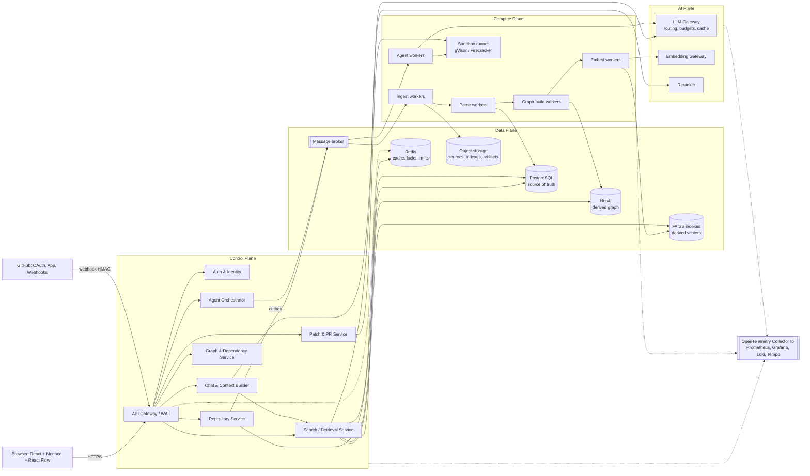
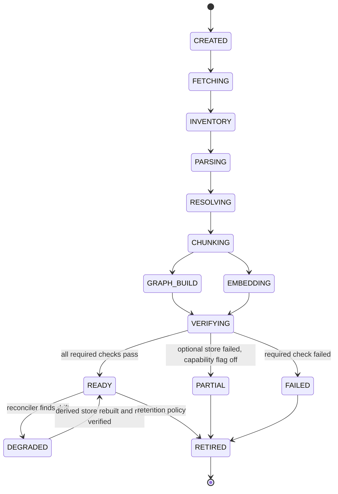
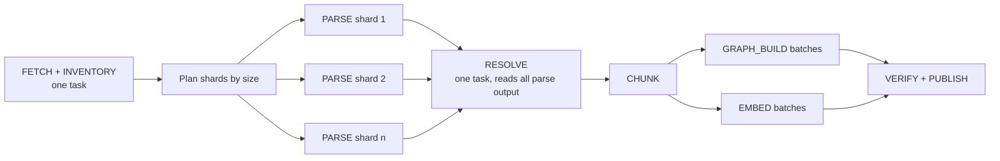
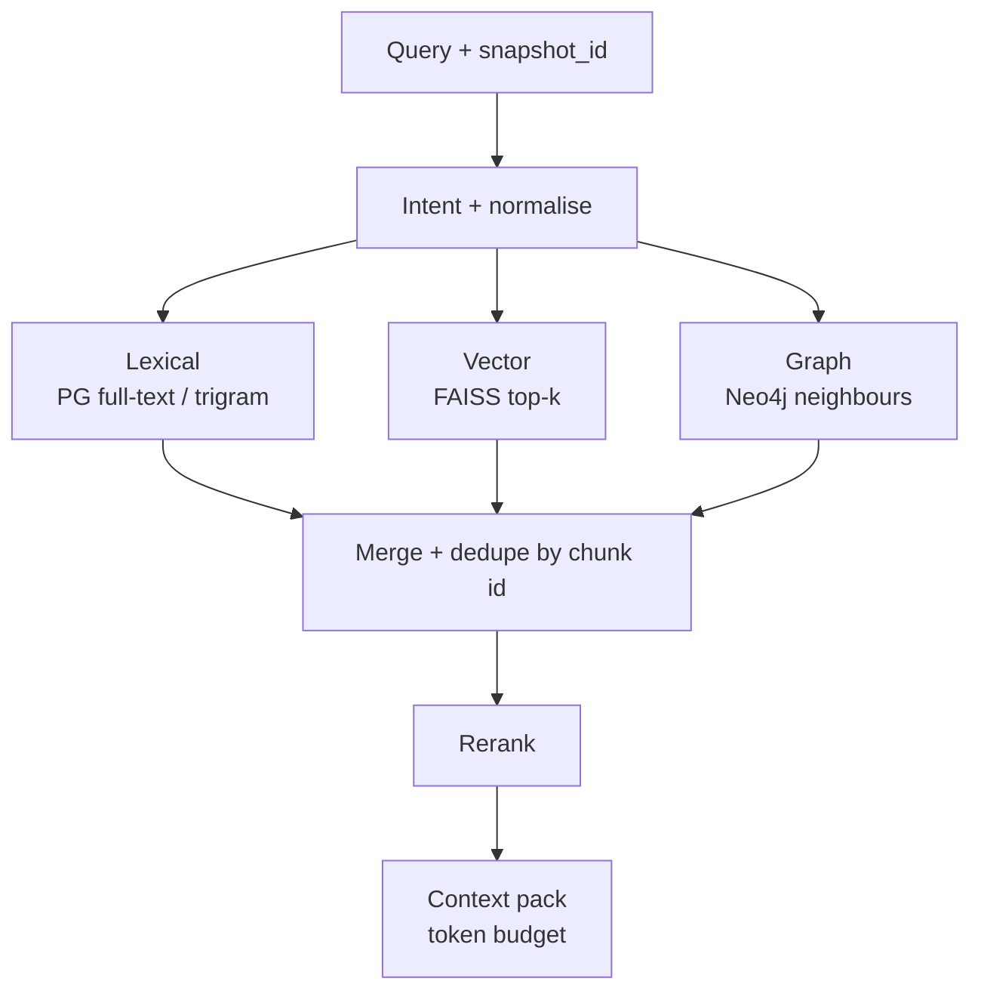
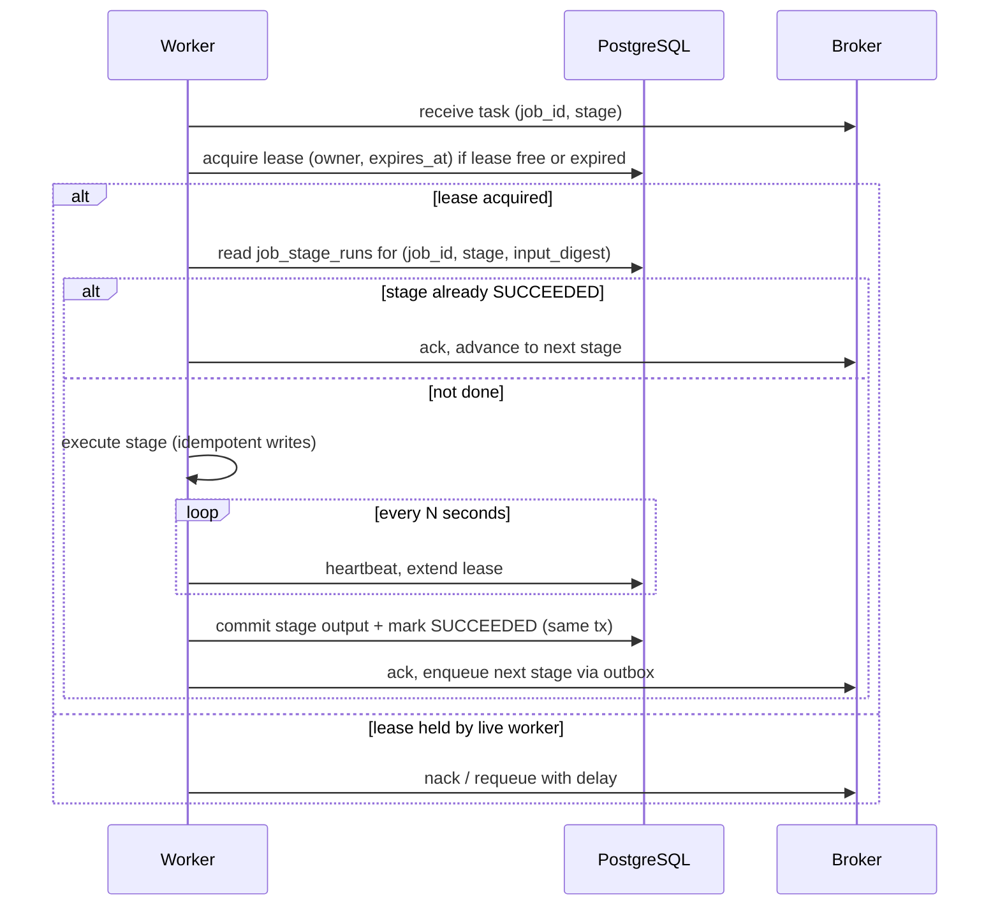
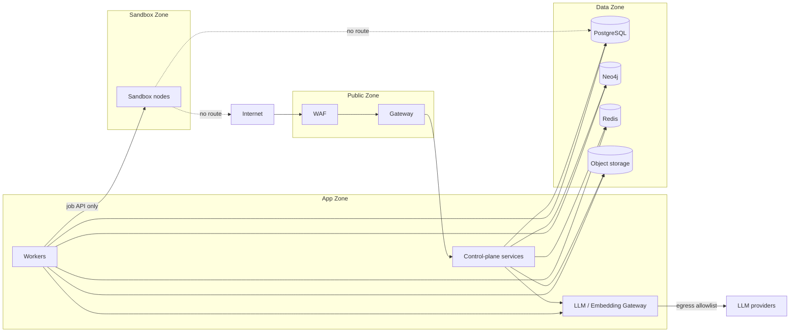
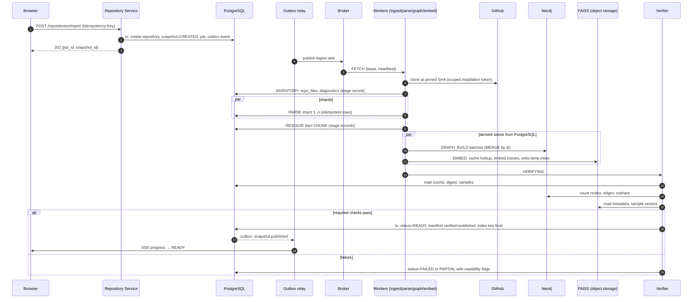
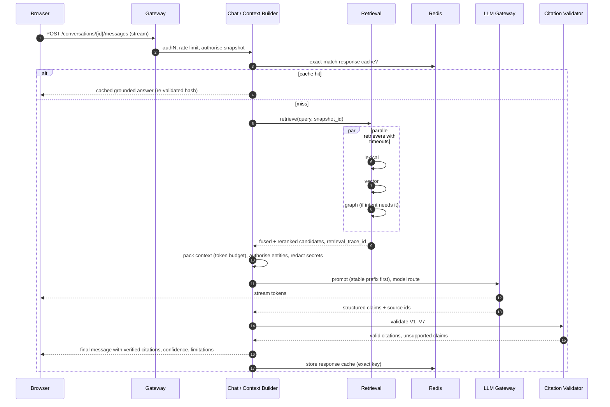

# CodePilot — System Design Specification

**The Knowledge of Athena · End-to-end system design for scale, latency, reliability, accuracy, consistency, security, observability and cost**

| Field | Value |
| --- | --- |
| Document | CodePilot System Design Specification (SDS) |
| Version | 1.1 |
| Companion to | CodePilot Master Architecture, Feature & Engineering Specification v2.1 |
| Scope | Non-functional architecture: how the 21 features in the Master Spec are made scalable, fast, reliable, accurate, consistent, secure, observable and affordable |
| Change log | v1.1: adds a 1,000-concurrent-user design requirement (§16: workload model, capacity plan, overload protection, validation tests, launch profiles) and patches §1, §3, §8, §11, §14, §15 and the appendices to match |
| Status | Proposed design. Every number marked **target** or **assumption** is a planning value to be measured, not a claim about existing behaviour |
| Notation | **Δ** marks a change or addition relative to Master Spec v2.1. Names without Δ are reused unchanged |

## How to read this document

- §1 turns the eight goals into measurable targets. §2 shows the whole system. §3 is the most important section: it defines the **snapshot contract** that every other section depends on.
- §4–§11 take one goal each: scalability, latency, reliability, accuracy, consistency, security, observability, cost. Each ends with a short **Verification** list.
- §12 gives end-to-end flows. §13 covers deployment. §14 explains the capacity method. §15 separates delivery profiles and gives the Definition of Done. **§16 sizes the whole system for 1,000 concurrently active users** and defines the load tests that prove it.
- Appendices hold new DDL, Redis conventions, queue definitions, SLO tables and ADRs.

---

# 1. Goals, Targets and Constraints

## 1.1 Goal-to-mechanism map

| # | Goal | Primary mechanisms | Section |
| --- | --- | --- | --- |
| 1 | Scalability | Stateless services, queue-per-workload, sharded parse/embed, partitioned tables, per-snapshot indexes, tenant fair-share | §4 |
| 2 | Low latency | Immutable-snapshot caching, parallel hybrid retrieval, streaming, precomputation, warm indexes | §5 |
| 3 | Reliability | Bulkheads, circuit breakers, idempotent staged jobs, leases, outbox, graceful degradation | §6 |
| 4 | Accuracy | Evidence-only prompting, citation validator, abstention, retrieval and generation evals in CI | §7 |
| 5 | Consistency | Snapshot manifest, publish gate, PostgreSQL as source of truth, derived-store verification and reconciliation | §3, §8 |
| 6 | Security | Tenant isolation in every store, KMS-wrapped credentials, network zones, gVisor/Firecracker sandbox, injection controls | §9 |
| 7 | Observability | RED/USE metrics, trace_id across queue and AI calls, AI-quality telemetry, consistency monitor, SLO burn alerts | §10 |
| 8 | Cost efficiency | Model routing, embedding cache by content hash, incremental indexing, token budgets, quotas, lifecycle policies | §11 |

## 1.2 Service level objectives (targets)

These are initial targets. Measure them in staging before publishing them as commitments (see §10.5 for burn-rate alerting).

| User-facing operation | SLI | Target (p95 unless stated) | Notes |
| --- | --- | --- | --- |
| Explorer: tree page, file open | Server time | < 300 ms | Postgres + object storage only; no AI |
| Symbol/exact search | Server time | < 400 ms | Lexical path |
| Hybrid search (lexical + semantic + graph) | Server time | < 800 ms | Parallel retrieval, §5.3 |
| Chat / AI explain: time to first token | Server time | < 2.5 s | Streaming over SSE |
| Chat / AI explain: full answer | Server time | < 15 s | Depends on model and answer length |
| Graph query (callers, dependents, path ≤ 4 hops) | Server time | < 600 ms | Snapshot-scoped, cached |
| Import, 100k LOC repository | Wall clock to READY | < 10 min | Assumption; dominated by embedding throughput |
| Incremental re-index, ≤ 50 changed files | Wall clock to READY | < 2 min | §4.5 |
| Job enqueue to first worker pickup | Queue wait | < 30 s (interactive), < 5 min (batch) | Autoscaled on queue age |
| API availability | Successful non-5xx | 99.5 % (MVP), 99.9 % (Scale) | Excludes planned maintenance |
| Cross-store consistency | Published snapshots passing verification | 100 % | A failed check blocks publication (§3.4) |
| Citation validity | Citations that resolve to real spans | ≥ 99 % served to users | Invalid ones are removed before serving (§7.4) |
| **Concurrent active users** | Users served within the SLOs above | **1,000 (design), validated to 1,500 with graceful degradation** | Workload model and tests in §16 |
| Overload behaviour | Core functions (explorer, search, PostgreSQL-backed graph) inside SLO while AI features are shed | Brownout levels L0–L3 | §16.7 |

## 1.3 Assumptions to validate

| ID | Assumption | Why it matters |
| --- | --- | --- |
| AS-1 | A tenant is a user account in the MVP and an organisation later | Drives `tenant_id` design (§9.1) |
| AS-2 | Typical repository is 10k–500k LOC; the tail reaches several million LOC | Drives sharding and size limits (§4.3) |
| AS-3 | Interactive questions dominate by count; ingestion dominates by compute | Drives queue separation (§4.2) |
| AS-4 | LLM and embedding calls go to hosted providers with rate limits, or to a local model with finite GPU capacity | Drives backpressure and routing (§4.6, §11.1) |
| AS-5 | Repositories change faster than users re-import them | Drives staleness detection and incremental indexing (§4.5) |
| AS-6 | Neo4j Community Edition may be used in early environments | It does not provide clustering, so the design keeps Neo4j **rebuildable** from PostgreSQL (§3.2). Verify against your licence |

## 1.4 Non-goals

- Multi-region active-active. The design is single-region with cross-region backup (§6.9).
- Real-time collaborative editing of code.
- Executing repository code outside the sandbox (§9.6).
- Guaranteeing correctness of LLM reasoning. The system guarantees that **cited evidence exists and matches the snapshot**, and measures the rest (§7).

## 1.5 Target load

The design requirement is **1,000 concurrently active users** at peak, with headroom to 1,500 (§16). Every capacity statement elsewhere in this document is consistent with that requirement. The first constraint to bind is LLM and embedding throughput, not web or database capacity.

---

# 2. System Architecture

## 2.1 Planes

The system is split into five planes so each can scale, fail and be secured independently.

| Plane | Components | Scaling unit | Failure impact |
| --- | --- | --- | --- |
| Edge | CDN for static web assets, WAF, API gateway (TLS, authN, rate limit) | Gateway replicas | Total outage for users |
| Control | FastAPI services: auth, repository, search, chat, graph, agent, patch, PR | Stateless replicas behind a load balancer | Feature-level outage if one service fails |
| Data | PostgreSQL (primary + replicas), Neo4j, FAISS index store, Redis, object storage | Per store (§4) | Degrades features per §6.6 |
| Compute | Celery/worker pools per queue: ingest, parse, embed, graph, ai, agent, sandbox | Queue depth and age | Jobs delay; interactive path unaffected |
| AI | LLM gateway, embedding gateway, reranker | Provider quotas, GPU/replica count | AI features degrade; non-AI features unaffected |

## 2.2 Logical architecture



## 2.3 Store roles (the rule everything else follows)

| Store | Role | Authority | Rebuildable? |
| --- | --- | --- | --- |
| PostgreSQL | Canonical metadata, symbols, imports, call sites, chunks, findings, jobs, audit | **Source of truth** | No. Back up and replicate |
| Object storage | Source blobs per snapshot, FAISS index files, reports, diagram exports, patch artifacts | Source of truth for bytes (content hash recorded in PostgreSQL) | Sources: re-fetch from GitHub at the pinned SHA. Indexes: yes |
| Neo4j | Traversal-optimised copy of relationships | **Derived** from PostgreSQL | Yes, from `symbols`, `imports`, `call_sites`, `api_endpoints` |
| FAISS | Vector index over `code_chunks` | **Derived** from PostgreSQL + `embedding_cache` | Yes, from `code_chunks` and the embedding cache |
| Redis | Cache, locks, rate limits, progress fan-out | Ephemeral | Yes, by definition |

> **Design rule R1.** Nothing is ever written to Neo4j or FAISS that is not already committed in PostgreSQL for the same `snapshot_id`. Derived stores can therefore always be dropped and rebuilt, and a mismatch is always resolved in PostgreSQL's favour.

> **Design rule R2.** A snapshot is **immutable once published**. Any change to repository content creates a new snapshot. Immutability is what makes caching safe (§5.2) and consistency checkable (§8).

## 2.4 Service responsibilities and statefulness

Service boundaries follow Master Spec §3.4. The table adds what matters for scaling and failure.

| Service | Stateless? | Scale on | Depends on (hard) | Depends on (soft, degrades) |
| --- | --- | --- | --- | --- |
| Auth & Identity | Yes | RPS | PostgreSQL, Redis (sessions) | GitHub API |
| Repository | Yes | RPS | PostgreSQL | GitHub API |
| Search / Retrieval | Yes (index cache is warm state) | RPS, memory | PostgreSQL | Neo4j, FAISS, reranker |
| Chat & Context Builder | Yes | RPS, concurrent streams | Search, LLM Gateway | Neo4j |
| Graph & Dependency | Yes | RPS | PostgreSQL | Neo4j (falls back, §6.6) |
| Agent Orchestrator | Yes (state in PostgreSQL) | Concurrent runs | PostgreSQL, broker, LLM Gateway | Sandbox |
| Patch & PR | Yes | RPS | PostgreSQL, GitHub API | Sandbox |
| LLM Gateway | Yes | Tokens per minute | Provider | Secondary provider |
| Workers | Yes | Queue depth and age | Broker, PostgreSQL, stores per stage | — |

---

# 3. The Snapshot Contract

Every feature, cache key, index, graph node and AI answer is scoped to one **snapshot**. This section defines what a snapshot is and how it is built and published. It is the foundation for goal 5 (consistency) and the cache safety in goal 2.

## 3.1 Definition

A snapshot is the complete, immutable analysis of one repository at one commit under one set of tool versions.

**Identity** (from Master Spec §5.5): `(repository_id, commit_sha, analysis_profile, ingestion_version)`, with `parser_version` and `embedding_version` recorded on the row.

**Δ Content digest.** A snapshot also carries `content_digest`: a Merkle-style hash over every `repo_files.content_hash` sorted by path. Two snapshots with equal digests contain identical source. The digest is what caches and the verifier compare against.

## 3.2 What is stored where, per snapshot

| Artifact | Store | Key | Written by stage |
| --- | --- | --- | --- |
| Source blobs | Object storage `tenants/{tenant}/snap/{sid}/src/…` | `repo_files.content_hash` | FETCH |
| `repo_files`, `modules`, `symbols`, `imports`, `call_sites`, `api_endpoints` | PostgreSQL | `snapshot_id` | PARSE, RESOLVE |
| `code_chunks` (+ `search_text` for lexical) | PostgreSQL | `snapshot_id` | CHUNK |
| Graph nodes and edges | Neo4j | `snapshot_id` property on every node and edge | GRAPH |
| Vectors | FAISS file in object storage; local mmap cache on retrieval nodes | `snapshot_id` + `generation` | EMBED |
| **Δ `snapshot_manifests`** | PostgreSQL | `snapshot_id` | VERIFY, PUBLISH |

## 3.3 Snapshot state machine

The Master Spec lists READY/PARTIAL/FAILED. This design makes the intermediate states explicit so recovery knows where to resume.



GRAPH_BUILD and EMBEDDING run **in parallel** after CHUNKING because both read only PostgreSQL (R1). VERIFYING waits for both.

**Visibility rule.** Only `READY`, `PARTIAL` and `DEGRADED` snapshots are readable by feature APIs. Everything earlier is invisible to them, so a reader can never observe a half-built snapshot. `PARTIAL` and `DEGRADED` expose only the capabilities whose flags are on (Master Spec §5.6). The graph capability additionally requires `neo4j_state = RESIDENT` (§16.5); otherwise graph queries use the PostgreSQL path.

## 3.4 Publish protocol

Publishing is a gate, not a flag flip. It is the mechanism that guarantees PostgreSQL, Neo4j and FAISS refer to the same snapshot.

1. **Write PostgreSQL first.** PARSE → RESOLVE → CHUNK commit rows under the new `snapshot_id`, inside bounded transactions. Nothing is readable yet because `snapshots.status` is not a readable state.
2. **Build derived stores from PostgreSQL.** GRAPH_BUILD reads committed rows and writes Neo4j in idempotent batches (`MERGE` on node id). EMBED reads `code_chunks`, fills from `embedding_cache` by `content_hash`, embeds the remainder, and writes a **new FAISS file to a temporary object-storage key**.
3. **Record counts and checksums.** Each stage writes its counts and checksum into `snapshot_manifests` (Δ, Appendix A.1).
4. **Verify (§8.2).** The verifier compares PostgreSQL, Neo4j and FAISS against the manifest and against each other.
5. **Publish atomically.** In one PostgreSQL transaction: set `snapshots.status = READY` (or PARTIAL), set `manifest.published_at`, set `manifest.verified_at`, and write the final FAISS object key. The FAISS file is moved from its temporary key to its final key **before** this transaction, so the committed row never points at a missing object.
6. **Announce.** An outbox event (§6.4) invalidates retrieval-node index caches and notifies the UI.

If any step fails, the snapshot stays in a non-readable state and the retry resumes at the failed stage (§6.3). Orphaned Neo4j data and temporary FAISS files for non-published snapshots are removed by the reaper after a TTL (§8.4).

## 3.5 Reader pinning

- Every API request that touches repository content carries a `snapshot_id`. The service resolves it once at the start of the request and passes it down. Services never re-resolve "latest snapshot" mid-request.
- Every Cypher query is generated by a `SnapshotScopedGraphClient` that injects `snapshot_id` and **rejects raw Cypher** from agents and user input (Master Spec §6.4).
- Every FAISS search goes through `SnapshotIndex.search(snapshot_id, …)`, which loads exactly that snapshot's file. Cross-snapshot vector mixing is impossible by construction.
- Conversations record `snapshot_id`. If the user later moves to a newer snapshot, the UI starts a new context rather than silently re-pointing old answers (Master Spec §9 A7).

## 3.6 Incremental snapshots (changed repository, same lineage)

A re-import after a push creates a **new snapshot**, not an in-place update.

1. Diff `parent.content_digest` against the new tree by `content_hash` per path. Unchanged files keep their parsed output.
2. **Reuse:** copy unchanged `symbols`, `imports`, `call_sites`, `code_chunks` rows to the new `snapshot_id` using bulk `INSERT … SELECT`. Embeddings come from `embedding_cache`, so no re-embedding happens for unchanged chunk hashes.
3. **Recompute:** parse changed files, then re-resolve every file in the **reverse-dependency closure** of the changed files, because imports and calls elsewhere may now resolve differently.
4. Run the normal GRAPH, EMBED, VERIFY and PUBLISH steps.

Trade-off: copying rows costs storage per snapshot (see §11.5). The alternative, a shared-row model with a snapshot-membership table, saves storage but complicates every query and the Neo4j id scheme. Record the decision in ADR-S2 (Appendix E).

---

# 4. Scalability

## 4.1 Scale dimensions

| Dimension | Grows with | Bottleneck | Strategy |
| --- | --- | --- | --- |
| Repository size | LOC, file count | Parse and embed CPU/GPU, graph write rate, index memory | Sharded map stage, batched writes, index type by size (§4.4) |
| Users and tenants | Accounts | API concurrency, DB connections | Stateless replicas, connection pooling, read replicas |
| Concurrent jobs | Imports, analyses, agent runs | Worker slots, DB write throughput | Queue-per-workload, autoscaling, per-tenant fair share |
| AI workload | Questions, agent steps, summaries | Provider rate limits, tokens, GPU | LLM Gateway with budgets, batching, model routing, caching |
| Data volume | Snapshots retained | Storage, index memory | Retention, partitioning, compression (§11.5) |

## 4.2 Queue topology

One broker queue per workload class, so a slow or bursty class cannot starve the others (a bulkhead, §6.1).

| Queue | Workload | Worker profile | Concurrency control | Autoscale signal |
| --- | --- | --- | --- | --- |
| `ingest` | Fetch, inventory | I/O bound, network egress to GitHub | Per-tenant and global GitHub rate limits | Queue age |
| `parse` | Tree-sitter parse, shard tasks | CPU bound | One shard = ~200 files or ~5 MB | Queue depth |
| `resolve` | Cross-file symbol resolution | Memory bound, one task per snapshot | Singleton per snapshot (distributed lock) | Queue age |
| `graph` | Neo4j batch writes | Write-throughput bound | Cap concurrent writers on Neo4j | Neo4j write latency |
| `embed` | Embedding calls | GPU or provider-rate bound | Token-bucket per provider | Queue depth, provider 429 rate |
| `ai-interactive` | Short LLM tasks needed by the UI (summaries on demand) | Provider bound | Highest priority, small batches | Queue age (tight) |
| `ai-batch` | Docs generation, quality scans, bulk summaries | Provider bound | Lower priority, off-peak | Budget remaining |
| `agent` | Multi-agent runs, investigations | Mixed | Per-run step and cost caps | Concurrent runs |
| `sandbox` | Tests, validation, patch checks | CPU, strict isolation | Hard cap on concurrent containers | Container pool utilisation |
| `maintenance` | Reconciler, reaper, retention | Low | Singleton schedules | — |

**Broker choice.** Redis is acceptable for the MVP, but it is not durable by default. If Redis is the broker, enable AOF persistence and size the visibility timeout above the longest stage. For the Scale profile prefer RabbitMQ or a managed queue with durable acknowledgements. Jobs must be **idempotent** (§6.3) either way, because at-least-once delivery means duplicates happen. Record the decision in ADR-S1.

## 4.3 Sharded ingestion (large repositories)

Parsing is embarrassingly parallel by file. Cross-file resolution is not. The pipeline separates them.



| Stage | Parallelism | Shard unit | Notes |
| --- | --- | --- | --- |
| PARSE | Map: N tasks | ~200 files or ~5 MB, balanced by size | Each shard writes `symbols`/`imports`/`call_sites` rows; unique key `(snapshot_id, file_id, …)` makes retries safe |
| RESOLVE | Single task per snapshot, internally multi-threaded | Whole snapshot | Needs the full symbol table; run as an in-memory join over indexed PostgreSQL reads |
| CHUNK | Map | Per file | Deterministic from `repo_files` and `symbols` |
| GRAPH_BUILD | Batched writers | 5k–20k nodes or edges per transaction (tune) | Idempotent `MERGE`; concurrency capped to protect Neo4j |
| EMBED | Batched | Provider batch size | Skip chunks already in `embedding_cache` |

**Hard limits** (configurable, enforced at INVENTORY; Master Spec §5.2): max file size, max total repository size, max file count, excluded vendored/generated/binary paths. A repository over a limit imports as `PARTIAL` with a clear diagnostic rather than exhausting workers.

## 4.4 Data-store scaling

### PostgreSQL

| Concern | Design |
| --- | --- |
| Connections | PgBouncer in transaction-pooling mode in front of the primary; each API replica uses a small pool |
| Read scaling | One or more read replicas for explorer, search metadata and finding lists. Reads of **just-published snapshots** go to the primary for a short window, or check replica lag against `published_at` |
| Large tables | Hash-partition `repo_files`, `symbols`, `imports`, `call_sites`, `code_chunks` by `snapshot_id` (e.g. 32 partitions to start). Dropping a retired snapshot's rows then becomes cheap batched deletes or partition-aware cleanup |
| Indexes | `(snapshot_id, path)` on `repo_files`; `(snapshot_id, qualified_name)` and a trigram GIN on `symbols.name`; GIN on `code_chunks.search_text`; `(snapshot_id, caller_symbol_id)` and `(snapshot_id, callee_symbol_id)` on `call_sites` |
| Write path | Bulk `COPY` or batched `INSERT` from workers; avoid per-row round trips |
| Migrations | Alembic with expand → migrate → contract; no destructive change in a single release (§13.4) |
| Multi-tenant | `tenant_id` on tenant-owned tables plus row-level security (§9.1) |

### Neo4j

| Concern | Design |
| --- | --- |
| Capacity model | Neo4j stores **only relationships needed for traversal** (Master Spec §6.4). Unresolved calls stay in PostgreSQL `call_sites` |
| Isolation | Every node carries `snapshot_id` and `tenant_id`; unique constraint on `id`, index on `snapshot_id` |
| Growth | Retired snapshots are deleted in batches by `snapshot_id`. Avoid one giant delete transaction |
| Scale-out | Neo4j Enterprise clustering or per-tenant databases are the scale path. On Community Edition, keep one database and scale vertically. Because Neo4j is derived (R1), switching is a rebuild, not a migration |
| Fallback | Short traversals (callers, callees, direct dependents) can be answered from PostgreSQL `call_sites` and `imports` with indexed lookups or recursive CTEs, so Neo4j is an accelerator, not a single point of failure (§6.6) |

### FAISS vector index

| Snapshot size (chunks) | Index type | Rationale |
| --- | --- | --- |
| < 50k | Flat (exact inner product) | Exact and fast enough; no tuning |
| 50k – 1M | HNSW | Low latency, high recall, more memory |
| > 1M | IVF with product quantisation (IVF-PQ) | Memory reduction at some recall cost; measure recall (§7.6) |

- One immutable index file per snapshot (`faiss/{tenant}/{sid}/{generation}.index`) with a sidecar `ids` mapping to `code_chunks.id`.
- **Filtering.** FAISS has no native metadata filter. Language or directory filters use an allowed-ID set or over-fetch and post-filter (Master Spec §7.2). If filtered recall becomes a problem, move to pgvector (ADR-003).
- **Memory.** Retrieval nodes load indexes lazily with memory mapping and an LRU keyed by `(snapshot_id, generation)`. Pin the most active snapshots; evict cold ones.
- **Shared volume problem.** Index files live in object storage and are cached locally; no shared writable volume is required between API and workers.

### Redis

| Concern | Design |
| --- | --- |
| Roles | Cache, rate limits, distributed locks, SSE progress fan-out. **Never** the only copy of anything |
| Scale | Separate logical instances (or clusters) for cache vs broker vs locks so cache eviction cannot drop queue state |
| Eviction | `allkeys-lru` on the cache instance only |

### Object storage

Prefix per tenant and snapshot, server-side encryption, lifecycle rules (§11.5), no public access. Large objects are written once and addressed by content hash.

## 4.5 Staleness and refresh

- A scheduled job compares `repositories.remote_head_sha` (from GitHub, via webhook push event or periodic poll) with the snapshot's `commit_sha` and sets `remote_checked_at`. The UI shows "N commits behind" (Master Spec §5.7).
- Refresh is user-initiated or webhook-triggered by policy. Auto-refresh is rate limited per repository to prevent import storms from busy repositories.

## 4.6 Concurrency control and fairness

| Mechanism | Purpose |
| --- | --- |
| **Per-tenant concurrency caps** per queue (Redis semaphores) | One tenant cannot occupy all workers |
| **Weighted fair queueing** at dispatch (round-robin over tenants with pending work) | Bounded wait for small tenants during a large import |
| **Priority classes**: interactive > on-demand > batch | User-visible work is never blocked by bulk jobs |
| **Backpressure**: reject (HTTP 429 + `Retry-After`) when a tenant's queued work exceeds its limit | Protects the system instead of building unbounded queues |
| **Provider token buckets** in the LLM and embedding gateways | Keep total demand under provider limits; share capacity by priority |
| **Admission control for agent runs**: plan cost estimate vs remaining budget | Refuse runs that cannot complete within budget (§11.3) |

## 4.7 Autoscaling

| Component | Metric | Scale out when | Scale in when |
| --- | --- | --- | --- |
| API replicas | CPU, in-flight requests | p95 latency or CPU above threshold | Sustained low utilisation |
| Parse / ingest workers | Oldest-message age | Age above the queue's wait target | Queue empty for a cool-down |
| Embed workers | Queue depth and provider 429 rate | Depth rising and no throttling | Throttling or empty |
| Sandbox pool | Container utilisation | Utilisation > 70 % | Idle |
| Retrieval nodes | Memory, index load time | Cache miss rate on index loads is high | — |

Use cooldowns to prevent flapping. Heavy workers can run on spot or preemptible capacity because stages are idempotent and checkpointed (§6.3).

## 4.8 Verification

- Load test: N concurrent imports of mixed size while interactive search runs; interactive p95 must stay within §1.2.
- Fairness test: one tenant floods `parse`; another tenant's small import still starts within its wait target.
- Soak test: queue depth and memory remain bounded for 24 hours under steady load.

---

# 5. Low Latency

## 5.1 Interactive latency budget

The chat path is the tightest. Budget for **time to first token** (targets):

| Step | Budget (p95) | How it is kept small |
| --- | --- | --- |
| Gateway, authN, rate limit | 20 ms | Session cache in Redis; no DB call on the hot path when the token is valid |
| Authorise `snapshot_id` | 10 ms | Cached `(user, repo, role)` with short TTL |
| Intent classification | 30 ms | Rules first; small model only on ambiguity |
| Query embedding | 40 ms | Cached by normalised query hash; local embedding model |
| **Parallel retrieval** (lexical ∥ vector ∥ graph) | 120 ms | Run concurrently with per-source timeouts (§5.3) |
| Rerank top candidates | 100 ms | Cap candidates (e.g. 40 → 12); lightweight cross-encoder |
| Context pack | 20 ms | Token-budgeted, deterministic |
| LLM time to first token | 800–1500 ms | Streaming, prompt caching, right-sized model (§11.1) |
| **Total to first token** | **≈ 1.2–2.0 s** | Inside the 2.5 s target |

After the first token, citation validation runs on the streamed claims (§7.4) so it does not delay the start of the answer.

## 5.2 Caching layers

Because snapshots are **immutable** (R2), cache entries scoped by `snapshot_id` never need invalidation. They expire only by TTL or eviction. This is the single biggest latency and cost lever.

| Layer | What | Key | TTL / eviction | Safe because |
| --- | --- | --- | --- | --- |
| L0 Browser / TanStack Query | Tree, file content, symbol lists | URL + `snapshot_id` + `content_hash` ETag | Session; `Cache-Control: private` | Immutable per snapshot |
| L1 In-process | Hot snapshot metadata, parsed ASTs of open files, FAISS index handles | `(snapshot_id, generation)` | LRU, memory-bounded | Immutable |
| L2 Redis | Search results, graph query results, query embeddings, auth/permission decisions | See below | 10 min – 24 h by type | Keys include `snapshot_id` and versions |
| L3 PostgreSQL | `file_summaries`, `ai_cache`, `embedding_cache`, `generated_docs` | `content_hash` + `context_hash` + `prompt_version` + `model` | Until snapshot retired (summaries) or by policy | Hash-addressed |
| L4 Provider prompt cache | Static system prompt and stable context prefixes | Provider-managed | Provider-defined | Prompt prefix kept byte-stable |

**Cache key rules**

- Search: `s:{snapshot_id}:{sha256(normalised_query + filters + retrieval_version)}`
- Graph: `g:{snapshot_id}:{query_kind}:{sha256(params)}`
- Query embedding: `qe:{embedding_version}:{sha256(normalised_query)}`
- Summary: `(snapshot_id, file_id, content_hash, context_hash, prompt_version, model)` (Master Spec §6.6)
- **Never** cache a response that contains data from more than one snapshot, and never share cache entries across tenants unless the key content is public and identical.
- Cache **stampede protection**: single-flight lock per key so concurrent identical requests share one computation.

**Not cacheable:** anything depending on live GitHub state, user-private conversation context, or in-progress runs.

## 5.3 Parallel hybrid retrieval



- The three retrievers run **concurrently** (`asyncio.gather` with per-retriever timeouts, e.g. 150 ms lexical, 200 ms vector, 250 ms graph; tune from measurements).
- **Partial results are acceptable.** If one retriever times out, proceed with the others and add an entry to `limitations[]` (Master Spec §7.4). Do not block the whole answer on the slowest source.
- The graph retriever is **conditional**: run it only when intent is dependency, call-path or impact oriented, or when the top lexical/vector hit is a symbol that benefits from neighbours.
- Reranking uses a capped candidate set. If the reranker is unavailable, fall back to reciprocal-rank fusion of the three result lists.

## 5.4 Precomputation (move work off the request path)

| Precomputed at | Artifact | Benefit |
| --- | --- | --- |
| Ingest (VERIFY time) | Directory/file tree, language stats, top-level module map, dependency metrics (`dependency_metrics`) | Explorer and A4 answer from PostgreSQL immediately |
| Ingest, `ai-batch` queue, low priority | File summaries for the most-connected files (by graph degree) and entry points | First "explain this file" is instant for important files |
| Lazily, on first request | File summaries for the rest | Avoids paying for files nobody opens (§11.2) |
| On snapshot publish | Warm retrieval nodes: preload the index of recently active snapshots | Removes cold-start index load from the first query |
| On snapshot publish | Embeddings cache hit rate report | Detects wasted work early |

## 5.5 Streaming and asynchronous interaction

- **SSE** streams tokens and job progress to the browser. Chat uses `POST` + fetch streaming because `EventSource` cannot `POST` (Master Spec §4).
- Anything expected to take more than ~2 s returns `202 Accepted` with a `job_id`; progress arrives on `GET /jobs/{id}/events`. The UI shows stage-level progress.
- The client sends `Idempotency-Key` on mutations so reconnects do not duplicate work.
- Long lists use **keyset pagination**, never `OFFSET` on large tables.

## 5.6 Query and storage optimisation

| Technique | Where |
| --- | --- |
| Covering indexes for hot reads | Tree listing, symbol list by file, references lookup |
| Batch fetch with `WHERE id = ANY($1)` instead of N+1 | Resolving `source_refs` for chunk results |
| Keep `code_chunks.text_ref` out of hot rows; load text only for packed chunks | Smaller index and cache footprint |
| Limit graph traversal depth and fan-out; return `truncated: true` | Prevents unbounded expansions on hub nodes |
| Connection pooling and prepared statements | All services |
| HTTP/2, gzip or brotli for JSON, ETag for file content | Edge |
| Virtualised tree and lazy graph expansion in the browser | Frontend |

## 5.7 Verification

- Per-stage latency histograms; a regression in any budgeted step fails the performance gate in CI (§10.6).
- Cache hit-rate dashboards per layer; investigate any layer below its expected hit rate after warm-up.
- Synthetic probes run the golden search and chat queries every minute against a pinned snapshot.

---

# 6. Reliability

## 6.1 Failure domains and bulkheads

A failure in one domain must not cascade into another. Each row is isolated by separate pools, queues and timeouts.

| Domain | Isolation mechanism | What it protects |
| --- | --- | --- |
| Interactive API vs batch work | Separate worker pools and queues (§4.2); separate DB connection pools | Chat and explorer stay fast during large imports |
| Per-tenant | Concurrency caps, quotas, rate limits | A noisy tenant cannot exhaust shared capacity |
| Per-dependency | Independent client pools and circuit breakers for Neo4j, FAISS loader, Redis, LLM provider, GitHub, reranker | A slow dependency cannot hold all threads |
| Sandbox | Separate cluster or node pool, no shared credentials, no route to internal services | Untrusted code cannot affect the platform |
| Cache vs broker | Separate Redis instances | Cache eviction cannot drop queued jobs |
| Providers | Primary and secondary LLM provider behind the gateway | Provider outage degrades quality, not availability |

## 6.2 Standard resilience policies

Apply these in a shared client library so every service behaves the same way.

| Policy | Rule |
| --- | --- |
| **Timeouts** | Every network call has a connect and total timeout; no unbounded waits. Budgets propagate: a downstream timeout is always shorter than the caller's remaining deadline |
| **Retries** | Only for idempotent operations and transient errors (timeouts, 429, 5xx). Exponential backoff with full jitter; max 3 attempts; honour `Retry-After` |
| **Circuit breaker** | Open after a threshold of consecutive failures or a high error ratio over a window; half-open probes before closing. While open, fail fast or use the degraded path (§6.6) |
| **Load shedding** | When saturated, reject lowest-priority requests first with 429/503 and `Retry-After` |
| **Deadline propagation** | A request deadline travels in headers and job metadata; workers abandon work whose deadline passed |
| **Idempotency** | Mutating endpoints require `Idempotency-Key`; stored in `idempotency_keys` (Master Spec §6.6) |
| **Poison-message handling** | After N failed attempts a job moves to a dead-letter queue with diagnostics; it does not retry forever |

## 6.3 Safe recovery of interrupted jobs

Workers can be killed at any moment (deploys, spot reclamation, OOM). The design assumes **at-least-once execution** and makes that safe.

### Stage-based checkpointing

A job is a sequence of **stages**. Each stage is deterministic given its inputs and idempotent in its writes.



| Concept | Design |
| --- | --- |
| **Lease** | `jobs.lease_owner`, `lease_expires_at` (Δ). A worker must hold a live lease to run a stage. If the worker dies, the lease expires and another worker takes over |
| **Heartbeat** | Worker extends the lease every few seconds. A stalled worker loses its lease and must stop on its next check (fencing token compared on every write) |
| **Idempotent writes** | Unique keys such as `(snapshot_id, file_id, symbol qualified_name, start_line)` and Neo4j `MERGE` on node id make repeated stage runs converge to the same state |
| **Stage record** | `job_stage_runs` (Δ, Appendix A.2) stores `(job_id, stage, attempt, status, input_digest, output_digest)`. A re-delivered task whose stage already succeeded becomes a no-op |
| **Exactly-once effects** | Achieved by **idempotency plus atomic commit of output with stage status**, not by broker guarantees |
| **Resume point** | After a crash the job resumes at the first non-SUCCEEDED stage. PARSE shards that already succeeded are skipped |
| **Cancellation** | A `cancel_requested` flag is checked between batches; workers stop cleanly and the reaper removes partial data |
| **Retry policy per stage** | Retry transient errors; do not retry deterministic failures (e.g. parser rejects a file: record a diagnostic and continue) |

### Saga with compensation

Ingestion spans several stores, so it is a saga rather than a distributed transaction.

| Step | Compensation if the saga fails |
| --- | --- |
| Create snapshot row | Mark `FAILED` |
| Write object-storage sources | Reaper deletes unreferenced prefix after TTL |
| Write PostgreSQL rows | Delete by `snapshot_id` in batches |
| Write Neo4j nodes and edges | Delete by `snapshot_id` in batches |
| Write FAISS temp file | Delete temp key |
| Publish transaction | Only step that makes data visible; it is a single PostgreSQL transaction, so it either happens fully or not at all |

Compensation is performed by the reaper (§8.4), not inline, so a crashed worker cannot leave residue that nobody cleans.

## 6.4 Transactional outbox

Writing to PostgreSQL and then enqueuing to the broker can lose the enqueue if the process dies in between. The outbox removes that gap.

1. In the same PostgreSQL transaction that changes state, insert a row into `outbox_events` (Δ, Appendix A.3).
2. A relay process reads unpublished rows (`SELECT … FOR UPDATE SKIP LOCKED`), publishes to the broker, and marks them published.
3. Consumers deduplicate by `event_id`.

Used for: job and stage enqueue, snapshot-published notifications, cache invalidation of index handles, webhook processing results, and audit events that must not be lost.

## 6.5 External dependency handling

| Dependency | Failure | Handling |
| --- | --- | --- |
| GitHub API | Rate limit, outage, revoked token | Respect rate-limit headers; per-installation limits; queue and retry with backoff; mark repository `access_verified_at` stale; show reconnect path. Webhooks are deduplicated by `webhook_deliveries.delivery_id` |
| LLM provider | 429, timeout, outage | Retry with jitter within budget; switch to secondary provider or smaller model; return retrieval-only results (§6.6) |
| Embedding provider | Same | Queue embedding with backoff; snapshot proceeds as `PARTIAL` with semantic search capability off if the provider stays down |
| Neo4j | Down, slow | Circuit breaker; graph features use PostgreSQL fallback or are disabled by capability flag |
| FAISS load | Object storage error, memory pressure | Retry load; fall back to lexical retrieval |
| Redis | Unavailable | Cache bypass; rate limiting fails **open** with a conservative local limiter; locks fall back to PostgreSQL advisory locks for critical sections |
| Object storage | Errors | Retry with backoff; sources can be re-fetched from GitHub at the pinned SHA |

## 6.6 Graceful degradation matrix

The product keeps working with reduced capability. The UI always states what is degraded (capability flags, Master Spec §5.6).

| Failed component | Still works | Degraded or disabled | User message |
| --- | --- | --- | --- |
| LLM provider (all) | Explorer, lexical search, graph views, dependency analysis, stored summaries, findings from static tools | Chat, explain, new summaries, agents, doc generation | "AI is temporarily unavailable. Search and navigation still work." |
| Neo4j | Explorer, search, chat with vector + lexical, PostgreSQL-backed callers/callees and direct dependents | Multi-hop path and impact queries, architecture graph rendering (shows cached export if any) | "Deep graph queries are unavailable." |
| FAISS or embedding model | Exact and lexical search, graph, explorer | Semantic search; chat falls back to lexical + graph retrieval and flags lower recall | "Semantic search unavailable; showing keyword results." |
| Reranker | All | Ranking uses reciprocal-rank fusion | None (quality metric flagged internally) |
| Redis cache | All, slower | Rate limits use local limiter | None |
| Sandbox | Everything except execution | Test generation validation, reproduction, patch test runs | "Test execution is unavailable. Patches are shown unvalidated." |
| GitHub | Everything on existing snapshots | Import, refresh, PR sync, publishing | "GitHub is unreachable. Existing repositories remain available." |
| One PostgreSQL replica | All | None | None |
| PostgreSQL primary | Reads via replicas (stale-tolerant paths) | All writes, new jobs | Maintenance banner; failover (§6.8) |

## 6.7 Interrupted AI work

- **Streaming chat** interrupted by a disconnect: the server cancels the provider call, stores the partial message with `status = INTERRUPTED`, and the client can retry using the same idempotency key.
- **Agent runs** persist plan, task states, tool calls and outputs after every step (`agent_tasks`, `tool_calls`). After a crash the orchestrator resumes from the last persisted step. Steps with side effects (EXECUTE, WRITE, PUBLISH) require re-approval if their input changed (Master Spec §13.2, §14).
- **Approved patches** are bound to `diff_sha256`; a resumed run cannot publish a different diff than the one approved.

## 6.8 Backup, recovery and release safety

| Item | Target | Mechanism |
| --- | --- | --- |
| PostgreSQL RPO | ≤ 5 min | Continuous WAL archiving + PITR |
| PostgreSQL RTO | ≤ 30 min | Managed failover or promoted replica |
| Neo4j, FAISS | No backup needed for correctness | Rebuild from PostgreSQL (§8.5). Take periodic snapshots only to shorten recovery time |
| Object storage | Versioning on index and artifact buckets | Soft delete window |
| Secrets and keys | KMS-managed; documented rotation | Tested key-rotation runbook |
| Restore drill | Quarterly | Restore PostgreSQL to a clean environment, rebuild derived stores for one snapshot, run the verifier |
| Releases | Canary → progressive rollout; automatic rollback on SLO burn | Feature flags for new AI behaviour; expand/contract migrations |
| Chaos tests | Before major releases | Kill workers mid-stage, drop Neo4j, throttle provider, expire leases |

## 6.9 Verification

- Kill-and-resume test at every stage boundary; final snapshot digest and counts must equal an uninterrupted run.
- Duplicate-delivery test: deliver every task twice; no duplicate rows or edges.
- Dependency-outage tests for every row of §6.6 confirm the documented degraded behaviour.
- Outbox test: crash between commit and publish; the event is still delivered exactly once to a deduplicating consumer.

---

# 7. Accuracy

Accuracy has two parts: **grounding** (answers rest on real, current repository evidence) and **measurement** (quality is tracked, not assumed). The system enforces the first mechanically and measures the second continuously.

## 7.1 Grounding principles

1. **Evidence-only answering.** The model answers from retrieved repository evidence. Without sufficient evidence it says so (abstains) rather than guessing from general knowledge (Master Spec Executive Summary).
2. **Every claim cites evidence.** The response contract (Master Spec §7.4) requires `claims[]` linked to `sources[]`.
3. **Snapshot pinning.** All evidence comes from the pinned `snapshot_id`; the answer shows the commit SHA.
4. **Deterministic first.** Facts that tools can compute (call graph edges, dependency counts, line spans) come from the parser and graph, not from the model.
5. **Confidence is derived from evidence**, not from the model's self-rating: retrieval score margin, number of independent supporting sources, resolution confidence of graph edges (`RESOLVED`, `PROBABLE`, `UNRESOLVED`), and validator outcomes.

## 7.2 Retrieval quality design

| Technique | Purpose |
| --- | --- |
| Syntax-aware chunking (function/class level, file context header) | Chunks align with units developers ask about |
| Hybrid retrieval (lexical + vector + graph) | Exact identifiers, intent, and structural neighbours each covered |
| Reciprocal-rank fusion then cross-encoder rerank | Stable merge; precision at the top |
| Neighbour expansion bounded by token budget | Include the callee, caller, or class the answer needs without flooding the prompt |
| Query rewriting for follow-ups using conversation state | Resolves "what about the other function?" against active entities |
| Code-appropriate embedding model, chosen by evaluation (ADR-004) | A general text model is not assumed best for code |
| Index metadata includes `embedding_version`; mismatched query and index versions are rejected | Prevents silent recall loss |

## 7.3 Prompt construction

- Static **system prompt** first (stable for provider prompt caching), then **instructions**, then **delimited evidence blocks**, then the user question.
- Evidence blocks carry stable IDs (`[S1]`, `[S2]`, …) mapped to `source_refs`. The model must cite by ID.
- Retrieved text is marked as **untrusted data**; the prompt states that instructions inside evidence must not be followed (§9.7).
- Structured output (Pydantic schema): `answer`, `claims[{text, source_ids[]}]`, `limitations[]`.
- `prompt_version` is recorded on every message and cache entry.

## 7.4 Citation validation pipeline

Runs on every grounded answer before it is marked verified. It is deterministic and does not call an LLM unless noted.

| Step | Check | On failure |
| --- | --- | --- |
| V1 | Every cited source ID was in the **retrieved set for this request** | Drop the citation; the claim becomes uncited |
| V2 | `file_path` exists in the snapshot (`repo_files`) | Drop citation |
| V3 | `line_start ≤ line_end ≤ file LOC` | Drop citation |
| V4 | Hash of the cited lines (from the snapshot's stored content) equals `source_refs.snippet_hash` | Drop citation; log as retrieval or index inconsistency |
| V5 | If `symbol_id` is given, it exists and its span overlaps the cited lines | Drop `symbol_id` or citation |
| V6 | **Claim-support check:** identifiers, literals and signatures mentioned in the claim appear in the cited span (lexical check). For high-stakes outputs (findings, patches, review comments) also run an entailment check with an independent model or rule set | Mark claim `UNSUPPORTED` |
| V7 | **Completeness:** every claim has at least one valid citation, unless it is explicitly flagged as general or inferential | Remove or label the claim |

**Failure policy.**

- Unsupported claims are removed, or kept and visibly labelled "not verified". They are never shown as cited.
- If more than a set fraction of claims fail, regenerate **once** with the validator feedback appended; if it still fails, return an abstention with the retrieved evidence list.
- The response `confidence` reflects validator results.
- Validator outcomes are recorded in `verification_results` (Master Spec §6.6) and aggregated as the **citation validity rate** (§10.3).

## 7.5 Accuracy of non-chat features

| Feature | Accuracy mechanism |
| --- | --- |
| A1/A4 Relationships and dependencies | Computed from parser + resolver; every edge stores `resolution_method` and `confidence`; unresolved references are shown, not invented |
| A3/M6 Findings | `origin` field separates `STATIC_TOOL`, `GRAPH_RULE`, `AI_HYPOTHESIS`, `CONFIRMED`; AI hypotheses never display as confirmed; suppression and false-positive feedback tracked |
| A6 Documentation | Signatures validated against parser output before saving (`generated_docs.validation`) |
| M2 Bug investigation | Hypotheses ranked with `SUPPORTS`/`CONTRADICTS` evidence; status stays `UNCONFIRMED` until a reproduction or test supports it |
| M4/M5 Fixes and tests | Patch must apply cleanly, pass syntax, lint and relevant tests in the sandbox; results stored in `validation_runs`; approval binds to `diff_sha256` |
| M7 PR review | Comments anchor to changed lines in the pinned base/head SHAs; comments without valid anchors are discarded |

## 7.6 Measuring quality

### Evaluation assets (Master Spec §16.3, extended)

| Asset | Content | Owner |
| --- | --- | --- |
| **Golden repositories** | 5–10 small and medium repositories across the supported languages, pinned to commits | QA + AI |
| **Retrieval set** | Questions with labelled relevant chunks/files/symbols | AI |
| **QA set** | Questions with reference answers and required citations, including multi-file and unanswerable questions | AI |
| **Graph truth set** | Hand-verified call and import edges for sampled modules | Backend |
| **Finding set** | Known bugs and vulnerabilities (and clean controls) | Security |
| **Fix/test set** | Issues with known good patches and existing test suites | AI |

### Metrics

| Layer | Metric | Notes |
| --- | --- | --- |
| Retrieval | Recall@k, MRR, nDCG@k, context precision (fraction of packed chunks that were useful) | Computed per retriever and for the fused result to show what each contributes |
| Graph | Edge precision and recall against the truth set, by language and `confidence` class | Calibrates `PROBABLE` |
| Generation | **Faithfulness** (claims supported by evidence), answer correctness vs reference, **citation precision and recall**, abstention correctness on unanswerable questions | Use rubric-guided LLM judging with periodic human spot checks to keep the judge honest |
| Findings | Precision, false-positive rate, and recall on the finding set | Report per rule pack |
| Patches/tests | Patch apply rate, test pass rate after patch, mutation or coverage delta for generated tests | From `validation_runs` and `coverage_reports` |
| Production | Thumbs up/down (`feedback`), citation validity rate, abstention rate, regenerate rate | Online signal; sampled for human review |

### Evaluation gates

- **CI gate:** any change to chunking, embedding model, retrieval, reranker, prompts or model version must run the retrieval and QA sets. The change is blocked if a tracked metric drops by more than a threshold relative to the stored baseline (initial thresholds to be calibrated).
- **Index compatibility:** embedding or chunking changes bump `embedding_version`, which creates new snapshots by design (§3.1).
- **Shadow evaluation:** a candidate model or prompt runs on sampled production queries in the background and is compared before promotion.
- Eval data lives in PostgreSQL (`eval_*` tables, Appendix A.6) so results are queryable over time.

## 7.7 Verification

- Mutation test of the validator: corrupt citations (wrong file, shifted lines, altered snippet) and confirm V1–V5 reject every one.
- Adversarial retrieval test: inject irrelevant context; the answer must abstain or cite only valid evidence.
- Weekly quality report: all §7.6 metrics trended; regressions assigned to an owner.

---

# 8. Consistency Across PostgreSQL, Neo4j and FAISS

## 8.1 Invariants

| ID | Invariant |
| --- | --- |
| I1 | A snapshot is readable **if and only if** `snapshots.status` is in {READY, PARTIAL, DEGRADED} and its manifest is published |
| I2 | For a readable snapshot, every Neo4j node and edge reachable by a query has `snapshot_id` equal to the queried snapshot, and exists in PostgreSQL under the same id |
| I3 | Every FAISS vector for the snapshot maps to exactly one `code_chunks.id` in the same snapshot, and every embeddable chunk has exactly one vector (unless the capability flag for semantic search is off) |
| I4 | Embedding model name, revision and dimension in the FAISS metadata equal the manifest values and the query embedder |
| I5 | The source bytes behind every citation match `repo_files.content_hash` for that snapshot |
| I6 | A snapshot's contents never change after publication |

I1 and I6 are enforced by the publish protocol (§3.4). I2–I5 are enforced by verification (§8.2) and monitored at runtime (§8.3).

## 8.2 Pre-publish verification checks

All checks run in the VERIFYING state. Required checks failing → `FAILED` (or `PARTIAL` if only an optional derived store is affected).

| Check | Compares | Rule | Required |
| --- | --- | --- | --- |
| C1 | `repo_files` count and digest vs manifest | Equal; digest recomputed from rows equals `content_digest` | Yes |
| C2 | Neo4j node counts by label vs PostgreSQL `symbols`, `repo_files`, `modules`, `api_endpoints` | Equal per kind | Graph features (resident snapshots only, §16.5) |
| C3 | Neo4j edge counts by type vs PostgreSQL | `CALLS` = resolved `call_sites`; `IMPORTS` = resolved `imports`; `CONTAINS` = symbols with a parent/file | Graph features (resident snapshots only, §16.5) |
| C4 | FAISS vector count vs embeddable `code_chunks` | Equal | Semantic search |
| C5 | FAISS metadata: model, revision, dimension, checksum | Equal to manifest and to the configured query embedder | Semantic search |
| C6 | **Sample integrity:** random sample of vector ids → `code_chunks` → `repo_files`, confirming same `snapshot_id` and matching `content_hash` | 100 % of sample pass | Semantic search |
| C7 | **Sample re-embed:** re-embed a small sample of chunk texts; cosine similarity to stored vectors above a threshold | Detects model or preprocessing drift | Semantic search |
| C8 | **Orphan scan:** Neo4j nodes whose `snapshot_id` is not this snapshot, or PostgreSQL rows with no parent file | Zero | Yes |
| C9 | Source object existence and hash for a sample of files | Equal | Yes |
| C10 | Parse coverage ≥ configured minimum; diagnostics recorded | Threshold | Yes (else PARTIAL with flag) |

The result of each check is stored in `snapshot_manifests.verification` as JSON (name, expected, actual, passed). A failed required check is never ignored by retry logic: it triggers a rebuild of the **derived** store from PostgreSQL, then re-verification.

## 8.3 Runtime consistency monitoring

| Mechanism | Frequency | Action |
| --- | --- | --- |
| **Reconciler**: re-runs cheap checks (C1–C5, C8) on recently active snapshots | Hourly; full checks nightly on a rotating subset | On drift: mark snapshot `DEGRADED`, disable the affected capability flag, enqueue a rebuild of the derived store |
| **Read-time guards**: every Neo4j and FAISS result carries `snapshot_id`; the service asserts it equals the request's `snapshot_id` | Every request | Mismatch → discard result, log `CONSISTENCY_VIOLATION`, serve fallback |
| **Index handle check**: loaded FAISS handle's `(snapshot_id, generation, checksum)` equals the manifest | On load and periodically | Reload from object storage |
| **Alert** | On any violation | Page if any user-visible mismatch was served; ticket otherwise |

## 8.4 Reaper (garbage and orphan cleanup)

Runs on the `maintenance` queue.

- Deletes Neo4j nodes and edges whose `snapshot_id` is not in a readable state past a TTL (e.g. 24 h).
- Deletes temporary FAISS keys, unreferenced source prefixes and abandoned workspaces.
- Deletes PostgreSQL rows of `FAILED` and `RETIRED` snapshots in batches, honouring retention (§11.5) and pins.
- Every deletion is recorded in `audit_events`.

## 8.5 Rebuilding derived stores

Because of R1, a derived store can always be recreated.

| Rebuild | Source | Cost | Typical trigger |
| --- | --- | --- | --- |
| Neo4j for one snapshot | `repo_files`, `symbols`, `imports`, `call_sites`, `api_endpoints` | Graph write time only; no parsing | Drift, Neo4j restore, version upgrade |
| FAISS for one snapshot | `code_chunks` + `embedding_cache` | Index build only; no re-embedding when cache is warm | Drift, index type change, corruption |
| Full re-parse | Source objects | Highest | Parser version change (creates new snapshots by design) |

Rebuild jobs are idempotent snapshot-level jobs: they build to a new `generation`, verify, then switch the manifest pointer in one transaction (the same publish gate as §3.4). Readers keep using the old generation until the switch.

## 8.6 What "consistent" means during a refresh

- A user reading snapshot S1 while S2 is being built sees only S1; S2 is invisible until its publish transaction commits.
- After S2 publishes, new requests may choose S2; in-flight requests finish against S1. Snapshots are not deleted while in-flight requests or pinned conversations reference them; retention honours a grace period.

## 8.7 Verification

- Fault-injection: kill the Neo4j writer halfway; the snapshot must not become readable; retry converges to matching counts.
- Corruption test: truncate a FAISS file; C4/C5 must fail publication; runtime guard must catch a corrupted published file and switch to fallback.
- Cross-snapshot leakage test: issue queries with a wrong `snapshot_id` against Neo4j and FAISS clients; zero rows from other snapshots.
- Property test: for random repositories, derived-store counts always equal PostgreSQL counts after publish.

---

# 9. Security and Isolation

## 9.1 Tenant model and isolation per store

**Δ Tenant.** Introduce `tenants(id, name, kind, plan, created_at, disabled_at)`. In the MVP each user owns one tenant (AS-1); organisations map to tenants later without schema change. Every tenant-owned row carries `tenant_id`. Master Spec v2.1 uses `owner_user_id`; keep it, and add `tenant_id` as the isolation key.

| Store | Isolation mechanism | Enforced by |
| --- | --- | --- |
| PostgreSQL | `tenant_id` column on tenant-owned tables plus **row-level security**: `USING (tenant_id = current_setting('app.tenant_id')::uuid)`. The service sets `SET LOCAL app.tenant_id` at the start of each transaction (required with PgBouncer transaction pooling) | Database |
| PostgreSQL roles | Separate roles for API, workers, maintenance, read-only analytics. Only the maintenance role may bypass RLS, and its use is audited | Database |
| Neo4j | `tenant_id` and `snapshot_id` on every node; all queries generated by `SnapshotScopedGraphClient` that injects both; raw Cypher is forbidden for user and agent input. Per-tenant databases on Enterprise | Application + driver wrapper |
| FAISS | One index per snapshot; file path includes `tenant_id`; the loader authorises `(tenant, snapshot)` before opening | Application + object-store IAM |
| Object storage | Prefix `tenants/{tenant}/…`; bucket policy denies cross-prefix access; presigned URLs are short-lived and tenant-scoped; per-tenant data keys (envelope encryption) | IAM + KMS |
| Redis | All keys prefixed with `t:{tenant}:` except global rate-limit keys; no tenant-controlled key segments without hashing | Client wrapper |
| Logs, metrics, traces | `tenant_id` as a label **in logs and traces only**, not as a metric label (cardinality). Source code and secrets are never logged | Logging library, CI lint |
| LLM context | A request's prompt contains evidence from one tenant and one snapshot only | Context builder (§9.7) |

**Authorisation model.** Roles from Master Spec §6.5 (`OWNER`, `ADMIN`, `VIEWER`) on `repository_permissions`. Every request: authenticate → resolve tenant → authorise `(user, repository, role)` → resolve snapshot. Authorisation of **every entity referenced in a context envelope** happens in the Context Builder (Master Spec §3.4).

## 9.2 Credentials and secrets

| Secret | Handling |
| --- | --- |
| GitHub tokens | Never stored raw in ordinary tables. `oauth_connections.encrypted_token_ref` points to a secret held in a managed KMS/secret manager. Prefer **GitHub App installation tokens**: short-lived, repository-scoped, minted on demand |
| Token access | Only the Repository/Ingest and PR services can request a token. Workers receive a short-lived token scoped to the single job and repository, never the stored credential |
| Session | Secure, HttpOnly, SameSite cookie or short-lived JWT with rotation; CSRF protection on state-changing routes; PKCE and `state` on OAuth |
| LLM and embedding API keys | In the secret manager; injected into the LLM Gateway only. Feature services never see provider keys |
| Encryption | TLS 1.2+ in transit everywhere, including internal hops. AES-256 at rest for PostgreSQL, object storage and backups. Key rotation runbook tested |
| Repository secrets | Secret scanning at INVENTORY. Findings store only a **fingerprint hash** (`secret_findings`), never the raw value. Redact before any LLM call (§9.7) |
| Log hygiene | Redact `Authorization`, cookies, tokens, `.env`-like content; CI test greps for leak patterns |

## 9.3 Network zones



- The Data Zone accepts connections only from the App Zone.
- The Sandbox Zone has **no route** to the Data Zone, the App Zone's internal APIs, or the Internet. Workers submit jobs to it through a narrow job API and receive results as artifacts.
- Egress from the App Zone is limited to allowlisted hosts: GitHub, the LLM gateway's providers, package mirrors where required.

## 9.4 Ingestion safety (untrusted repositories)

Repositories are attacker-controlled input from the moment they are cloned.

| Threat | Control |
| --- | --- |
| Malicious clone arguments, URL injection | Allowlist `github.com` host, validate `owner/repo` pattern, never interpolate into a shell; use an argument-vector git wrapper (Master Spec §4) |
| Git hooks, submodules, LFS pointers, `.gitattributes` filters executing code | Clone with hooks disabled and filters disabled; do not recurse submodules by default; do not run `git lfs` smudge |
| Path traversal and symlink escape | Resolve and constrain every path under the snapshot root; refuse symlinks that leave it; reject `..` segments |
| Zip/tar bombs, huge files, deep trees | Size, count and depth limits at INVENTORY; stream-process; per-job disk and memory quotas |
| Parser crashes or hangs on crafted input | Tree-sitter runs in worker processes with CPU time and memory limits; a crash records a diagnostic for that file and continues |
| Resource exhaustion | Per-tenant quotas and concurrency caps (§4.6) |
| Workspace residue | Per-job ephemeral workspace, wiped on completion or failure |

**Parsing and indexing never execute repository code.** Analyzers that load project configuration (for example ESLint or Semgrep with project rules) run inside the sandbox (Master Spec §3.4), because configuration files can execute code.

## 9.5 Web and API security

- OWASP ASVS-aligned controls: input validation with Pydantic, output encoding, parameterised SQL only, CORS allowlist, secure headers (CSP, HSTS, `X-Content-Type-Options`), request size limits.
- File content is returned as `text/plain` JSON payload (or `Content-Disposition: attachment`), never rendered as HTML from the platform origin. The Monaco viewer renders text, not markup.
- Webhooks: verify HMAC signature, check delivery ID replay (`webhook_deliveries`), validate repository ↔ installation mapping.
- Rate limits per IP, user, tenant and endpoint class; stricter on auth, import and AI endpoints.
- Dependency and image scanning in CI; pinned lockfiles; signed images; SBOM generated per build.

## 9.6 Sandbox for untrusted code execution

Used for: test execution (M5), bug reproduction (M2), patch validation (M4), and analyzers that load project config (A3/M6).

| Control | Requirement |
| --- | --- |
| Isolation technology | gVisor (`runsc`) containers or Firecracker microVMs; a plain shared-kernel container is **not** sufficient for untrusted code |
| Lifecycle | One disposable sandbox per run; destroyed afterwards; no state reuse between runs or tenants |
| Network | Disabled. No DNS, no metadata service, no internal routes |
| Filesystem | Read-only root; source mounted read-only; a small writable tmpfs for outputs with a hard size cap |
| Identity | Non-root user; all Linux capabilities dropped; seccomp profile; no privileged mode; no host mounts |
| Resources | cgroup limits on CPU, memory, PIDs and disk I/O; wall-clock timeout; output size cap |
| Credentials | None. No GitHub tokens, no provider keys, no environment inherited from workers |
| Dependencies | **Never install on the fly from the Internet.** Use pre-built, digest-pinned base images per language and an offline or vetted mirror. If a project needs extra packages, install in a separate, network-restricted build step whose output is a cached image, and surface that to the user as requiring approval (Master Spec AUD-26) |
| Approval | `EXECUTE` is an explicit, audited opt-in (Master Spec §13.3) |
| Output handling | Results returned as bounded artifacts; treated as untrusted data (may contain injection text); redacted for secrets before display or LLM use |
| Monitoring | Container start/stop, resource peaks and violations logged to `tool_execution_logs`; alerts on repeated limit breaches by one tenant |

## 9.7 AI-specific security

| Risk | Control |
| --- | --- |
| **Prompt injection** from code, comments, README, issues, PR descriptions, tool output | All repository-derived text is delimited and labelled untrusted evidence; system prompt forbids following instructions inside it; tool calls require policy checks that are **not** driven by model output alone; agents have least-privilege tools (Master Spec §13.3) |
| **Excessive agency** | Model output can request tools, but a policy engine decides. WRITE and PUBLISH need explicit user approval bound to a diff hash; no auto-merge or auto-push |
| **Data exfiltration through the model** | Context contains one tenant's data only; secrets redacted before prompting; outbound LLM traffic goes through the gateway with logging of sizes, not content; no tools with arbitrary network access |
| **Cross-tenant leakage via caches** | Cache keys include tenant and snapshot; no cross-tenant semantic cache; provider prompt caching uses stable prefixes that contain no tenant data (system prompt only) |
| **Provider data handling** | Use provider contracts and settings that prohibit training on customer data and define retention. Verify terms before launch; document them in the data-processing record |
| **Output safety** | Generated code is never executed outside the sandbox, never applied without approval, and is shown as a diff |
| **Jailbreak and abuse** | Per-user token quotas, request size limits, and anomaly alerts on usage spikes |

## 9.8 Audit, retention and deletion

- `audit_events` records authentication, repository connect/disconnect, import, snapshot deletion, approvals, publishes, permission changes, maintenance-role RLS bypass and secret-manager access. Append-only; exported to immutable storage.
- **Deletion** of a repository or tenant is a tracked saga across PostgreSQL, Neo4j, FAISS, object storage, caches and backups (backups expire by policy). The final audit event records completion. Satisfies "revoke on disconnect" in Master Spec B1.
- **Retention:** source snapshots and indexes follow §11.5; conversations follow a configurable retention; logs 30–90 days; audit 1 year or longer by policy.

## 9.9 Threat summary

| STRIDE area | Example threat | Primary control |
| --- | --- | --- |
| Spoofing | Stolen session; forged webhook | Short-lived sessions, MFA via GitHub, HMAC verification |
| Tampering | Modified index or snapshot after publish | Immutability (R2), checksums in manifest, write-once object keys |
| Repudiation | "I never approved that patch" | Approval bound to `diff_sha256` in `approvals` + audit |
| Information disclosure | Cross-tenant read; token leak; secret sent to LLM | RLS, scoped graph/index clients, KMS, redaction |
| Denial of service | Huge repo; import storm; token drain | Limits, quotas, fair queueing, load shedding |
| Elevation of privilege | Sandbox escape; prompt-injected tool use | gVisor/Firecracker, no network, policy engine, least privilege |

## 9.10 Verification

- Automated cross-tenant tests on every store: tenant A can never read tenant B data through API, RLS, Neo4j client, FAISS loader or cache keys.
- Sandbox escape test suite (network access attempts, host path reads, fork bombs, memory bombs, long loops).
- Malicious-repository corpus: symlink escape, huge files, hook scripts, prompt-injection READMEs; ingestion must stay safe and answers must ignore embedded instructions.
- Secret-leak test: seed secrets into a repository; confirm they never reach logs, prompts, caches or responses.
- Annual external penetration test before general availability.

---

# 10. Observability

## 10.1 Three pillars plus AI quality

| Pillar | Tooling (recommended) | What it answers |
| --- | --- | --- |
| Metrics | OpenTelemetry → Prometheus → Grafana | Is it healthy and fast? |
| Traces | OpenTelemetry → Tempo/Jaeger | Where did this request's time go across services, queues and AI calls? |
| Logs | Structured JSON → Loki/ELK | What happened in this specific request or job? |
| **AI quality** | Eval tables + online feedback + sampled review | Is it correct and grounded? |
| Errors | Sentry | Which exceptions are new or spiking? |

## 10.2 Correlation and propagation

- Every request gets a `trace_id` (W3C `traceparent`) at the gateway.
- The `trace_id`, `tenant_id`, `snapshot_id`, `job_id`, `run_id` and `user_id` (hashed) are added to every log line.
- **Queue hops preserve the trace**: the `traceparent` is stored in the job/outbox payload and restored by the worker, so one trace spans API → broker → worker stages → LLM calls.
- `retrieval_traces.id`, `messages.id` and `analysis_runs.id` link an answer back to its candidates, selected context, prompt version and model (Master Spec §6.6).

## 10.3 Metrics catalogue

**API and services (RED)**

| Metric | Labels | Purpose |
| --- | --- | --- |
| `http_requests_total`, `http_request_duration_seconds` | route, method, status | Rate, errors, latency per endpoint |
| `inflight_requests`, `rate_limited_total` | route | Saturation and shedding |
| `dependency_call_duration_seconds`, `dependency_errors_total` | dependency (pg, neo4j, faiss, redis, llm, github) | Which dependency is hurting |
| `circuit_breaker_state` | dependency | Open/half-open/closed |

**Jobs and queues**

| Metric | Labels | Purpose |
| --- | --- | --- |
| `queue_depth`, `queue_oldest_message_age_seconds` | queue | Autoscaling and wait-time SLO |
| `job_stage_duration_seconds` | stage, status | Where ingestion time goes |
| `job_retries_total`, `dead_letter_total` | queue, stage | Poison messages |
| `lease_expired_total` | stage | Worker crashes or stalls |
| `snapshot_publish_total` | outcome (READY, PARTIAL, FAILED) | Ingestion success rate |

**Resources (USE)**

| Resource | Signals |
| --- | --- |
| Workers and API | CPU, memory, restarts, OOM kills, disk |
| GPU or embedding nodes | Utilisation, memory, batch size, queue time |
| PostgreSQL | Connections, pool wait, slow queries, replication lag, locks, table and index bloat, partition sizes |
| Neo4j | Page-cache hit ratio, transaction latency, heap, store size |
| FAISS / retrieval nodes | Resident index memory, index load time, cache hit rate |
| Redis | Memory, evictions, hit rate, command latency |
| Sandbox | Concurrent containers, start latency, limit violations |
| Object storage | Request errors, throughput, bytes stored per tenant (via inventory) |

**AI and model quality**

| Metric | Labels | Purpose |
| --- | --- | --- |
| `llm_requests_total`, `llm_latency_seconds`, `llm_ttft_seconds` | provider, model, feature | Latency and errors by model |
| `llm_tokens_total` | provider, model, feature, kind (input, output, cached) | Cost and capacity |
| `llm_cost_usd_total` | provider, model, feature | Spend (from `usage_events`) |
| `retrieval_stage_duration_seconds` | retriever | Latency budget in §5.1 |
| `retrieval_candidates`, `context_tokens_packed` | feature | Retrieval health |
| `citation_validity_ratio`, `claims_unsupported_ratio` | feature | Grounding quality (§7.4) |
| `abstention_ratio`, `regenerate_ratio` | feature | Answerability and failure to ground |
| `feedback_score` | feature, prompt_version, model | Online user-rated quality |
| `eval_metric` | name (recall@k, faithfulness, …), dataset, version | Offline eval trend (§7.6) |

> **Cardinality rule.** Do not use `tenant_id`, `user_id`, `snapshot_id` or file paths as Prometheus labels. Per-tenant analysis uses logs, traces and `usage_events` in PostgreSQL.

## 10.4 Health checks

| Probe | Endpoint | Checks |
| --- | --- | --- |
| Liveness | `/healthz` | Process responds |
| Readiness | `/readyz` | Hard dependencies for this service (e.g. PostgreSQL pool) are reachable; soft dependencies are reported but do not fail readiness |
| Deep health (internal) | `/healthz/deep` | Per-dependency status, index load state, queue lag, migration version, last successful reconciler run |
| **Synthetic probes** | External | Every minute: authenticated explorer read, hybrid search and a short chat question against a pinned golden snapshot; verifies citations resolve |
| **Consistency probe** | `maintenance` queue | Runs §8.3 checks and reports `consistency_violations_total` |

## 10.5 SLOs and alerting

- Define SLOs from §1.2. Alert on **multi-window burn rate** of the error budget (for example a fast window for paging and a slower window for tickets), not on raw thresholds.
- Page-level alerts: availability burn, `consistency_violation` served to a user, dead-letter growth, circuit breaker open on a hard dependency for more than a few minutes, PostgreSQL replication lag above threshold, sandbox limit-violation spike, budget exhaustion for the platform.
- Ticket-level alerts: cache hit rate drop, eval regression, rising abstention or regenerate ratio, queue wait approaching target, storage growth anomalies.
- Every alert links to a runbook entry with first diagnostic steps and the relevant dashboard.

## 10.6 Dashboards

| Dashboard | Audience | Content |
| --- | --- | --- |
| Service overview | On-call | RED per service, dependency health, breaker states, error budget |
| Ingestion | Backend | Stage durations, queue ages, shard throughput, publish outcomes, diagnostics by code |
| Retrieval and latency | AI/Backend | §5.1 budget by step, cache hit rate by layer, index load times |
| AI quality | AI/Product | Citation validity, faithfulness trend, abstention, feedback by prompt and model version |
| Consistency | Platform | Last verification results, drift incidents, rebuild queue |
| Cost | Product/Finance | Spend by feature, model, tenant tier; cost per import and per answer; cache savings |
| Security | Security | Auth failures, rate limits, sandbox violations, RLS-bypass usage, anomalous access |

## 10.7 Data governance for telemetry

- No source code, secrets, prompts, or completions in metrics or default logs. Full prompt/completion capture is **off by default**; enable per request for debugging with a short-lived flag, redaction, restricted access, and a short retention.
- Trace sampling: keep all errors and slow traces; sample a percentage of the rest.
- Retention: metrics 13 months at reduced resolution, traces 7–14 days, logs 30–90 days.

## 10.8 Verification

- Chaos drills confirm each failure produces the expected alert and a trace that localises it.
- A new feature cannot ship without: RED metrics, a trace span per major step, a dashboard panel and an SLO entry (part of Definition of Done, §15.3).

---

# 11. Cost Efficiency

## 11.1 LLM usage control

**Model routing** through the LLM Gateway. Use the cheapest model that meets the quality bar measured in §7.6.

| Task | Model tier | Rationale |
| --- | --- | --- |
| Intent classification, query rewriting, tagging | Small / fast | Short, low-risk; rules handle most cases |
| File summaries, simple explanations | Small–medium | High volume; quality verified by evals |
| Whole-codebase Q&A, cross-file reasoning | Medium–large | Needs reasoning over multiple sources |
| Agent planning, bug investigation, fix generation, PR review | Large, with step caps | Highest value; bounded by budgets |
| Citation/entailment judging | Independent small–medium | Cheap check on high-stakes output |
| Embeddings | Local open model or low-cost embedding API | Large volume; choose by evaluation (ADR-004) |

**Techniques**

| Technique | Effect |
| --- | --- |
| **Evidence budgeting**: pack only reranked, deduplicated chunks within a token budget | Shorter prompts at equal quality |
| **Prompt caching**: stable system prompt and instruction prefix first, variable content last | Lower input cost and latency |
| **Response cache (exact-match only)**: key = `(tenant, snapshot_id, normalised question, prompt_version, model)` | Instant repeats at zero model cost. Do not use fuzzy semantic caching across questions until evals show it does not harm accuracy (ADR-S8) |
| **Structured outputs and `max_tokens` caps** per feature | Prevents runaway generation |
| **Batching** for offline work (summaries, docs, scans) on the `ai-batch` queue, using provider batch endpoints where available | Lower unit price, off-peak scheduling |
| **Cascade**: try a smaller model; escalate only when the validator or confidence gate fails | Most requests stay cheap |
| **Deterministic-first**: use parser, graph and static analyzers for facts and candidate findings; call the LLM only to explain or triage | Fewer tokens and fewer hallucinations |

## 11.2 Avoiding unnecessary recomputation

| Work | Reuse key | Rule |
| --- | --- | --- |
| Embeddings | `(content_hash, embedding_version)` in `embedding_cache` | Never re-embed identical content; shared across snapshots of the same tenant |
| Parsing and resolution | `repo_files.content_hash` + `parser_version` | Incremental snapshots copy unchanged rows (§3.6) |
| File summaries | `(content_hash, context_hash, prompt_version, model)` | Reuse across snapshots when file and its graph context are unchanged |
| Static analysis | `(content_hash, tool_version, rule_pack)` | Skip unchanged files; recompute dependents only where a rule uses graph context |
| Graph analyses (metrics, cycles) | `(snapshot_id, analysis_profile)` | Computed once at publish; stored |
| Docs, diagrams | `(snapshot_id, scope, config hash)` | Cached; recomputed only on config change |
| **Lazy generation** | — | Generate summaries and docs on first request, except for the top-ranked files (§5.4) |
| **Skip rules** | — | Exclude generated, vendored, minified and binary files at INVENTORY; do not embed files above the size limit or lockfiles |
| **Debounced refresh** | — | Collapse multiple webhook pushes into one re-index per repository per window |

Global content dedupe across tenants for **public** repositories is possible (identical public blobs), but only if isolation is preserved: share derived artifacts keyed by public content hash only, and only for publicly licensed content. Treat this as an optional later optimisation (ADR-S9).

## 11.3 Budgets, quotas and admission control

| Control | Mechanism |
| --- | --- |
| Per-tenant plan quotas | `tenant_quotas` (Δ): tokens per day, imports per day, repository count, storage bytes, concurrent jobs, agent runs |
| Real-time counters | Redis counters per tenant and period; `usage_events` is the durable ledger |
| Per-run cost cap | Every analysis run has a budget in tokens and estimated cost; the orchestrator stops or asks for approval when a plan's estimate exceeds the remaining budget (Master Spec §17.2) |
| Cost estimate before expensive actions | UI shows an estimate for imports, full-repository scans and agent runs |
| Platform budget | Global daily spend limit with alerting at thresholds; when exhausted, non-essential batch work pauses and AI features move to the cheapest tier |
| Bounded loops | Max agent steps, tool calls, retries and recursion depth |

## 11.4 Compute efficiency

| Technique | Where |
| --- | --- |
| Right-sized worker pools per queue | Avoid one large pool for mixed workloads |
| Spot / preemptible capacity for parse, embed, batch AI | Safe because stages are idempotent and checkpointed (§6.3) |
| Scale to zero for rarely used pools (sandbox, batch) | Pay for what runs |
| Batch embedding with large batch sizes; GPU utilisation targets | Throughput per unit cost |
| Memory-mapped FAISS with LRU eviction | Avoid holding all indexes in RAM |
| Reserved capacity for the steady baseline (API, PostgreSQL), on-demand for peaks | Lower unit price |

## 11.5 Storage lifecycle

| Data | Retention policy (defaults, configurable) |
| --- | --- |
| Latest READY snapshot per tracked branch | Keep |
| Older snapshots | Keep the last N per repository (e.g. 3) plus **pinned** and snapshots referenced by open conversations, patches or PR reviews; retire the rest after a grace period |
| `PR_BASE` / `PR_HEAD` snapshots | Retire shortly after the PR is closed/merged |
| `FAILED` snapshots | Delete after a short window |
| Source blobs | Content-addressed; garbage-collected when no snapshot references them |
| FAISS indexes | Delete with the snapshot; use product quantisation for very large snapshots |
| Neo4j data | Resident only for the latest snapshot per repository, pinned snapshots, and snapshots accessed recently (§16.5); delete by `snapshot_id` in batches on eviction or retirement |
| Caches | TTL-based; `ai_cache` pruned by age and hit count |
| Conversations, reports | Per-tenant retention setting |
| Cold data | Tier to infrequent-access storage after a period |

**Storage cost drivers to track:** rows per snapshot (symbols, call sites, chunks), vector bytes, graph size, source bytes, and retained snapshot count per repository. The copy-on-write choice in §3.6 trades storage for query simplicity; revisit with real numbers (ADR-S2).

## 11.6 Cost attribution and unit economics

- Every LLM, embedding, sandbox and storage action writes a `usage_events` row with tenant, repository, run/feature, model, input/output/cached tokens and estimated cost (Master Spec §6.6).
- Track **unit costs**: cost per import (by LOC), per chat answer, per agent run, per PR review, per GB-month stored. Alert on regressions after a release.
- Cost model for planning:

```
cost_llm      = Σ over calls ( in_tokens × price_in + out_tokens × price_out ) × (1 − cache_discount_share)
cost_embed    = (new_chunks_not_in_cache) × avg_chunk_tokens × price_embed          # 0 per-token if local; then GPU-hours
cost_storage  = Σ ( snapshot_bytes_pg + vectors_bytes + graph_bytes + source_bytes ) × price_gb_month × retention_months
cost_compute  = Σ ( worker_hours × price_hour ) split by pool
```

## 11.7 Verification

- Cache savings report: tokens and dollars avoided per layer; a layer with near-zero savings is a candidate for removal.
- Re-import of an unchanged commit must cost ~zero embedding and LLM spend (asserted in tests via `usage_events`).
- Budget enforcement test: a run exceeding its cap stops and reports partial results; platform budget exhaustion degrades gracefully.

---

# 12. End-to-End Flows

## 12.1 Repository import and indexing



## 12.2 Grounded question answering



## 12.3 Agent run (investigation, fix, tests, PR review)

1. `POST …/agent-runs` creates `analysis_runs` with a budget and returns 202.
2. The orchestrator builds a plan; each step is a persisted `agent_tasks` row with allowed tools and a state (`PENDING → RUNNING → SUCCEEDED/FAILED/BLOCKED`).
3. Specialised agents (architecture, security, performance, testing) run **in parallel** on the `agent` queue when independent. Each tool call goes through the policy engine, is logged in `tool_calls`, and is subject to the run budget.
4. Evidence-producing steps run the validator (§7.4). Steps needing execution go to the sandbox (§9.6) after explicit opt-in.
5. Write-effect steps (patch apply, PR comment publish) stop at `AWAITING_APPROVAL` until the user approves the exact `diff_sha256`.
6. On crash, the orchestrator resumes from the last persisted step (§6.7). Final report links every claim to evidence, with cost and token totals.

## 12.4 GitHub webhook (push or pull request)

1. Gateway verifies HMAC and checks `webhook_deliveries.delivery_id` for replay; stores the delivery and returns `200` quickly.
2. An outbox event routes the delivery to a worker.
3. **Push:** update `remote_head_sha`; if auto-refresh policy applies, enqueue an incremental snapshot (debounced).
4. **Pull request:** create `PR_BASE` and `PR_HEAD` snapshots (incremental from the branch snapshot), compute the changed-file set and impact via the graph, run the review agent, and publish comments only after approval.

---

# 13. Deployment and Operations

## 13.1 Environments

| Environment | Purpose | Data | Notes |
| --- | --- | --- | --- |
| Local | Developer laptop | Docker Compose with PostgreSQL, Neo4j, Redis, MinIO, a small embedding model, mock LLM | Single command start; golden repositories preloaded |
| CI | Tests, evals, security scans | Ephemeral | Runs unit, integration, consistency and eval gates |
| Staging | Production-like | Synthetic and public repositories | Load, chaos and DR drills; SLO measurement |
| Production | Users | Real | Canary rollout; separate accounts and keys from staging |

## 13.2 Production topology (Scale profile)

| Layer | Deployment |
| --- | --- |
| Edge | CDN + WAF + managed load balancer |
| Services | Containers on Kubernetes (or ECS): one Deployment per service, HPA on CPU and in-flight requests, PodDisruptionBudgets, anti-affinity across zones |
| Worker pools | One Deployment per queue with its own node pool and HPA/KEDA on queue age |
| Retrieval nodes | Memory-optimised pool for FAISS handles; warm-up on rollout |
| PostgreSQL | Managed service with synchronous standby in another zone, async read replicas, PgBouncer, PITR |
| Neo4j | Single instance with block storage and snapshots (Community) or a cluster (Enterprise) |
| Redis | Separate cache and broker/lock instances, replicated |
| Object storage | Versioned buckets with lifecycle rules, cross-region replication for backups |
| Sandbox | Dedicated node pool/cluster, tainted so nothing else schedules there, no service-account tokens mounted |
| Observability | OpenTelemetry Collector daemonset; Prometheus, Grafana, Loki, Tempo or managed equivalents |

## 13.3 CI/CD pipeline

1. Lint, type-check, unit tests.
2. Contract tests against the OpenAPI schema; migration tests on a copy of the previous schema.
3. Integration tests with real PostgreSQL, Neo4j and FAISS against golden repositories, including the **consistency verifier** and kill-and-resume tests.
4. **Eval gate**: retrieval and QA metrics vs baseline (§7.6).
5. Security gate: dependency, image, secret and SAST scans; SBOM; image signing.
6. Performance smoke test against the §1.2 budgets.
7. Deploy to staging; run synthetic probes; promote to production by **canary** (small traffic share, automatic rollback on SLO burn).

## 13.4 Schema and index changes

- **Expand → migrate → contract** for PostgreSQL: add nullable columns/tables first, backfill, switch code, then remove old structures in a later release.
- New parser, chunking or embedding versions create **new snapshots**; old snapshots remain valid until retired. Never mutate a published snapshot (R2).
- Neo4j schema changes are applied as versioned constraint/index scripts; graph content is rebuilt from PostgreSQL if semantics change.
- Feature flags gate new retrieval, prompt and model behaviour; roll out by percentage with eval shadowing.

## 13.5 Operations

| Practice | Detail |
| --- | --- |
| Runbooks | One per alert in §10.5; includes how to rebuild a derived store, drain a queue, rotate a key, fail over PostgreSQL |
| On-call | Page only on SLO burn or data-integrity alerts |
| Capacity review | Monthly: queue ages, index memory, storage growth, unit costs |
| Game days | Quarterly: dependency outages, worker kills, restore drill |
| Post-incident | Blameless review with action items tracked to closure |

---

# 14. Capacity Planning (Worked Example)

All inputs are **assumptions** to replace with measurements from golden repositories (Master Spec §16.3). The point is the method, not the numbers. The full sizing for 1,000 concurrent users, including the workload model and per-component capacity, is in §16.

## 14.1 Per-snapshot size

| Quantity | Formula | Medium repo (200k LOC) | Large repo (5M LOC) |
| --- | --- | --- | --- |
| Symbols | LOC ÷ 10 (assumption) | 20,000 | 500,000 |
| Call sites | symbols × 3 (assumption) | 60,000 | 1,500,000 |
| Chunks | LOC ÷ 20 (assumption) | 10,000 | 250,000 |
| Vector bytes (384-dim float32, flat) | chunks × 384 × 4 | ≈ 15 MB | ≈ 384 MB |
| Vector bytes (768-dim float32, flat) | chunks × 768 × 4 | ≈ 31 MB | ≈ 768 MB |
| Index choice | §4.4 | Flat | HNSW or IVF-PQ |
| Embedding tokens (first import) | chunks × avg tokens (assume 300) | 3 M | 75 M |

HNSW adds graph overhead on top of vector bytes; IVF-PQ reduces bytes substantially. Measure recall before choosing (§7.6).

## 14.2 Interactive AI sizing

```
chat_requests_per_min   = active_users × fraction_asking × asks_per_user_per_min
tokens_per_min          = chat_requests_per_min × (avg_input_tokens + avg_output_tokens)
required_provider_TPM   = tokens_per_min × peak_factor ÷ (1 − expected_cache_discount_share)   # sizing aid, not a guarantee
```

Example for the 1,000-user target (§16.2, assumptions): 360 billable chat requests/min × 5,000 tokens ≈ 1.8 M tokens/min for chat alone, and ≈ 2.4 M tokens/min including agents and summaries; plan for ≈ 3.6 M tokens/min at peak. Use this to negotiate provider limits and size gateway token buckets, then verify against measured token counts per feature.

## 14.3 Worker sizing

```
parse_workers  ≈ (files_per_min_needed) ÷ (files_per_min_per_worker)
embed_workers  ≈ (chunks_to_embed_per_min) ÷ (chunks_per_min_per_worker_or_GPU)
sandbox_slots  ≈ concurrent_runs × (1 + headroom)
```

Measure `files/min/worker`, `chunks/min/GPU`, and sandbox start latency in staging before setting autoscaler bounds.

---

# 15. Delivery Profiles and Definition of Done

## 15.1 MVP profile vs Scale profile

The full design is the target. The **MVP profile** below is suitable for a demo, hackathon or pilot (roughly up to a hundred concurrent users; an assumption to confirm by testing). It preserves every invariant while cutting infrastructure. **It is not sufficient for 1,000 concurrent users**: for that, use the **1K Launch profile (§16.12)**. Nothing in the MVP profile prevents moving to the 1K Launch or Scale profile later, because derived stores are rebuildable (R1) and snapshots are immutable (R2).

| Area | MVP profile | Scale profile |
| --- | --- | --- |
| Services | Modular monolith (FastAPI) + one worker image with multiple queues | Separate services and per-queue worker pools |
| Broker | Redis with AOF, or Postgres-backed queue | RabbitMQ or managed queue |
| PostgreSQL | Single instance + PITR backups | HA with replicas, PgBouncer, hash partitioning |
| Neo4j | Single instance, **or** PostgreSQL-only graph via `call_sites`/`imports` with recursive CTEs | Clustered or per-tenant databases |
| Vectors | FAISS Flat/HNSW per snapshot, loaded in the API/worker | Dedicated retrieval nodes; pgvector if filtered recall demands |
| Tenant isolation | `tenant_id` + application-enforced filters, RLS on core tables | RLS everywhere, per-tenant keys and databases where needed |
| Sandbox | Docker with gVisor on a separate host | Firecracker/gVisor pool with autoscaling |
| Observability | Prometheus + Grafana + structured logs + basic tracing | Full OpenTelemetry, SLO burn alerts, AI-quality dashboards |
| LLM | One provider + one fallback model, simple router | Multi-provider gateway, cascade, batch APIs |
| Caching | Redis + `embedding_cache` + `ai_cache` | All layers in §5.2 |
| Evals | Retrieval and QA sets run in CI | Shadow eval, human review loop, online metrics |
| **Never cut** | Snapshot publish gate, verifier C1–C5/C8, idempotent staged jobs, citation validator V1–V5, tenant authorisation, sandbox for execution, secret redaction, no execution of repository code during parsing | Same |

## 15.2 Phased rollout

| Phase | Deliverables | Exit criteria |
| --- | --- | --- |
| P1 Foundation | Snapshot contract, staged jobs with leases, outbox, PostgreSQL schema + RLS, object storage, observability baseline | Kill-and-resume and duplicate-delivery tests pass |
| P2 Retrieval | Chunking, lexical + vector retrieval, manifest + verifier, reader pinning | Consistency tests pass; retrieval eval baseline recorded |
| P3 Grounded AI | LLM Gateway, context builder, citation validator, response contract, caches | Citation validity ≥ target on QA set; TTFT within budget |
| P4 Graph and analysis | Neo4j (or fallback), graph clients, dependency analysis, findings | Graph truth-set precision/recall recorded |
| P5 Agents and sandbox | Orchestrator, policy engine, sandbox, approvals, patches, tests, PR review | Sandbox escape suite passes; approval binding verified |
| P6 Hardening | Load tests T1–T9 (§16.10), chaos, DR drill, security review, cost controls, brownout controller | SLOs met at 1,000 users and graceful degradation at 1,500 in staging; restore drill passed |

## 15.3 Definition of Done for any feature (non-functional)

A feature is not done until it has:

1. A `snapshot_id`-scoped data path and a documented degraded mode (§6.6).
2. Idempotent writes and, if long-running, staged checkpoints (§6.3).
3. RED metrics, a trace span per major step, a dashboard panel, and an SLO or explicit exemption (§10).
4. Tenant-isolation tests passing (§9.10).
5. If it uses an LLM: citation validation, token budget, model route, `prompt_version`, eval cases and cost attribution (§7, §11).
6. Cache keys including `snapshot_id` and versions; no cross-tenant sharing (§5.2).
7. A runbook entry for its failure modes.

## 15.4 Goal acceptance checklist

| Goal | Accepted when |
| --- | --- |
| 1 Scalability | Load tests T1–T9 (§16.10) pass at 1,000 users with graceful degradation at 1,500; fairness tests pass; autoscaling holds queue-age targets; no unbounded queue or memory growth in soak |
| 2 Low latency | §1.2 budgets met in staging at target load; cache hit rates above expectations after warm-up |
| 3 Reliability | All §6.9 tests pass; every §6.6 degraded mode verified; restore drill within RPO/RTO |
| 4 Accuracy | Citation validity and faithfulness meet thresholds on the eval sets; CI gate blocks regressions |
| 5 Consistency | Verifier required checks pass for 100 % of published snapshots; reconciler finds no unresolved drift; cross-snapshot leakage tests clean |
| 6 Security | Cross-tenant, sandbox, malicious-repository and secret-leak suites pass; penetration test findings closed |
| 7 Observability | Every alert has a runbook; synthetic probes and consistency probe running; AI-quality dashboard populated from production |
| 8 Cost | Unit costs tracked per feature; re-import of unchanged commit costs ~zero model spend; budget enforcement tested |

---

# 16. Design for 1,000 Concurrently Active Users

This section makes 1,000 concurrently active users a **design requirement** and sizes every layer for it. It builds on §4–§11 and changes the baseline: the **1K Launch profile** (§16.12) replaces the MVP profile as the minimum for public launch.

## 16.1 What "supports 1,000 active users" means

No design can promise that nothing ever goes wrong. This design commits to the following, and the load tests in §16.10 are the proof.

**Commitments (verified by test, not asserted):**

| # | Commitment |
| --- | --- |
| G1 | At 1,000 concurrent active users running the workload in §16.2, every SLO in §1.2 is met |
| G2 | At 150 % of that load (1,500 users), the system **degrades in defined steps** (§16.7) instead of collapsing: navigation and search stay inside their SLOs, and AI features slow down or simplify |
| G3 | No load level can corrupt data or break snapshot consistency (§8). Overload sheds work; it never skips verification or the publish gate |
| G4 | One tenant, one repository or one retry storm cannot take the platform down (§16.9) |
| G5 | Every overload action is visible to users (banner, message) and to operators (metrics, alerts) |

**What no design can guarantee:**

- **LLM provider capacity.** Throughput, latency and uptime of an external provider are outside your control. The design bounds the damage (multi-provider routing, budgets, brownout levels) but cannot remove it.
- **The numbers in this section.** They are planning values derived from stated assumptions. Replace them with measurements from the load tests before launch.
- **Unlimited growth.** Beyond the tested envelope plus headroom, capacity must be added (§16.13).

## 16.2 Workload model

"Active user" means a user with an open session who performed an action in the last five minutes. All values are **assumptions (A-1k)** to be replaced with measured behaviour from a pilot.

| Parameter | Value | Notes |
| --- | --- | --- |
| Concurrently active users (peak) | 1,000 | Design requirement |
| Explorer actions (tree, file open) | 3 / user / min | Cheap, PostgreSQL + object storage |
| Searches (hybrid) | 1 / user / min | |
| Chat or explain requests | 0.4 / user / min | One every 2.5 minutes |
| Graph views and dependency queries | 0.2 / user / min | |
| Other requests (lists, settings, polling) | 0.4 / user / min | |
| **Total** | **5 requests / user / min** | |
| Peak-to-average factor (requests) | 2 | |
| Design headroom on top of peak | 1.5 | Autoscaler ceilings and pool sizes are set to this |
| Chat: average tokens | 4,500 input + 500 output | Enforced by the evidence budget (§16.6) |
| Chat: duration | ≈ 10 s to full answer, TTFT ≈ 1.5 s | |
| Exact-match response-cache hit rate (chat) | 10 % | Conservative |
| New imports at peak | 30 / hour, ~200k LOC each | ≈ 10,000 chunks each |
| Incremental refreshes at peak | 100 / hour, ~500 new chunks each | Remaining chunks hit `embedding_cache` |
| Concurrent agent runs at peak | 10 (1 % of users) | ~40k tokens/min per run |
| Concurrent sandbox runs at peak | 30 (3 % of users) | Tests, reproductions, patch validation |
| Long-lived connections | 1 progress stream per active user + chat streams | SSE |

### Derived demand

| Quantity | Calculation | Result |
| --- | --- | --- |
| Average request rate | 1,000 × 5 ÷ 60 | ≈ 83 req/s |
| Peak request rate | 83 × 2 | ≈ 167 req/s |
| **Design request rate** | 167 × 1.5 | **≈ 250 req/s** |
| Retrievals (search + chat) | (1,000 + 400) ÷ 60 | ≈ 23 /s average, ≈ 47 /s peak |
| Billable chat requests | 400 × 0.9 | 360 / min = 6 /s |
| Concurrent chat streams (Little's law) | 6 /s × 10 s | ≈ 60 steady, ≈ 90 peak; **size for 150** |
| Chat tokens | 360 × 5,000 | 1.8 M tokens/min |
| Agent tokens | 10 runs × 40k | 0.4 M tokens/min |
| Summaries and other on-demand AI | assumption | 0.2 M tokens/min |
| **LLM steady load** | sum | **≈ 2.4 M tokens/min** |
| **LLM design target (× 1.5 peak)** | 2.4 × 1.5 | **≈ 3.6 M tokens/min** |
| Embedding demand | (30 × 10,000 + 100 × 500) ÷ 60 | ≈ 5.9k chunks/min ≈ 100 chunks/s |
| Hosted-embedding token load (if not local) | 300k chunks/hr × 300 tokens | ≈ 1.5 M tokens/min, **on top of** LLM load |
| Parse demand (bursty) | ~2,000 files per import, 5 imports start together | ≈ 170 files/s for about a minute |
| Postgres query rate | 250 req/s × 4 queries | ≈ 1,000 queries/s |
| Postgres busy connections | 1,000 q/s × 5 ms | ≈ 5 on average (pool is sized for tail latency, not average) |

> **Consequence.** The binding constraint is LLM and embedding throughput, not web servers or databases. That is why §16.6 and §16.7 matter more than adding API replicas.

## 16.3 Capacity plan by component

Starting sizes are **assumptions to validate in the load tests (§16.10)**. "Ceiling" is the autoscaler maximum, set so the system can absorb the 1.5× design headroom.

| Component | Starting size | Ceiling | How it is sized |
| --- | --- | --- | --- |
| CDN, WAF, gateway | Managed, 3 zones | Managed | Handles ≥ 10× design RPS; connection limits raised for SSE |
| API services (all control-plane, combined) | 8 replicas, 2 vCPU each, spread over 3 zones | 24 | 250 req/s ÷ ~50 req/s per replica (assumption) ≈ 5, plus 60 % headroom |
| Retrieval nodes (FAISS + lexical + merge) | 3 nodes, memory-optimised | 8 | Hot index set ≈ 1,000 active snapshots × ~8 MB ≈ 8 GB; each node holds the full hot set so any node can serve any query |
| Reranker | 2 replicas × 8 vCPU (or a small GPU) | 6 | 47 req/s × 40 candidates × ~100 ms ≈ 5 CPU-seconds per second |
| LLM Gateway | 4 replicas | 12 | Stateless; limited by provider quotas, not CPU |
| Parse workers | 8 | 32 | 170 files/s burst ÷ ~20 files/s per worker (assumption) |
| Resolve workers | 2 | 8 | Singleton per snapshot; parallel across snapshots |
| Graph-build workers | 4 (capped writers) | 8 | Capped to protect Neo4j write latency |
| Embedding | 2 GPU workers, local model | 4 | ≈ 100 chunks/s demand vs ~500 chunks/s per GPU (assumption); 2 for redundancy |
| Agent workers | 10 | 30 | One slot per concurrent run plus headroom |
| Sandbox pool | 40 slots | 100 | 30 concurrent runs plus headroom; queue wait capped (§16.7) |
| PostgreSQL primary | 16 vCPU, 64 GB RAM, NVMe, ~1 TB | Vertical to 32 vCPU | Dominated by working-set size (§16.4) |
| PostgreSQL replicas | 2 × same size | 4 | Read scaling and failover |
| PgBouncer | 2 instances, ~150 server connections total | — | `connections ≈ peak_RPS × queries_per_request × avg_query_seconds × 5` ≈ 250 × 4 × 0.01 × 5 ≈ 50, doubled for tail latency |
| Redis cache | 16 GB, replicated | 64 GB | ~10 Redis operations per request ≈ 2.5k ops/s, far below limits |
| Redis broker and locks | Separate, 4 GB, AOF | 16 GB | Queue depth, leases, semaphores |
| Neo4j | One instance, 64 GB RAM (≈ 32 GB page cache) | Vertical, or Enterprise cluster | Sized by **data size**, not QPS (§16.5) |
| Object storage | Managed | Managed | Vectors ≈ 46 GB, sources and artifacts per §16.4 |

**Rules for using this table**

1. Run at **≤ 60 % of the capacity last proven by a passing load test** during normal peak (§16.10). The remaining 40 % is headroom for spikes and failures.
2. Autoscaler ceilings are set from the 1.5× headroom, not from budget alone. If budget forces a lower ceiling, the supported user count shrinks accordingly.
3. Spread every tier across three zones so one zone failure leaves ≥ 66 % capacity, which is above the 60 % operating point.

## 16.4 Data volume at 1,000 users

Assumptions: 1,000 users with 3 repositories each, average 100k LOC, keeping the latest 2 snapshots per repository (§11.5).

| Quantity | Calculation | Result |
| --- | --- | --- |
| Rows per snapshot (100k LOC) | symbols 10k + call sites 30k + chunks 5k + imports 5k + files ~1k | ≈ 50k |
| Snapshots retained | 1,000 × 3 × 2 | 6,000 |
| Total relational rows | 6,000 × 50k | ≈ 300 M |
| Relational size with indexes | ≈ 300 bytes/row (assumption) | ≈ 90–100 GB |
| Vectors per snapshot (384-dim float32, flat) | 5,000 × 1,536 B | ≈ 7.7 MB |
| Total vectors | 6,000 × 7.7 MB | ≈ 46 GB (object storage) |
| **Hot vector set** | ~1,000 active snapshots × 7.7 MB | **≈ 8 GB (RAM per retrieval node)** |
| Neo4j resident set | latest snapshot per repo: 3,000 × (≈ 11k nodes, ≈ 36k edges) | ≈ 33 M nodes, ≈ 108 M relationships |

**Implications**

- Hash-partition the large tables by `snapshot_id` from day one (§4.4). With 32 partitions, each holds roughly 10 M rows.
- The copy-on-write snapshot model (ADR-S2) costs about 2× storage here. This is acceptable at 1,000 users. Revisit at ~5,000 users (§16.13).
- Retention (§11.5) is part of capacity: without it, data grows linearly with every import.

## 16.5 Graph query routing and Neo4j residency

Neo4j is sized by **data volume**. Its query rate is low: graph views are about 3 per second on average, about 7 per second at peak. Two changes keep it small and robust.

### Route by query shape

| Query | Served by | Why |
| --- | --- | --- |
| Direct callers/callees, direct imports, dependents (1 hop) | **PostgreSQL** (`call_sites`, `imports`; indexed on `(snapshot_id, callee_symbol_id)` and `(snapshot_id, caller_symbol_id)`) | Fast indexed lookup; no extra dependency |
| 2-hop neighbourhood with a small fan-out cap | PostgreSQL with a bounded recursive query | Still cheap |
| Paths, impact analysis (≥ 3 hops), cycles, centrality, component detection | **Neo4j** | What graph engines are for |
| Architecture diagrams | Precomputed at publish (`architecture_components`, `diagram_configs`); Neo4j only for on-demand re-layout | Avoids recomputation per request |

The `SnapshotScopedGraphClient` (§3.5) makes this routing decision so callers do not.

### Residency policy

Only graphs that are likely to be queried stay in Neo4j.

| State (`snapshot_manifests.neo4j_state`) | Meaning |
| --- | --- |
| `RESIDENT` | Graph is loaded and verified (C2, C3) |
| `EVICTED` | Graph removed from Neo4j; PostgreSQL rows remain |
| `BUILDING` | Rebuild in progress |

- **Resident set:** the latest READY snapshot per repository, plus pinned snapshots, plus snapshots accessed within the last N days (default 14).
- **Eviction:** a maintenance job deletes the Neo4j data for other snapshots in batches by `snapshot_id`. This bounds Neo4j size to the §16.4 figure.
- **Cold access:** if a query needs an `EVICTED` snapshot, the service answers 1–2 hop questions from PostgreSQL immediately, enqueues a rebuild on the `graph` queue with interactive priority (§8.5), and tells the user that deep graph queries will be available shortly.
- **Verification:** checks C2 and C3 (§8.2) apply only to `RESIDENT` snapshots. The graph capability flag requires `neo4j_state = RESIDENT`.

**Neo4j edition.** At this scale a single instance fits (§16.3), and the PostgreSQL fallback keeps navigation working if it fails (ADR-S4). Community Edition is therefore *possible* for launch, but it has no high availability. Enterprise (or a managed service) is recommended once graph features are on the critical path. Check licence terms for your use.

## 16.6 LLM capacity and token economy

At 1,000 users the LLM tier is the first thing to saturate, so it gets explicit capacity engineering.

### Token budgets per feature (enforced, not advisory)

| Feature | Max input tokens | Max output tokens | Notes |
| --- | --- | --- | --- |
| Chat / explain | 6,000 (target avg 4,500) | 800 (target avg 500) | Evidence budget in the Context Builder |
| File summary | 4,000 | 400 | Cached by content hash |
| Intent classification, rewriting | 500 | 50 | Small model or rules |
| Agent step | 10,000 | 1,000 | Run-level cap on total tokens |
| Citation entailment (high-stakes only) | 2,000 | 100 | Independent small model |

A request that would exceed its budget is trimmed by reranked relevance, never silently truncated by arbitrary position.

### Provider capacity strategy

| Mechanism | Detail |
| --- | --- |
| **Capacity target** | ≈ 3.6 M tokens/min across all providers (§16.2). Confirm how each provider counts cached prompt tokens against its limits |
| **Multi-provider, multi-key** | Primary and secondary provider, or several deployments/regions of one provider, behind the LLM Gateway. Requests spread by remaining quota |
| **Reserved or committed throughput** | Negotiate a limit that covers the design target before launch; the default tier of most providers will not |
| **Adaptive concurrency** | The gateway adjusts in-flight requests per provider with additive-increase / multiplicative-decrease (AIMD) driven by 429s and latency, so it finds each provider's real limit without overloading it |
| **Priority queue inside the gateway** | Interactive chat > on-demand summaries > agents > batch. Lower classes wait or are dropped first |
| **Short, bounded waiting** | A chat request waits at most ~2 s for capacity; after that the user sees a clear "busy" message or a degraded answer (§16.7), not a hung stream |
| **Retry budget** | Retries may add at most ~10 % to request volume; beyond that, fail fast. Prevents retry storms against a struggling provider |
| **Local model option** | Embeddings run on a local model (§16.3). A local small model can serve classification and simple summaries, removing that traffic from provider limits |

### Per-user and per-tenant fairness

| Control | Default (configurable) |
| --- | --- |
| Per-user chat rate | 10 / min |
| Per-user concurrent streams | 2 |
| Per-tenant token share | Guaranteed minimum = 50 % of the platform limit ÷ number of active tenants; the remainder is shared by demand |
| Per-user daily token quota (plan-based) | e.g. 200k tokens/day on the base plan |

Quotas also bound **cost**: maximum daily token spend ≈ users × daily quota × blended price per token. This is the number to put in the budget (§11.3, §16.11).

## 16.7 Overload protection

Overload is expected, so it is designed in. The design has four layers, applied from the edge inward.

| Layer | Mechanism |
| --- | --- |
| 1. Edge | WAF rate limits per IP; connection caps; request-size limits |
| 2. Admission | Per-user, per-tenant and global limits (Redis semaphores and token buckets); reject with `429` + `Retry-After` before expensive work starts |
| 3. Queue-based load levelling | Heavy work (imports, agents, batch) goes to queues with bounded depth; the API never runs it inline. A full queue returns `429`, not unbounded delay |
| 4. Brownout controller | Reduces *quality and optional work* in defined steps to protect core functions |

### Brownout levels

An **overload controller** (maintenance service) reads metrics every few seconds and writes `overload:level` to Redis; every service reads it, with a local fallback if Redis is unavailable. Operators can override it manually.

| Level | Typical trigger (placeholders to calibrate) | Actions | User-visible effect |
| --- | --- | --- | --- |
| **L0 Normal** | Within SLOs | None | None |
| **L1 Elevated** | LLM TTFT p95 > 3.5 s for 2 min, or provider 429 > 2 %, or `ai-interactive` queue age > 5 s | Pause `ai-batch` and proactive summaries; replace reranker with reciprocal-rank fusion; shrink evidence budget by 25 %; lengthen response-cache TTL | Slightly shorter, possibly less refined answers |
| **L2 High** | TTFT p95 > 6 s, or 429 > 10 %, or API CPU > 85 % sustained | Route chat to the smaller model; cap output tokens; 1 concurrent stream per user; queue new imports above a size threshold for off-peak processing; pause agent runs for the lowest plan tier | Banner: "High demand. Answers are shorter and large imports are queued." |
| **L3 Critical** | Provider outage, or TTFT p95 > 10 s, or fast error-budget burn | New chat questions return **retrieval-only results** with citations (no generation) unless served from cache; agent runs paused; imports queued | Banner: "AI answers are temporarily limited. Search, navigation and graph views work normally." |

**Rules**

- Core functions (explorer, search, graph views from PostgreSQL, authentication) are **never** shed by the brownout controller. They are protected by capacity, not by degrading.
- **Hysteresis:** step down one level only after conditions have been clear for about 10 minutes, to avoid flapping.
- Every transition is logged, alerted, and shown on the operations dashboard (§10.6).
- Shedding order inside any queue follows priority classes (§4.6).

## 16.8 Connection and resource budgets

Exhausting a shared resource is how overload turns into outage. Budget each one explicitly.

| Resource | Budget rule | Value at design load |
| --- | --- | --- |
| PostgreSQL server connections | Σ(PgBouncer server pools) ≤ 70 % of `max_connections`; each API replica uses a small client pool | ≈ 150 server connections; replicas use ≤ 20 client connections each |
| Long-lived SSE connections | One progress stream per active user; idle heartbeat every 15–25 s; per-node limit set from file-descriptor limit | ≈ 1,000 + ~100–150 chat streams, spread over gateway nodes |
| File descriptors and sockets | OS limits raised on gateway and API nodes; monitored | Set well above peak connections |
| Thread and async pools | Bounded executors for CPU-bound work (parsing, reranking) so they cannot starve the event loop | One CPU pool per process |
| Memory | Index LRU limits, per-request body limits, bounded result sizes (`truncated: true`) | Retrieval nodes sized for the 8 GB hot set plus headroom |
| Neo4j sessions | Driver pool with a hard cap; per-query timeouts | Small; graph QPS is low |
| Sandbox | Hard slot cap and bounded queue with a maximum wait | 40 slots, queue ≤ 200, wait ≤ 60 s then "busy" |

## 16.9 Hot spots, herds and storms

| Scenario | Problem | Design response |
| --- | --- | --- |
| **Popular repository** (many users ask about the same snapshot) | One index and one set of cache keys receive much of the traffic | Immutable snapshot caches make this cheap; every retrieval node holds the hot set; single-flight locks stop duplicate computation |
| **Cache stampede** | Many identical misses at once | Single-flight per cache key; stale-while-revalidate for cacheable reads; jittered TTLs |
| **Login or start-of-day surge** | Thousands of sessions authenticate together | Session cache; scheduled pre-scaling before known peaks; fast-fail on dependency timeouts |
| **Retry storm** | Clients and services retry a slow dependency and make it worse | Exponential backoff with full jitter on clients and services; `Retry-After`; retry budget; circuit breakers (§6.2) |
| **Webhook storm** (a monorepo with frequent pushes) | Import queue floods | Debounced refresh per repository, per-repository rate limit, deduplicated by delivery ID (§11.2) |
| **Import burst** | Many large imports at once | Per-tenant concurrency caps, fair queueing, size-aware shard planning, large imports queued at L2 |
| **Noisy neighbour** | One tenant exhausts shared capacity | Per-tenant semaphores, token share, quotas; metrics in logs and traces by tenant to find offenders quickly |
| **Cold start** (deploy, restart, zone failure) | Empty caches and unloaded indexes cause a latency spike | Warm-up on startup: preload hot indexes before readiness passes; roll deploys gradually; keep ≥ 66 % capacity during zone loss |
| **Thundering herd after recovery** | Dependency returns and receives full queued demand at once | Ramp admission gradually; hysteresis in the brownout controller |

## 16.10 Capacity validation

The claim "works for 1,000 users" is accepted only when these tests pass. Run them in staging with **realistic data volume** (§16.4), not an empty database: query plans and cache behaviour change with scale.

### Test setup

- Tooling: a load generator (e.g. k6 or Locust) driving **user-journey scripts** that follow the §16.2 mix, with think time.
- **Two LLM modes.** (a) An LLM stub with realistic latency, token-rate and error distributions, so platform capacity is measured independently of provider behaviour. (b) A smaller real-provider test to validate provider limits, quotas, fallback and cost.
- A pre-seeded staging dataset: ~6,000 snapshots (or a scaled equivalent), indexes and graphs in the §16.5 residency state.
- Full observability enabled (§10), so every failure is explainable.

### Test matrix

| ID | Scenario | Load | Duration |
| --- | --- | --- | --- |
| T1 | Steady state | 1,000 virtual users, §16.2 mix | 60 min |
| T2 | Headroom | Ramp to 1,500 users (150 %) | 30 min |
| T3 | Spike | 0 → 1,000 users in 2 min | 15 min |
| T4 | Soak | 700 users | 24 h |
| T5 | Import storm | 100 imports/hour with large repositories mixed in, plus T1 interactive load | 60 min |
| T6 | Failure under load | During T1: kill API pods, kill workers mid-stage, take Neo4j down, fail over Redis, lose a replica, lose a zone, 429 storm from the primary provider | Per failure |
| T7 | Noisy neighbour | One tenant floods search, chat and imports during T1 | 30 min |
| T8 | Cold start | Empty caches, unloaded indexes, then T3 | 30 min |
| T9 | Provider limits (real provider) | Scaled load to measured quota; verify AIMD, fallback and cost | 60 min |

### Acceptance criteria

| Test | Pass when |
| --- | --- |
| T1 | All §1.2 SLOs met; 5xx rate < 0.1 % (intentional `429` shedding excluded and reported separately); queue wait targets met; no pod restarts from OOM; PostgreSQL CPU < 60 % and replication lag within threshold; zero consistency violations |
| T2 | No cascading failure; brownout level ≤ L2; explorer, search and graph SLOs still met; 5xx rate < 1 %; system returns to L0 within 15 min after load drops |
| T3 | Autoscaling and warm-up keep p95 within 2× SLO for at most 5 minutes, then recover |
| T4 | No monotonic growth in memory, queue depth, connections or disk beyond expectations |
| T5 | Interactive p95 unchanged within 10 % of T1; large imports queue rather than starve small ones |
| T6 | Every failure produces the documented degraded behaviour (§6.6), the matching alert, and recovery without manual data repair; kill-and-resume produces identical snapshots |
| T7 | Other tenants' p95 degrades by < 10 %; the noisy tenant receives `429`s |
| T8 | Warm-up completes before readiness; no error spike |
| T9 | Fallback and quota enforcement work; spend matches `usage_events` within tolerance |

### Headroom and ongoing validation

- **Operating policy:** production peak must stay ≤ 60 % of the load last proven by a passing T1/T2. If it exceeds 60 %, add capacity or retest at a higher level.
- Re-run T1, T2 and T6 before each major release and after any change to retrieval, models, prompts, schema or infrastructure sizing.
- Monthly capacity review (§13.5) compares real peak behaviour with §16.2 and updates the assumptions.

## 16.11 Cost at 1,000 users

| Control | Effect |
| --- | --- |
| Per-user daily token quota (§16.6) | Gives a hard upper bound: `max_daily_llm_spend ≈ users × quota × blended price per token` |
| Token budgets per feature (§16.6) | Keeps average request size near the sizing assumption |
| Exact-match response cache and provider prompt caching | Reduces billable tokens; measure actual hit rate against the 10 % assumption |
| Local embedding model | Removes ≈ 1.5 M tokens/min of hosted-embedding load and its cost; costs GPU-hours instead |
| Brownout L1/L2 | Automatically lowers spend when demand spikes |
| Platform daily spend limit (§11.3) | Final backstop |

Track cost per active user per day as a first-class metric. If it exceeds the plan price assumption, adjust quotas, model routing or plan tiers before growing the user base.

## 16.12 Launch profiles

The **1K Launch profile** is the minimum for a public launch to 1,000 concurrent users. It is the Scale profile (§15.1) with the cost-saving choices listed here.

| Area | MVP profile (pilot, ≲ 100 concurrent users, assumption) | **1K Launch profile (§16)** | Scale profile |
| --- | --- | --- | --- |
| Services | Modular monolith, one worker image | Separate API, retrieval, LLM Gateway, worker pools per queue | Same, with more replicas and services split further |
| Zones | One | **Three** | Three, plus cross-region backup |
| PostgreSQL | Single instance | Primary + 2 replicas, PgBouncer, hash-partitioned large tables | Same, with sharding by tenant if needed |
| Broker | Redis (AOF) | Separate Redis for broker/locks, or RabbitMQ / managed queue | Managed queue |
| Neo4j | Optional | Single instance, **residency policy** and PostgreSQL routing (§16.5) | Cluster or per-tenant databases |
| Vectors | FAISS in app process | Dedicated retrieval nodes, full hot set per node | Same, with sharded retrieval |
| Embeddings | Hosted API acceptable | **Local GPU model** (2 workers) | Autoscaled GPU pool |
| LLM | One provider + fallback model | **Multi-provider gateway**, AIMD, priority queues, reserved throughput | Same, plus regional deployments |
| Overload | Rate limits | **Admission control + brownout controller (L0–L3)** | Same |
| Sandbox | One host | Pool of 40 slots, autoscaled, separate node pool | Larger pool |
| Observability | Basic | Full RED/USE, SLO burn alerts, overload dashboard | Same, plus AI-quality loop at scale |
| Load validation | Smoke test | **T1–T9 passed** | T1–T9 at higher targets |
| Never cut (any profile) | Publish gate, verifier C1–C5/C8, idempotent staged jobs, citation validator V1–V5, tenant authorisation, sandbox for execution, secret redaction, no execution of repository code during parsing | Same | Same |

## 16.13 Scaling beyond 1,000 users

What changes first, in order, when concurrent users grow past the tested envelope plus headroom:

| Order | Pressure | Change |
| --- | --- | --- |
| 1 | LLM and embedding throughput | More providers/regions, larger reserved throughput, more GPUs, more aggressive model cascade |
| 2 | Retrieval CPU and memory | Shard retrieval nodes by tenant or snapshot hash; add reranker capacity |
| 3 | PostgreSQL write and storage growth | Move to shared-row incremental snapshots (revisit ADR-S2), shard by tenant (e.g. Citus), tighter retention |
| 4 | Neo4j size | Enterprise cluster or per-tenant databases; shorter residency window |
| 5 | Operational blast radius | Cell-based architecture: independent stacks per tenant group, with a thin routing layer |

The derived-store and immutable-snapshot rules (R1, R2) make each of these changes a rebuild or a routing change, not a data migration.

## 16.14 Verification

- Every number in §16.2 and §16.3 is replaced by a measured value after the first complete T1 run; the document is updated and re-reviewed.
- A launch checklist gate: T1–T9 passed, runbooks written for each brownout level, provider quotas confirmed in writing, alerts for every layer in §16.7 tested, restore drill completed (§6.8).

---

# Appendix A — New and Changed Schema (Δ relative to Master Spec v2.1)

Types follow Master Spec §6.6. DDL is illustrative PostgreSQL; adjust names to the final migration conventions.

## A.1 Tenants and manifest

```sql
CREATE TABLE tenants (
  id            UUID PRIMARY KEY,
  name          TEXT NOT NULL,
  kind          TEXT NOT NULL CHECK (kind IN ('PERSONAL','ORGANIZATION')),
  plan          TEXT NOT NULL DEFAULT 'free',
  created_at    TIMESTAMPTZ NOT NULL DEFAULT now(),
  disabled_at   TIMESTAMPTZ
);

-- Add tenant_id UUID NOT NULL REFERENCES tenants(id) to every tenant-owned table:
-- repositories, snapshots, repo_files, modules, symbols, imports, call_sites, api_endpoints,
-- code_chunks, file_summaries, conversations, messages, analysis_runs, findings, patches,
-- generated_docs, usage_events, audit_events, ... (denormalised for RLS and partition-local checks)

CREATE TABLE snapshot_manifests (
  snapshot_id      UUID PRIMARY KEY REFERENCES snapshots(id),
  tenant_id        UUID NOT NULL REFERENCES tenants(id),
  commit_sha       TEXT NOT NULL,
  content_digest   TEXT NOT NULL,                 -- Merkle-style hash over repo_files.content_hash
  generation       INT  NOT NULL DEFAULT 1,       -- bumped by derived-store rebuilds
  pg_counts        JSONB NOT NULL,                -- {files, symbols, imports, call_sites, chunks, endpoints}
  neo4j_counts     JSONB,                         -- {nodes_by_label, edges_by_type}
  faiss_meta       JSONB,                         -- {object_key, vectors, dim, model, revision, index_type, checksum}
  verification     JSONB,                         -- [{check, expected, actual, passed}]
  verified_at      TIMESTAMPTZ,
  published_at     TIMESTAMPTZ,
  CHECK (published_at IS NULL OR verified_at IS NOT NULL)
);

-- Row-level security pattern (apply to each tenant-owned table):
ALTER TABLE repo_files ENABLE ROW LEVEL SECURITY;
CREATE POLICY tenant_isolation ON repo_files
  USING (tenant_id = current_setting('app.tenant_id')::uuid);
-- Services run: BEGIN; SET LOCAL app.tenant_id = '<uuid>'; ... COMMIT;
```

## A.2 Job leases and stage records

```sql
ALTER TABLE jobs
  ADD COLUMN lease_owner       TEXT,
  ADD COLUMN lease_expires_at  TIMESTAMPTZ,
  ADD COLUMN fencing_token     BIGINT NOT NULL DEFAULT 0,
  ADD COLUMN cancel_requested  BOOLEAN NOT NULL DEFAULT FALSE,
  ADD COLUMN deadline_at       TIMESTAMPTZ,
  ADD COLUMN traceparent       TEXT,
  ADD COLUMN priority          SMALLINT NOT NULL DEFAULT 5;

CREATE TABLE job_stage_runs (
  job_id         UUID NOT NULL REFERENCES jobs(id),
  stage          TEXT NOT NULL,                   -- FETCH, INVENTORY, PARSE:shard-7, RESOLVE, CHUNK, GRAPH, EMBED, VERIFY, PUBLISH
  attempt        INT  NOT NULL,
  status         TEXT NOT NULL CHECK (status IN ('RUNNING','SUCCEEDED','FAILED','CANCELLED')),
  input_digest   TEXT NOT NULL,
  output_digest  TEXT,
  error_code     TEXT,
  started_at     TIMESTAMPTZ NOT NULL DEFAULT now(),
  ended_at       TIMESTAMPTZ,
  PRIMARY KEY (job_id, stage, attempt)
);
CREATE UNIQUE INDEX job_stage_success_uq
  ON job_stage_runs (job_id, stage, input_digest) WHERE status = 'SUCCEEDED';
```

## A.3 Transactional outbox

```sql
CREATE TABLE outbox_events (
  id            BIGSERIAL PRIMARY KEY,
  event_id      UUID NOT NULL UNIQUE,             -- consumers deduplicate on this
  tenant_id     UUID,
  topic         TEXT NOT NULL,                    -- job.enqueue, snapshot.published, cache.invalidate, webhook.process
  payload       JSONB NOT NULL,
  traceparent   TEXT,
  created_at    TIMESTAMPTZ NOT NULL DEFAULT now(),
  published_at  TIMESTAMPTZ
);
CREATE INDEX outbox_unpublished_idx ON outbox_events (id) WHERE published_at IS NULL;
-- Relay: SELECT ... FROM outbox_events WHERE published_at IS NULL ORDER BY id LIMIT 100 FOR UPDATE SKIP LOCKED;
```

## A.4 Quotas

```sql
CREATE TABLE tenant_quotas (
  tenant_id   UUID NOT NULL REFERENCES tenants(id),
  metric      TEXT NOT NULL,                      -- tokens_per_day, imports_per_day, repos, storage_bytes, concurrent_jobs, agent_runs_per_day
  period      TEXT NOT NULL CHECK (period IN ('MINUTE','DAY','MONTH','TOTAL')),
  limit_value BIGINT NOT NULL,
  updated_at  TIMESTAMPTZ NOT NULL DEFAULT now(),
  PRIMARY KEY (tenant_id, metric, period)
);
```

## A.5 Retention and pins

```sql
ALTER TABLE snapshots
  ADD COLUMN pinned        BOOLEAN NOT NULL DEFAULT FALSE,
  ADD COLUMN retire_after  TIMESTAMPTZ,
  ADD COLUMN retired_at    TIMESTAMPTZ;
-- Retire-eligible = not pinned, not latest per branch, not referenced by open conversation/patch/PR review, past grace period.
```

## A.6 Evaluation

```sql
CREATE TABLE eval_datasets (
  id UUID PRIMARY KEY, name TEXT NOT NULL, kind TEXT NOT NULL,   -- RETRIEVAL, QA, GRAPH, FINDINGS, PATCH
  repository_ref TEXT NOT NULL, commit_sha TEXT NOT NULL, version INT NOT NULL,
  created_at TIMESTAMPTZ NOT NULL DEFAULT now()
);
CREATE TABLE eval_cases (
  id UUID PRIMARY KEY, dataset_id UUID NOT NULL REFERENCES eval_datasets(id),
  input JSONB NOT NULL, expected JSONB NOT NULL, tags TEXT[]
);
CREATE TABLE eval_runs (
  id UUID PRIMARY KEY, dataset_id UUID NOT NULL REFERENCES eval_datasets(id),
  system_version TEXT NOT NULL, prompt_version TEXT, model TEXT, embedding_version TEXT, retrieval_version TEXT,
  started_at TIMESTAMPTZ NOT NULL DEFAULT now(), ended_at TIMESTAMPTZ, git_sha TEXT
);
CREATE TABLE eval_results (
  run_id UUID NOT NULL REFERENCES eval_runs(id), case_id UUID NOT NULL REFERENCES eval_cases(id),
  metrics JSONB NOT NULL,                          -- {recall_at_10, mrr, faithfulness, citation_precision, ...}
  output JSONB, passed BOOLEAN,
  PRIMARY KEY (run_id, case_id)
);
CREATE TABLE eval_baselines (
  dataset_id UUID NOT NULL REFERENCES eval_datasets(id), metric TEXT NOT NULL,
  value DOUBLE PRECISION NOT NULL, threshold_delta DOUBLE PRECISION NOT NULL,
  set_at TIMESTAMPTZ NOT NULL DEFAULT now(), PRIMARY KEY (dataset_id, metric)
);
```

## A.7 Consistency incidents

```sql
CREATE TABLE consistency_incidents (
  id UUID PRIMARY KEY, tenant_id UUID, snapshot_id UUID NOT NULL REFERENCES snapshots(id),
  detected_by TEXT NOT NULL,                       -- VERIFIER, RECONCILER, READ_GUARD
  check_name TEXT NOT NULL, expected JSONB, actual JSONB,
  user_visible BOOLEAN NOT NULL DEFAULT FALSE,
  action TEXT,                                     -- REBUILD_NEO4J, REBUILD_FAISS, DEGRADE, NONE
  detected_at TIMESTAMPTZ NOT NULL DEFAULT now(), resolved_at TIMESTAMPTZ
);
```

## A.8 Graph residency and overload state

```sql
ALTER TABLE snapshot_manifests
  ADD COLUMN neo4j_state          TEXT NOT NULL DEFAULT 'BUILDING'
      CHECK (neo4j_state IN ('RESIDENT','EVICTED','BUILDING')),
  ADD COLUMN last_graph_access_at TIMESTAMPTZ,
  ADD COLUMN graph_evicted_at     TIMESTAMPTZ;

CREATE INDEX manifests_graph_eviction_idx
  ON snapshot_manifests (last_graph_access_at)
  WHERE neo4j_state = 'RESIDENT';
-- Eviction job: RESIDENT snapshots that are not latest-per-repo, not pinned, and not accessed within N days.

CREATE TABLE overload_events (
  id           BIGSERIAL PRIMARY KEY,
  from_level   SMALLINT NOT NULL,                 -- 0..3
  to_level     SMALLINT NOT NULL,
  trigger      JSONB NOT NULL,                    -- metric values that caused the transition
  source       TEXT NOT NULL CHECK (source IN ('CONTROLLER','OPERATOR')),
  created_at   TIMESTAMPTZ NOT NULL DEFAULT now()
);
```

---

# Appendix B — Redis Key and Limit Conventions

| Purpose | Key pattern | TTL | Notes |
| --- | --- | --- | --- |
| Session | `sess:{session_id}` | Session lifetime | Cache instance |
| Permission decision | `t:{tenant}:perm:{user}:{repo}` | 60 s | Invalidated on permission change |
| Search result | `t:{tenant}:s:{snapshot}:{hash}` | 10 min – 1 h | Immutable snapshot |
| Graph result | `t:{tenant}:g:{snapshot}:{kind}:{hash}` | 1 – 24 h | Immutable snapshot |
| Query embedding | `qe:{embedding_version}:{hash}` | 24 h | No tenant data besides the query text hash |
| Response cache | `t:{tenant}:ans:{snapshot}:{hash}` | 6 – 24 h | Exact match only |
| Single-flight lock | `lock:{purpose}:{hash}` | Short | Stampede protection |
| Job lock (singleton stages) | `joblock:{snapshot}:{stage}` | Lease length | PostgreSQL advisory lock as fallback |
| Rate limit | `rl:{scope}:{id}:{window}` | Window | Token bucket or sliding window |
| Concurrency semaphore | `sem:{tenant}:{queue}` | Self-healing via lease expiry | Per-tenant caps |
| Progress stream | `prog:{job_id}` | 1 h | Fan-out for SSE |
| Overload level | `overload:level` | No TTL; written by the controller | Read by every service; local fallback if unavailable |
| Per-user concurrency | `sem:user:{user}:chat` | Self-healing via lease expiry | Default 2 concurrent streams |
| Per-user chat rate | `rl:user:{user}:chat:{window}` | Window | Default 10 / min |
| Tenant token share | `tok:{tenant}:{minute}` | 2 min | Feeds weighted fair share in the LLM Gateway |
| Provider adaptive limit | `llm:{provider}:inflight_limit` | None | AIMD state, per provider and key |

Broker data must live on a **separate** Redis instance from cache keys (§6.1).

---

# Appendix C — Risks

| Risk | Likelihood | Impact | Mitigation | Owner |
| --- | --- | --- | --- | --- |
| Derived store drifts from PostgreSQL | Medium | High | Publish gate, verifier, reconciler, rebuild path (§8) | Platform |
| Provider outage or rate limits | High | Medium | Gateway, fallback model, degradation matrix (§6.6) | AI |
| Large repository exhausts workers | Medium | High | Limits, shards, quotas, PARTIAL snapshots (§4.3) | Backend |
| Snapshot copy storage grows faster than expected | Medium | Medium | Retention, measure early, revisit ADR-S2 (§11.5) | Platform |
| Sandbox escape | Low | Critical | gVisor/Firecracker, no network, no credentials, escape test suite (§9.6) | Security |
| Prompt injection through repository text | High | High | Untrusted-evidence framing, policy engine, approvals (§9.7) | AI + Security |
| Retrieval quality regresses silently after a model or prompt change | Medium | High | CI eval gate, shadow evaluation (§7.6) | AI |
| Neo4j licence or scale limits | Medium | Medium | Rebuildable derived store; PostgreSQL fallback (§4.4) | Backend |
| Cost spikes from agents | Medium | Medium | Budgets, caps, admission control, alerts (§11.3) | Product |
| Embedding model change forces mass re-embedding | Medium | Medium | `embedding_version` on snapshots; incremental rollout; cache by `(content_hash, version)` | AI |
| LLM provider limit below the ~3.6 M tokens/min design target | High | High | Reserved throughput, multi-provider routing, token budgets, brownout L1–L3, local model for simple tasks (§16.6, §16.7) | AI + Product |
| Real user behaviour differs from the §16.2 workload model | High | Medium | Pilot measurement, monthly capacity review, re-run T1/T2 with measured mix (§16.10) | Platform |
| Staging data volume unrealistic, so load tests mislead | Medium | High | Pre-seed ~6,000 snapshots; require realistic volume in T1–T9 (§16.10) | Platform |
| Neo4j resident set grows beyond memory | Medium | Medium | Residency and eviction policy, PostgreSQL routing for 1–2 hop queries (§16.5) | Backend |
| Brownout thresholds mis-calibrated (flapping or late) | Medium | Medium | Calibrate in T2/T9, hysteresis, operator override (§16.7) | Platform |
| Single-zone loss pushes load above safe capacity | Low | High | Three zones; operate at ≤ 60 % of proven capacity (§16.3, §16.10) | Platform |

---

# Appendix D — Architecture Decision Records (new)

| ID | Decision | Status | Rationale | Revisit when |
| --- | --- | --- | --- | --- |
| ADR-S1 | Broker: Redis (AOF) for MVP, RabbitMQ or managed queue for Scale | Proposed | Redis is simple; durability and ack semantics are stronger elsewhere. Idempotent stages make either safe | Job loss or visibility-timeout issues observed |
| ADR-S2 | Incremental snapshots **copy** unchanged rows rather than share them | Proposed | Keeps every query and Neo4j id scoped to one `snapshot_id`; simpler and safer | Storage per repository exceeds budget |
| ADR-S3 | Tenant = user account in MVP, organisation later, with `tenant_id` on all rows from day one | Proposed | Avoids a painful backfill | Team features start |
| ADR-S4 | Neo4j is **derived and rebuildable**; PostgreSQL fallback for short traversals | Proposed | Removes Neo4j as a single point of failure and a data-loss risk | Graph queries dominate load |
| ADR-S5 | FAISS per snapshot, immutable files in object storage, mmap + LRU on retrieval nodes | Proposed | Immutability gives safe caching and trivial consistency checks | Filtered-recall problems → pgvector (ADR-003) |
| ADR-S6 | Sandbox on gVisor or Firecracker, no network, no credentials | Proposed | Shared-kernel containers are insufficient for untrusted code | Never relax; only change technology |
| ADR-S7 | PostgreSQL RLS as defence in depth, with application-level checks retained | Proposed | Database enforces tenant isolation even if application code has a bug | RLS performance issues measured |
| ADR-S8 | Response cache is exact-match only; no fuzzy semantic cache initially | Proposed | A wrong cached answer is costlier than a cache miss | Evals show semantic cache keeps accuracy |
| ADR-S9 | No cross-tenant content dedupe initially | Proposed | Isolation first; savings are optional | Cost data shows large public-repo overlap |
| ADR-S10 | Outbox + idempotent consumers instead of distributed transactions | Proposed | Reliable enqueue without 2PC | — |
| ADR-S11 | 1,000 concurrent users is a design requirement; 1K Launch profile is the minimum for public launch | Proposed | Makes capacity testable and prevents the MVP profile being mistaken for launch-ready | Measured load differs materially from §16.2 |
| ADR-S12 | Route 1–2 hop graph queries to PostgreSQL; use Neo4j for deep traversals | Proposed | Cuts Neo4j load and dependency on the critical path | Query mix shifts toward deep traversals |
| ADR-S13 | Neo4j holds only a **resident set** of snapshots; others are evicted and rebuilt on demand | Proposed | Bounds graph size; derived store is rebuildable (R1) | Rebuild latency hurts users |
| ADR-S14 | Brownout controller (L0–L3) degrades AI quality before core navigation | Proposed | Protects the functions users rely on most | Thresholds fail validation in T2 |
| ADR-S15 | Local embedding model on GPU workers at launch | Proposed | Removes ~1.5 M tokens/min from provider limits and cost | Embedding quality or GPU cost evaluation changes |

---

# Appendix E — Summary of Changes to Master Spec v2.1

| Area | Change |
| --- | --- |
| New tables | `tenants`, `snapshot_manifests`, `job_stage_runs`, `outbox_events`, `tenant_quotas`, `eval_datasets`, `eval_cases`, `eval_runs`, `eval_results`, `eval_baselines`, `consistency_incidents` |
| Changed tables | `jobs` (lease, fencing token, deadline, traceparent, priority, cancel flag); `snapshots` (pinned, retire_after, retired_at; states DEGRADED and RETIRED; `content_digest` via manifest); all tenant-owned tables (`tenant_id`) |
| New states | `RESOLVING`, `CHUNKING`, `GRAPH_BUILD`, `EMBEDDING`, `VERIFYING`, `DEGRADED`, `RETIRED` (Master Spec lists READY/PARTIAL/FAILED) |
| New components | Outbox relay, reaper, reconciler, verifier, LLM Gateway budgets and routing, `SnapshotScopedGraphClient`, `SnapshotIndex`, sandbox job API |
| New rules | R1 (derived stores are rebuildable), R2 (snapshots immutable after publish), publish gate, reader pinning, exact-match response cache only |
| v1.1 additions | §1.5 target load; §16 (workload model, capacity plan, graph routing and residency, LLM capacity, overload protection, validation tests, launch profiles, scaling path); A.8 residency and overload tables; new Redis keys; new risks and ADR-S11–S15 |
| Changed tables (v1.1) | `snapshot_manifests` (`neo4j_state`, `last_graph_access_at`, `graph_evicted_at`); new `overload_events` |
| Master Spec inconsistencies noted separately | Variable-kind enumeration (§6.1 vs §6.1.1) and the stale `embeddings_meta` reference in B4 persistence should be corrected in the Master Spec itself |

*End of document.*
