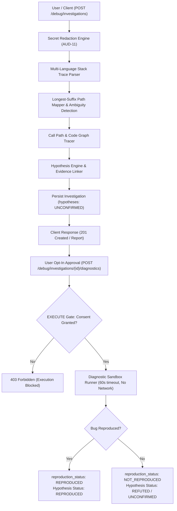
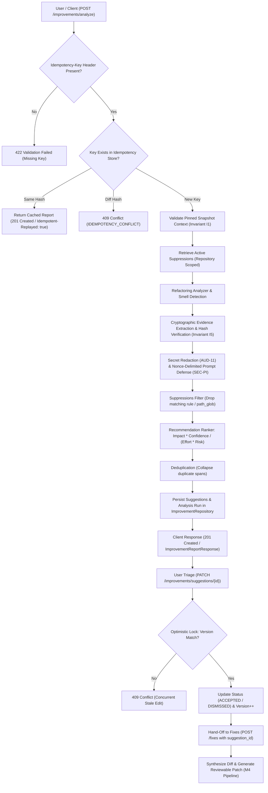
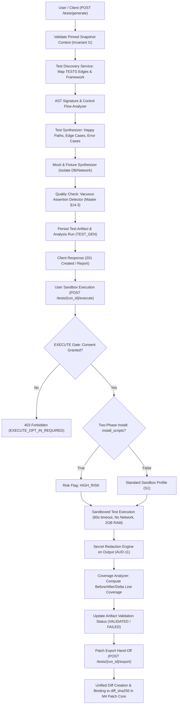

# CodePilot Agent Workflows

## Mastermind Feature 2 (M2): AI Bug Investigation Workflow

The AI Bug Investigation workflow investigates reported bugs by parsing multi-language stack traces, sanitizing secrets, performing longest-suffix file mapping, traversing the call path graph, formulating ranked root-cause hypotheses backed by cryptographic evidence references, and executing approved reproduction diagnostics in an isolated sandbox.

### Core Architecture Components

1. **Secret Redaction Engine (`ai_service/security_analysis/secret_detector.py`)**:
   - Scrubs API keys (OpenAI, Anthropic, GitHub, Google, AWS, Slack), JWTs, Bearer tokens, private keys, database connection strings, and sensitive environment variables before storage (`stack_trace_redacted`) or prompt dispatch (AUD-11 compliance).

2. **Multi-Language Stack Trace Parser (`ai_service/debugging/stack_trace_parser.py`)**:
   - Parses Python tracebacks, Node/V8 stack traces, Java stack traces, and Go panics.
   - Normalizes file paths (SEC-API-06, UT-05) and performs **longest-suffix matching** against snapshot repository files.
   - Ambiguous suffix matches are flagged and recorded as candidates rather than arbitrarily guessed.

3. **Call Path & Code Graph Tracer (`ai_service/debugging/call_path_tracer.py`)**:
   - Reconstructs end-to-end execution flow: Entrypoint -> Intermediate Callers -> Failure Site.
   - Extracts source code snippets with exact line bounds and calculates cryptographic SHA256 snippet hashes.

4. **Root-Cause Hypothesis Engine (`ai_service/debugging/hypothesis_engine.py`)**:
   - Generates ranked root cause hypotheses (Hit@1 and Hit@3 precision on AI-11 benchmark).
   - Links supporting and contradicting evidence references (`evidence_refs` with `owner_type='HYPOTHESIS'`).
   - Enforces the invariant: **status stays `UNCONFIRMED` until a reproduction diagnostic validates it**.

5. **Diagnostic Sandbox Runner & EXECUTE Gate (`sandbox/runner/diagnostic_sandbox.py`)**:
   - Enforces the **EXECUTE opt-in gate**: sandbox execution requires explicit user authorization.
   - Runs reproduction tests under strict limits: 60s hard timeout, 2GB memory cap, no network egress.
   - Updates `reproduction_status` and hypothesis status upon test completion.

---

## Mastermind Feature 3 (M3): Code Improvement Suggestions Workflow

The Code Improvement Suggestions workflow analyzes repository snapshots to discover actionable, evidence-backed improvements across Performance, Maintainability, Readability, Architecture, and Code Quality. It evaluates concrete refactorings with before/after diffs, explains trade-offs, computes multidimensional priority scores, enforces prompt-injection boundaries, supports 24-hour idempotent execution, provides optimistic-locking triage (accept/dismiss), and hands off approved suggestions directly to M4 AI-assisted code fixes.

### Core Architecture Components

1. **Refactoring Analyzer (`ai_service/improvements/refactoring_analyzer.py`)**:
   - Synthesizes before/after refactorings for quadratic loop string concatenation, linear searches on lists, high cyclomatic complexity, deeply nested conditionals, long functions, unclosed file descriptors, bare `except:` clauses, dead code, and boolean simplification.

2. **Recommendation Ranker (`ai_service/improvements/recommendation_ranker.py`)**:
   - Scores recommendations using multidimensional impact and confidence weights penalized by effort and risk factors:
     $$\text{PriorityScore} = \text{round}\left(\frac{\text{Impact} \times \text{Confidence}}{\text{Effort} \times \text{Risk}} \times 10, 2\right)$$
   - Sorts suggestions in descending order of priority score and deduplicates redundant overlapping spans.

3. **Suggestion Engine & Injection Defense (`ai_service/improvements/suggestion_engine.py`)**:
   - Enforces SEC-PI-01 through SEC-PI-08: wraps repository content in random nonce-delimited blocks (`<EVIDENCE_{nonce}>`), respects system prompt supremacy, sanitizes `@`-mentions, and scrubs secrets using `redact_secrets` (AUD-11).
   - Generates polymorphic `EvidenceRef` with SHA256 snippet hashes ensuring citation integrity (Invariant I5).
   - Evaluates active repository suppressions to respect human overrides.

4. **Improvement Repository (`backend/app/repositories/improvement_repository.py`)**:
   - Thread-safe repository managing suggestion records, reports, unified `analysis_runs` synchronization, and 24-hour idempotency replay state.
   - Enforces optimistic concurrency control (`version` integer) on suggestion edits to prevent lost updates.

5. **Fixes Hand-Off Integration (`backend/app/api/v1/fixes.py`)**:
   - Integrates M3 with M4: allows `POST /fixes` to take `suggestion_id`, auto-synthesizing the unified diff from the suggestion's before/after code blocks.

---

## Mastermind Feature 5 (M5): Unit Test Generation Workflow

The Unit Test Generation workflow synthesizes meaningful, non-vacuous unit tests for selected functions, classes, or modules by analyzing actual AST implementation logic, mapping repository test conventions via `TESTS` graph edges, isolating external dependencies with mock fixtures, verifying assertion quality (rejecting tautological/vacuous asserts), executing candidate tests under the hardened sandbox EXECUTE gate with two-phase dependency preparation, calculating before/after/delta coverage metrics, and seamlessly exporting test patches into M4 Patch Core.

### Core Architecture Components

1. **AST & Control Flow Analyzer (`ai_service/generation/test_generator.py`)**:
   - Parses target files with AST, extracting function/method signatures, parameter type annotations, return types, docstrings, branches, and raised exception types.
   - Infers boundary values (None, empty string/list/dict, 0, negative values) and custom target edge cases.

2. **Vacuous Assertion Quality Guard (`ai_service/generation/test_generator.py`)**:
   - Enforces Master Architecture Specification §14.3: analyzes generated test AST to prevent trivial or tautological asserts (`assert True`, `assert 1 == 1`, `assert x == x`) and confirms target functions are genuinely exercised.

3. **Test Discovery & Graph Mapping (`backend/app/modules/testing/test_discovery.py`)**:
   - Locates existing test files and frameworks (`pytest`, `unittest`, `jest`, `vitest`).
   - Maps `TESTS` graph edges between target symbols and existing test suites with confidence ratings (`HIGH`, `MEDIUM`, `LOW`).

4. **Sandboxed Test Runner & EXECUTE Gate (`backend/app/modules/testing/test_execution.py`)**:
   - Strictly enforces the **EXECUTE opt-in gate**: sandbox execution without `consent: {"execute": true}` returns `403 Forbidden` (`EXECUTE_OPT_IN_REQUIRED`).
   - Implements two-phase dependency preparation (Master §14.2): `install_scripts: true` marks the run as `HIGH_RISK`.
   - Isolates execution: 60s hard timeout, 2048 MB memory limit, zero network egress, and secret redaction (AUD-11) on stdout/stderr.

5. **Coverage Delta Analyzer (`backend/app/modules/testing/coverage_analyzer.py`)**:
   - Computes baseline statement coverage before tests and post-generation coverage, outputting `before`, `after`, and `delta` JSONB reports with newly covered lines.

6. **M4 Patch Core Integration (`backend/app/modules/testing/test_manager.py`)**:
   - `POST /tests/{run_id}/export` compiles the generated test suite into a unified diff bound to `diff_sha256`, registering it directly into `PatchManager` for code review, approval, and application.
