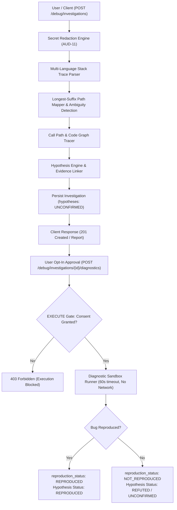

# CodePilot Agent Workflows

## Mastermind Feature 2 (M2): AI Bug Investigation Workflow

The AI Bug Investigation workflow investigates reported bugs by parsing multi-language stack traces, sanitizing secrets, performing longest-suffix file mapping, traversing the call path graph, formulating ranked root-cause hypotheses backed by cryptographic evidence references, and executing approved reproduction diagnostics in an isolated sandbox.

### Core Architecture Components

1. **Secret Redaction Engine (`ai_service/security_analysis/secret_detector.py`)**:
   - Scrubs API keys (OpenAI, Anthropic, GitHub, Google, AWS, Slack), JWTs, Bearer tokens, private keys, database connection strings, and sensitive environment variables before storage (`stack_trace_redacted`) or prompt dispatch (AUD-11 compliance).

2. **Multi-Language Stack Trace Parser (`ai_service/debugging/stack_trace_parser.py`)**:
   - Parses Python tracebacks, Node/V8 stack traces, Java stack traces, and Go panics.
   - Normalizes file paths (SEC-API-06, UT-05) and performs **longest-suffix matching** against snapshot repository files.
   - Ambiguous suffix matches are flagged and recorded as candidates rather than arbitrarily guessed.

3. **Call Path & Code Graph Tracer (`ai_service/debugging/call_path_tracer.py`)**:
   - Reconstructs end-to-end execution flow: Entrypoint -> Intermediate Callers -> Failure Site.
   - Extracts source code snippets with exact line bounds and calculates cryptographic SHA256 snippet hashes.

4. **Root-Cause Hypothesis Engine (`ai_service/debugging/hypothesis_engine.py`)**:
   - Generates ranked root cause hypotheses (Hit@1 and Hit@3 precision on AI-11 benchmark).
   - Links supporting and contradicting evidence references (`evidence_refs` with `owner_type='HYPOTHESIS'`).
   - Enforces the invariant: **status stays `UNCONFIRMED` until a reproduction diagnostic validates it**.

5. **Diagnostic Sandbox Runner & EXECUTE Gate (`sandbox/runner/diagnostic_sandbox.py`)**:
   - Enforces the **EXECUTE opt-in gate**: sandbox execution requires explicit user authorization.
   - Runs reproduction tests under strict limits: 60s hard timeout, 2GB memory cap, no network egress.
   - Updates `reproduction_status` and hypothesis status upon test completion.
